# Analiza designu – inwentarz prototypu PoleChamp v2

> Dokument: `00-research/03-analiza-designu.md` · Autor: Architekt systemu (Agent 1) · Stan: 23.10.2026
> Źródło prawdy dla wyglądu: `design/PoleChamp v2.dc.html` (1436 linii, przeczytany w całości). Pomocniczo `design/PoleChamp.dc.html` (v1), `design/_ds/nocturne-…/` (design system), `design/uploads/*.png` (9 zrzutów z uwagami).
> Szczegółowe specyfikacje ekranów: [../02-specification/05-ekrany-organizatora.md](../02-specification/05-ekrany-organizatora.md), [../02-specification/06-ekrany-sedziego.md](../02-specification/06-ekrany-sedziego.md). Design system w aplikacji: [../02-specification/09-design-system.md](../02-specification/09-design-system.md).

## 1. Charakterystyka prototypu

- Prototyp to jedna strona HTML w środowisku „x-dc”: markup z szablonami `{{ }}`, `sc-if`, `sc-for` oraz klasa logiki `Component extends DCLogic` (React) na końcu pliku.
- U góry jest przełącznik widoków: **„Organizator”** (ramka iPhone 402×874, ciemna) i **„Sędzia”** (ramka tabletu 1100×720 w poziomie). Przycisk **„Ekran startowy”** odtwarza splash. Obok logo widnieje tag „prototyp”.
- Parametry prototypu: `startView` (admin/judge), `showSplash` (true), `autoAdvance` (true – automatyczne przejście do następnej zawodniczki), `showPinHint` (true – podpowiedź PIN-ów demo).
- Wszystkie dane są lokalne (generator z ziarnem 20260914). Nie ma backendu, logowania organizatora, offline ani realtime.
- Ikony: Phosphor 2.1.1 (regular i fill). Czcionka: Inter. Liczby: `font-variant-numeric: tabular-nums`.
- Format liczb: przecinek dziesiętny, 1 miejsce po przecinku dla wyników (`fmt`: `54,3`), wagi i wartości bez zbędnych zer (`fmtShort`: `×1,5`, `−2 pkt`). Polska odmiana liczebników (`plural`: kategoria / kategorie / kategorii, zawodniczka / zawodniczki / zawodniczek).

## 2. Inwentarz ekranów i stanów

Identyfikatory `SCR-*` są wiążące dla całej dokumentacji. Ekrany „poza designem” są propozycjami (szczegóły w specyfikacji ekranów).

### 2.1 Organizator – telefon

| ID | Ekran / nakładka | Typ | W designie | Stany w designie | Wejście (akcja) |
|---|---|---|---|---|---|
| SCR-ORG-00 | Ekran startowy organizatora | pełny ekran (splash) | ✔ | animacja tancerki, pasek postępu 4,2 s, komunikaty: „Wczytywanie turniejów…” → „Synchronizacja wyników…” → „Gotowe” | uruchomienie aplikacji |
| SCR-ORG-01 | Turnieje (lista) | ekran | ✔ | lista Aktywne; sekcja Zakończone tylko gdy niepusta | po splashu, „‹ Turnieje” |
| SCR-ORG-02 | Nowy turniej | bottom sheet | ✔ | pusty formularz | przycisk „+” na SCR-ORG-01 |
| SCR-ORG-03 | Szczegóły turnieju | ekran | ✔ | status W przygotowaniu / Trwa / Zakończona; pusta lista kategorii; brak rozpoczętych kategorii | karta turnieju |
| SCR-ORG-04 | Zakończyć turniej? | bottom sheet (potwierdzenie) | ✔ | – | „Zakończ turniej” |
| SCR-ORG-05 | Nowa kategoria / Edytuj kategorię | bottom sheet | ✔ | tryb nowy / edycja | „Dodaj” w sekcji Kategorie / ikona ołówka |
| SCR-ORG-06 | Kategoria – zakładka Kryteria | ekran + zakładka | ✔ | kategoria nierozpoczęta (przycisk „Rozpocznij kategorię”) / rozpoczęta (Zakończ i zablokuj / Odblokuj + Eksport PDF) | karta kategorii |
| SCR-ORG-07 | Kategoria – zakładka Zawodniczki | zakładka | ✔ | lista; pusta: „Lista startowa jest pusta.” | segment „Zawodniczki” |
| SCR-ORG-08 | Kategoria – zakładka Wyniki | zakładka | ✔ | ranking; wiersze bez ocen „—”, „brak ocen” | segment „Wyniki” |
| SCR-ORG-09 | Nowe kryterium / Edytuj kryterium | bottom sheet | ✔ | nowy / edycja z „Usuń kryterium” | „Dodaj” / wiersz kryterium |
| SCR-ORG-10 | Nowa kara / Edytuj karę | bottom sheet | ✔ | nowa / edycja z „Usuń karę” | „Dodaj” / wiersz kary |
| SCR-ORG-11 | Nowa zawodniczka | bottom sheet | ✔ | pusty formularz | „Dodaj” w Lista startowa |
| SCR-ORG-12 | Podgląd PDF | bottom sheet | ✔ | zakres: cały turniej / kategoria | ikona PDF na SCR-ORG-03, „Eksport PDF” na SCR-ORG-06…08 |
| SCR-SYS-01 | Wybór trybu (Organizator / Tablet sędziowski) | ekran | ✘ poza designem | – | pierwsze uruchomienie instalacji |
| SCR-ORG-13 | Logowanie / rejestracja / reset hasła | ekran | ✘ poza designem | – | pierwsze uruchomienie, wylogowanie |
| SCR-ORG-14 | Sędziowie i urządzenia turnieju | ekran | ✘ poza designem | – | kafel „Sędziowie” na SCR-ORG-03 |
| SCR-ORG-15 | Nowy / Edytuj sędziego (z PIN-em) | bottom sheet | ✘ poza designem | – | SCR-ORG-14 |
| SCR-ORG-16 | Sparuj tablet (kod QR) | bottom sheet | ✘ poza designem | – | SCR-ORG-14 |
| SCR-ORG-17 | Edytuj zawodniczkę / wycofaj | bottom sheet | ✘ poza designem | – | wiersz zawodniczki na SCR-ORG-07 |
| SCR-ORG-18 | Zablokować kategorię? (ostrzeżenie o brakach) | bottom sheet | ✘ poza designem | – | „Zakończ i zablokuj” przy brakach / zaległych urządzeniach |
| SCR-ORG-19 | Oceny zawodniczki (szczegóły per sędzia) | bottom sheet | ✘ poza designem | – | wiersz rankingu na SCR-ORG-08 |
| SCR-ORG-20 | Edytuj turniej | bottom sheet | ✘ poza designem | – | nagłówek SCR-ORG-03 |
| SCR-ORG-21 | Konto (ustawienia, wylogowanie) | ekran | ✘ poza designem | – | ikona konta na SCR-ORG-01 |
| SCR-ORG-22 | Odrzucone oceny | bottom sheet | ✘ poza designem | – | baner na SCR-ORG-06…08 |

### 2.2 Sędzia – tablet (poziomo)

| ID | Ekran / nakładka | Typ | W designie | Stany w designie | Wejście |
|---|---|---|---|---|---|
| SCR-JDG-00 | Ekran startowy sędziego | splash | ✔ | „Łączenie z turniejem…” → „Pobieranie list startowych…” → „Gotowe”; podtytuł „Panel sędziego” | uruchomienie |
| SCR-JDG-01 | Panel sędziego – wybór profilu | ekran | ✔ | siatka 3 kolumn kart sędziów | po splashu, po wylogowaniu |
| SCR-JDG-02 | Panel sędziego – PIN | ekran (krok 2) | ✔ | kropki 0–4, błąd „Nieprawidłowy PIN — spróbuj ponownie”, podpowiedź demo | wybór profilu |
| SCR-JDG-03 | Kategorie („Dzień dobry, {imię}”) | ekran | ✔ | karty kategorii; nierozpoczęte przygaszone (opacity 0,55); zablokowane z ikoną kłódki; pusto: „Organizator nie dodał jeszcze kategorii do tego turnieju.” | poprawny PIN, „‹ Kategorie” |
| SCR-JDG-04 | Kategoria – kolejka (pusty panel prawy) | ekran dwupanelowy | ✔ | „Wybierz zawodniczkę z listy, aby ją ocenić.”; baner blokady w panelu bocznym | karta kategorii |
| SCR-JDG-05 | Formularz oceny | panel prawy | ✔ | nowa ocena / „Oceniono” (aktualizacja) / zablokowana (tylko podgląd) / ostatnia nieoceniona | wiersz kolejki, auto-przejście |
| SCR-JDG-06 | Parowanie tabletu | ekran | ✘ poza designem | – | pierwsze uruchomienie (brak przypisanego turnieju) |
| SCR-JDG-07 | Stan synchronizacji (szczegóły) | popover / bottom sheet | ✘ poza designem | – | wskaźnik w nagłówku |
| SCR-JDG-08 | Blokada PIN (zbyt wiele prób) | stan SCR-JDG-02 | ✘ poza designem | – | 5 błędnych PIN-ów |
| SCR-JDG-09 | Wylogować się? (niewysłane oceny) | dialog | ✘ poza designem | – | ikona wylogowania przy zaległej kolejce |
| SCR-JDG-10 | Urządzenie odłączone | ekran | ✘ poza designem | – | organizator unieważnił urządzenie |

### 2.3 Publiczne (po MVP)

| ID | Ekran | W designie | Uwagi |
|---|---|---|---|
| SCR-PUB-01 | Publiczne wyniki turnieju (web, link/QR) | ✘ poza designem | v2, propozycja w [05-ekrany-organizatora.md](../02-specification/05-ekrany-organizatora.md#scr-pub-01) |

## 3. Nawigacja

```mermaid
flowchart TD
    subgraph ORG["Organizator – telefon"]
        S1["SCR-SYS-01 Wybór trybu (pierwsze uruchomienie, poza designem)"] --> O0
        O0["SCR-ORG-00 Splash"] --> O13{"Zalogowany?"}
        O13 -- "nie (poza designem)" --> OL["SCR-ORG-13 Logowanie"]
        OL --> O1
        O13 -- tak --> O1["SCR-ORG-01 Turnieje"]
        O1 -- "+" --> O2["SCR-ORG-02 Nowy turniej"]
        O2 -- "Utwórz turniej" --> O3
        O1 -- "karta turnieju" --> O3["SCR-ORG-03 Szczegóły turnieju"]
        O3 -- "‹ Turnieje" --> O1
        O3 -- "Zakończ turniej" --> O4["SCR-ORG-04 Zakończyć turniej?"]
        O3 -- "ikona PDF" --> O12["SCR-ORG-12 Podgląd PDF"]
        O3 -- "Dodaj" --> O5["SCR-ORG-05 Nowa kategoria"]
        O3 -- "kafel Sędziowie (poza designem)" --> O14["SCR-ORG-14 Sędziowie i urządzenia"]
        O3 -- "karta kategorii" --> O6["SCR-ORG-06 Kryteria"]
        O6 <--> O7["SCR-ORG-07 Zawodniczki"]
        O7 <--> O8["SCR-ORG-08 Wyniki"]
        O6 <--> O8
        O6 -- "‹ Turniej" --> O3
        O6 -- "ołówek" --> O5e["SCR-ORG-05 Edytuj kategorię"]
        O6 -- "Dodaj / wiersz" --> O9["SCR-ORG-09 Kryterium"]
        O6 -- "Dodaj / wiersz" --> O10["SCR-ORG-10 Kara"]
        O7 -- "Dodaj" --> O11["SCR-ORG-11 Nowa zawodniczka"]
        O8 -- "Eksport PDF" --> O12
    end
    subgraph JDG["Sędzia – tablet"]
        J0["SCR-JDG-00 Splash"] --> JP{"Tablet sparowany?"}
        JP -- "nie (poza designem)" --> J6["SCR-JDG-06 Parowanie"]
        J6 --> J1
        JP -- tak --> J1["SCR-JDG-01 Wybór profilu"]
        J1 -- "karta sędziego" --> J2["SCR-JDG-02 PIN"]
        J2 -- "Zmień sędziego" --> J1
        J2 -- "poprawny PIN" --> J3["SCR-JDG-03 Kategorie"]
        J3 -- "kategoria Trwa / Zakończona" --> J4["SCR-JDG-04 Kolejka"]
        J3 -- "kategoria W przygotowaniu" --> JT["toast: Ta kategoria jeszcze się nie rozpoczęła"]
        J4 -- "wiersz zawodniczki" --> J5["SCR-JDG-05 Formularz oceny"]
        J5 -- "Zatwierdź i dalej" --> J5
        J5 -- "ostatnia ocena" --> J4
        J4 -- "‹ Kategorie" --> J3
        J3 -- "wyloguj" --> J1
    end
```

Zasady nawigacji z prototypu:
- Organizator: stos ekranów (lista → turniej → kategoria) i nakładki w formie bottom sheetów. Przy zmianie ekranu przewinięcie wraca na górę (`componentDidUpdate` zeruje `scrollTop`). Po wejściu w kategorię aktywna jest zawsze zakładka „Kryteria”.
- Sędzia: brak stosu. Nagłówek (po zalogowaniu) jest stały, a treść przełączana: kategorie ↔ kategoria (kolejka + formularz). Przy zmianie zawodniczki formularz przewija się na górę.
- Bottom sheet zamyka się przez tapnięcie w tło (strefa nad arkuszem), przycisk „×” albo akcję główną.

## 4. Komponenty użyte w designie

| Komponent | Gdzie | Charakterystyka wizualna (wartości z prototypu) |
|---|---|---|
| Przycisk primary (obrysowany) | „Utwórz turniej”, „Rozpocznij kategorię”, „Zapisz”, „Zatwierdź i dalej” | `.btn .btn-primary`: tekst i obrys 1px w kolorze accent, tło przezroczyste (w pasku przyklejonym: accent 10% nad bg). Wysokość 44–52 px, font 14–16 px / 500 |
| Przycisk secondary | „Zakończ turniej”, „Anuluj”, „Zakończ i zablokuj”, „Usuń kryterium” | obrys divider, tekst `--color-text` (lub neutral-300 dla usuń) |
| Przycisk ghost | „+ Dodaj”, „‹ Zmień sędziego” | tekst accent, bez obrysu, hover tint 10% |
| Przycisk ikonowy okrągły | „+” (40 px, ring accent), PDF i ołówek (36 px, surface + shadow-sm), „×” w arkuszu (30 px, neutral-800), wyloguj (36 px) | – |
| Link wstecz | „‹ Turnieje”, „‹ Turniej”, „‹ Kategorie” | ikona caret-left + tekst accent 15 px (13,5 px na tablecie), strefa 44 px wysokości |
| Pigułka statusu | turniej, kategoria | 11,5 px, radius 999, kropka 6 px; **Trwa**: tło accent-900, tekst accent-300, kropka accent, ring accent-800; **Zakończona**: tło neutral-900, tekst neutral-300, kropka neutral-500; **W przygotowaniu**: tło przezroczyste, tekst neutral-300, kropka neutral-600, ring divider |
| Karta turnieju (aktywna) | SCR-ORG-01 | gradient 160° accent 9% → surface, radius lg (14), shadow-sm, padding 16 |
| Wiersz listy grupowanej | Zakończone turnieje, kryteria, kary, zawodniczki, ranking | wiersze na surface rozdzielone 1 px divider (gap 1 px na tle divider), radius lg całej grupy, min. wysokość 56–60 px |
| Etykieta sekcji (kicker) | „AKTYWNE”, „KATEGORIE”, „KRYTERIA OCENY”, „KARY PUNKTOWE”, „LISTA STARTOWA”, „RANKING NA ŻYWO” | 11,5 px, wersaliki, letter-spacing 0,08 em, neutral-400 |
| Pasek postępu | karty turniejów, kategorii, postęp oceniania, ranking | tor neutral-800, wypełnienie accent (ranking: 1. miejsce accent, reszta accent-700), wysokość 3–6 px |
| Kafle statystyk | SCR-ORG-03 | siatka 3 kolumn, liczba 22 px/500, opis 11,5 px neutral-400 |
| Segmented control (zakładki) | SCR-ORG-06…08, przełącznik w prototypie | kontener surface + shadow-sm, radius 11; aktywny segment: accent 14% nad bg, tekst accent-200, ring accent-700; licznik 11 px opacity 0,7 |
| Chipy wyboru | Styl, Poziom w SCR-ORG-05 | radius 999; wybrany: accent-900, tekst accent-200, ring accent; niewybrany: bg, neutral-300, ring divider |
| Pole formularza | wszystkie arkusze | `.field` + `label` 12 px (70% tekstu), `.input` min. 44 px, 15 px, tło bg na arkuszu surface |
| Bottom sheet | wszystkie dialogi organizatora | tło surface, radius 22 px u góry, uchwyt 36×5 px neutral-700, max. wysokość 88%, backdrop neutral-900 70%, animacja wjazdu 0,26 s |
| Toast | globalnie | pigułka u dołu (28 px od krawędzi), surface + shadow-md, ikona check-circle (fill, accent), 13,5 px, znika po 2,2 s |
| Odznaka numeru startowego | listy zawodniczek, kolejka | 38×38 px, radius 11, accent-900 / accent-200 (ocenione) lub neutral-900 / neutral-200 (nieocenione w kolejce) |
| Karta profilu sędziego | SCR-JDG-01 | awatar z inicjałami 64 px (accent-900/accent-200), imię i nazwisko 15 px, „Sędzia” |
| Klawiatura PIN | SCR-JDG-02 | 3×4, klawisze 76×76 px okrągłe, surface + shadow-sm, 26 px; pusty klawisz ukryty; backspace jako ikona |
| Kropki PIN | SCR-JDG-02 | 4 × 14 px; wypełniona accent / pusta ring 1,5 px neutral-600 |
| Karta kryterium (sędzia) | SCR-JDG-05 | surface, radius lg, padding 16; nazwa 15 px/500 + odznaka wagi `×2` (accent-900/accent-300); opis 12 px; wartość 30 px accent-200 + „/10” 13 px neutral-500; −/+ 44 px okrągłe; suwak 8 px z kciukiem 28 px (accent-100 z obrysem 7 px accent) |
| Licznik kary | SCR-JDG-05 | karta surface; aktywna (licznik > 0): accent 10% nad surface + ring accent-700; −/+ 40 px; liczba 22 px; „+” przy max: opacity 0,35 |
| Pasek wyniku (stopka) | SCR-JDG-05 | tło surface 45% nad bg, linia górna z wygaszonymi końcami; „Twój wynik” 30 px + „/ 65”; chip „kary −2,0”; przycisk 52 px |
| Panel boczny kolejki | SCR-JDG-04/05 | szerokość 300 px, tło surface 45% nad bg, wiersze 60 px, aktywny wiersz accent 14% + ring accent-700 |
| Baner blokady | SCR-JDG-04/05 | accent-900, tekst accent-200, ikona lock-simple, 12 px |
| Stan pusty | SCR-ORG-03, 07; SCR-JDG-03, 04 | ikona accent (squares-four, hand-pointing), tekst 13–14 px neutral-400 |
| Tabela (PDF) | SCR-ORG-12 | `.table` Nocturne: nagłówek wersaliki 11 px, wiersze z wygaszaną linią |

## 5. Tokeny Nocturne

Pełne źródło: `design/_ds/nocturne-…/styles.css`, zasady: `readme.md`. Mapowanie na theme aplikacji mobilnej: [09-design-system.md](../02-specification/09-design-system.md).

| Grupa | Token | Wartość |
|---|---|---|
| Tło | `--color-bg` | `#161826` |
| Powierzchnia | `--color-surface` | `#232532` |
| Tekst | `--color-text` | `#e9e9ed` |
| Akcent | `--color-accent` | `#9184d9` |
| Akcent 2 (zastępczy, ta sama rola) | `--color-accent-2` | `#a7a1db` |
| Separator | `--color-divider` | `#e9e9ed` 16% (≈ `#383946` na bg, `#434450` na surface) |
| Neutral 100–900 | `--color-neutral-*` | `#f3f5fe`, `#e4e7f5`, `#cfd3e5`, `#b2b6ca`, `#9397ab`, `#75798c`, `#595d6c`, `#3f424d`, `#292b31` |
| Akcent 100–900 | `--color-accent-*` | `#f5f4ff`, `#e7e5fe`, `#d2cefd`, `#b5abfc`, `#968ae0`, `#796cbf`, `#5d5294`, `#423a6a`, `#2b2741` |
| Sekcja (tylko prezentacje) | `--color-section*` | `#262a60`, `#353b80`, `#4c5397` – **nie używać w aplikacji** |
| Czcionka | `--font-heading`, `--font-body` | Inter; nagłówki waga 500 (nigdy grubsze) |
| Odstępy (gęstość 0,7×) | `--space-1/2/3/4/6/8` | 2,8 / 5,6 / 8,4 / 11,2 / 16,8 / 22,4 px |
| Promienie | `--radius-sm/md/lg` | 4 / 8 / 14 px (design używa też 11, 12, 16, 22 i 999) |
| Cienie | `--shadow-sm` | `0 0 0 1px #3f424d` (krawędź) |
| | `--shadow-md` | `0 0 0 1px #595d6c, 0 6px 18px rgba(0,0,0,.55)` |
| | `--shadow-lg` | `0 0 0 1px #9397ab, 0 16px 40px rgba(0,0,0,.65)` |
| Typografia bazowa | body | 15 px / 1,55; h1 42, h2 32, h3 25, h4 20 (prototyp nadpisuje rozmiary: h1 26–32, h2 24) |
| Stany | focus | `outline: 2px solid accent; offset 2px`; disabled: opacity 0,45 |

Zasady Nocturne istotne dla aplikacji: przyciski **obrysowane, nie wypełnione**; akcent jako linia i poświata, **nigdy jako zalanie dużej powierzchni**; brak czystej czerni i bieli; separatory wygaszane na końcach (48 px); hierarchia przez rozmiar i odstęp, nie przez pogrubienie; ikony Phosphor; motywowane stany hover/pressed/focus.

## 6. Uwagi z przeglądu designu (`uploads/`)

Wszystkie 9 zrzutów pochodzi z **wcześniejszej iteracji (v1)**: widać przełącznik „Panel administratora / Panel sędziego”, tagi „Pole Sport / Beginner / Przygotowanie” i przecinki zapisane kropką („54.3”). Czerwone zaznaczenia to uwagi recenzenta. Każdą uwagę zinterpretowano, sprawdzono w v2 i zamieniono w regułę UI (`UI-xx`), na którą powołują się wymagania niefunkcjonalne ([NFR-2xx](../02-specification/08-wymagania-niefunkcjonalne.md)) i opisy ekranów.

| Plik | Co pokazuje zrzut (v1) | Interpretacja uwagi | Stan w v2 | Wynikające wymaganie / reguła |
|---|---|---|---|---|
| `draw-07bb170b-….png` | Kategoria „test” (Przygotowanie), zakładki Kryteria / Uczestniczki / Wyniki; zakreślona zakładka **„Wyniki”** | Zakładka Wyniki w kategorii nierozpoczętej jest niejasna: nie wiadomo, co pokaże, a w v1 tabela miała emoji medali i była nieczytelna. Możliwa też uwaga o kontraście / wyrównaniu etykiety | ✔ Rozwiązane: zakładka „Wyniki” z listą „Ranking na żywo”, wiersze bez ocen pokazują „—” i „brak ocen”, pod listą objaśnienie wzoru | **UI-01:** Zakładka Wyniki jest dostępna w każdym statusie. Bez ocen pokazuje wiersze z „—”/„brak ocen” (design), bez emoji, z objaśnieniem wzoru i reguły remisu |
| `draw-145da932-….png` | Szczegóły turnieju zakończonego; zakreślony pełnej szerokości przycisk **„Turniej zakończony”** | Element wygląda jak przycisk, a nic nie robi (w v1 handler był pusty). Status nie powinien udawać akcji | ✔ Rozwiązane: dla statusu Zakończona przycisk akcji jest ukryty (`tournamentCanAct = false`), status pokazuje pigułka | **UI-02:** Statusy prezentujemy pigułką/tekstem, nigdy jako przycisk. Akcje niedostępne w danym stanie są ukryte (albo nieaktywne z wyjaśnieniem). ⚠ W v2 na zakończonym turnieju nadal widać „+ Dodaj” w sekcji Kategorie – do usunięcia (FR-208) |
| `draw-1721c70f-….png` | Tablet sędziego, kategoria zablokowana; **cały ekran zakreślony**: baner „Kategoria zablokowana — podgląd bez możliwości edycji.”, a pod nim aktywnie wyglądające suwaki (systemowe niebieskie kciuki), −/+, przyciski kar, ucięte opisy kryteriów („Siła, elementy na ru…”), „/ 10” zawinięte, widoczny pasek przewijania | Tryb tylko-do-odczytu był nieczytelny i niespójny: wyglądał na edytowalny, tekst się ucinał i nachodził na siebie, kontrolki nie były ostylowane | ✔ Rozwiązane: układ dwupanelowy (kolejka + formularz), baner „Kategoria zablokowana — tylko podgląd” w panelu bocznym, formularz przygaszony (opacity 0,55) i nieinteraktywny, stopka z „Zatwierdź” ukryta, własny styl suwaka, ukryte paski przewijania | **UI-03:** Stan tylko-do-odczytu: kontrolki nieaktywne i wizualnie przygaszone, brak akcji zatwierdzenia, jeden jednoznaczny baner. **UI-04:** Wszystkie kontrolki w stylu Nocturne (zero domyślnych stylów systemowych). **UI-05:** Teksty nie mogą się nakładać – długie linie ucinane wielokropkiem albo zawijane w przewidzianym miejscu |
| `draw-189563b9-….png` | Kategoria „test”: zakreślone zakładki i pierwsza karta kryterium „Technika” (tylko „×”, bez edycji) | Zakładki pod przyciskiem „Rozpocznij kategorię” i ze stanem aktywnym „zalanym” akcentem łamały zasady Nocturne. Karta kryterium z samym „×” daje usuwanie jednym tapnięciem i nie pokazuje, że można edytować | ✔ Rozwiązane: zakładki tuż pod nagłówkiem i statusem, aktywny segment jako tint + ring (bez zalania), akcja startu przeniesiona do przyklejonego dolnego paska; wiersze kryteriów z chevronem otwierają arkusz edycji, „Usuń kryterium” jest w arkuszu | **UI-06:** Akcje destrukcyjne nie występują inline na listach – tylko w arkuszu edycji (z potwierdzeniem, FR-305). **UI-07:** Element edytowalny ma afordancję (chevron). **UI-08:** Stan aktywny = tint + obrys, nie zalanie |
| `draw-4718409e-….png` | Kategoria „Exotic Pro”: zakreślony systemowy pasek przewijania wystający poza ramkę telefonu | Pasek przewijania psuje wygląd i wychodzi poza obszar ekranu | ✔ Rozwiązane: `[data-scroll] { scrollbar-width: none }` | **UI-09:** Bez widocznych systemowych pasków przewijania w kontenerach treści (natywnie: `showsVerticalScrollIndicator={false}` tam, gdzie lista jest krótka i ma wyraźne granice). Treść nie wychodzi poza bezpieczny obszar |
| `draw-620e569c-….png` | Kategoria „Pole Sport Advanced”: link **„‹ Turnie[j]”** nachodzi na godzinę „9:41” na pasku statusu; tag „Pole Sport” zawinięty w dwie linie; „Panel administratora” zawinięte w przełączniku | Treść nie respektuje bezpiecznego obszaru (status bar, Dynamic Island); etykiety zawijają się w miejscach, gdzie nie powinny | ✔ Rozwiązane: górny odstęp 54 px + wiersz nawigacji 44 px; tagi zastąpione linią meta „Pole Sport · Advanced · Senior 18+”; etykiety `white-space: nowrap` | **UI-10:** Wszystkie ekrany respektują safe area (iOS: notch/Dynamic Island, home indicator; Android: status bar, gesture bar) – `react-native-safe-area-context`. **UI-11:** Pigułki, chipy i przyciski nie zawijają tekstu |
| `draw-7df0e943-….png` | Formularz oceny (Zofia Kowalczyk, nr 21): zakreślone kary „Upadek ×0 (−0.0)” i „Przekroczenie czasu ×0 (−0.0)” z małymi −/+ oraz komentarz, na który nachodzi napis „Suma z tego formularza: 54.3” | Zapis kary jako „×0 (−0.0)” jest nieczytelny, brak informacji o wartości i limicie. Pływająca suma zasłania pole komentarza | ✔ Rozwiązane: karta kary z nazwą, opisem „−2 pkt za każde · maks. 3×”, dużą liczbą wystąpień i −/+ (plus nieaktywny przy limicie); suma w stałej stopce „Twój wynik 54,3 / 65” poza obszarem przewijania | **UI-12:** Kara = licznik z widoczną wartością za wystąpienie i limitem; „+” nieaktywny przy limicie. **UI-13:** Podsumowanie i akcja główna w stałej stopce, która nie zasłania treści |
| `draw-b6f0ad4f-….png` | Kategoria „test”: zakreślona karta „Technika” (tylko „×”), meta „waga × 2 · skala 0– 10” z błędnymi odstępami | Niespójna afordancja edycji (w innej iteracji był ołówek – `draw-07bb170b`) i nieporządny zapis wagi i skali | ✔ Rozwiązane: jednolity wiersz – nazwa, „Skala 0–10”, odznaka „×2”, chevron | **UI-14:** Jednolity wzorzec wiersza konfiguracyjnego: nazwa, podtytuł, odznaka wartości, chevron. Liczby z poprawną typografią (półpauza w zakresach, znak „×”, „−” zamiast dywizu, przecinek dziesiętny) |
| `draw-ec4d7712-….png` | Formularz oceny: nazwisko „Zofia Kowalczyk” zawinięte i **nachodzące na nazwę klubu**; zakreślone kary-przełączniki „Upadek ×2 (−4.0)” | Nagłówek zawodniczki źle się łamie. Kara jako jeden przycisk-przełącznik nie pozwala zmniejszyć licznika i jest niejasna | ✔ Rozwiązane: nagłówek w układzie flex (`min-width: 0`), nazwisko w jednej linii z wielokropkiem, klub w osobnej linii; kary jako liczniki −/+ | **UI-05** (j.w.) oraz **UI-12** (j.w.). Dodatkowo **UI-15:** nazwiska zawodniczek wszędzie w jednej linii z wielokropkiem, a pełna wartość jest dostępna dla czytnika ekranu |

**Weryfikacja przykładu z uwag:** suma z formularza na `draw-7df0e943` („54.3”) wynika z not 8,5 / 8,5 / 8 / 8 / 8,5 i wag 2 / 1,5 / 1 / 1 / 1: 17 + 12,75 + 8 + 8 + 8,5 = **54,25 → 54,3**. Na `draw-ec4d7712` z karą Upadek ×2 (−4,0) wychodzi **50,25 → 50,3**. Oba wyniki zgadzają się z logiką v2 (`fmt` zaokrągla do 0,1). Szczegóły: [07-reguly-punktacji.md §6](../02-specification/07-reguly-punktacji.md#6-przykłady-liczbowe).

## 7. Różnice v1 → v2 (istotne dla specyfikacji)

| Obszar | v1 | v2 (obowiązuje) |
|---|---|---|
| Nazwy ról w przełączniku | „Panel administratora”, „Panel sędziego” | „Organizator”, „Sędzia” |
| Zakładka uczestników | „Uczestniczki” | „Zawodniczki” (nagłówek listy: „Lista startowa”) |
| Status kategorii/turnieju | tagi | pigułki z kropką |
| Usuwanie kryterium/kary | „×” w wierszu | „Usuń kryterium” / „Usuń karę” w arkuszu edycji |
| Dodawanie zawodniczki | formularz inline | bottom sheet „Nowa zawodniczka” |
| PIN | przycisk „Zaloguj” | automatyczne zatwierdzenie po 4. cyfrze |
| Ocena | jeden ekran, „‹ Lista uczestniczek”, „Suma z tego formularza” | dwa panele (kolejka + formularz), „Twój wynik … / max”, auto-przejście |
| Kary w formularzu | przyciski-przełączniki „×n (−x)” | liczniki −/+ z limitem |
| Ranking | tabela z medalami (emoji) | lista z kolorem pozycji, paskiem i „n/5 sędziów” |
| Eksport | „Eksportuj wyniki całego turnieju” (przycisk na dole) | ikona PDF w nagłówku + „Eksport PDF” w kategorii + „Podgląd PDF” |
| Postęp | brak | paski postępu na kartach, „Postęp oceniania”, „x/y ocen” |
| Splash | brak | animacja pixel-art (pole-spinner.js) + komunikaty ładowania |
| Liczby | kropka dziesiętna („54.3”) | przecinek („54,3”) |
| Toasty | „Kategoria rozpoczęta — sędziowie mogą teraz oceniać”, „Zmieniono status…” | krótkie: „Kategoria rozpoczęta”, „Kategoria zakończona”, „Kategoria odblokowana” |

## 8. Dane przykładowe z prototypu

Dane pochodzą z generatora w prototypie. Liczby policzono, uruchamiając jego logikę (`buildSeed`) skryptem pomocniczym.

### 8.1 Turnieje

| ID | Nazwa | Status | Data | Miejsce | Kategorie | Zawodniczki | Postęp |
|---|---|---|---|---|---|---|---|
| t1 | Mistrzostwa Polski Pole Sport 2026 | Trwa | 3–4 października 2026 | Warszawa, Hala Torwar | 8 | 61 | **173 z 215 ocen (80%)** |
| t2 | Puchar Wiosny PoleChamp | W przygotowaniu | 18 kwietnia 2027 | Poznań, Arena | 3 | 20 | 0 z 0 („Brak rozpoczętych kategorii”) |
| t3 | Zimowy Puchar PoleChamp | Zakończona | 8 lutego 2026 | Kraków, Tauron Arena | 4 | 33 | 165 z 165 (100%) |
| t4 | Otwarte Mistrzostwa Śląska | Zakończona | 22 listopada 2025 | Katowice, Spodek | 3 | 20 | 100 z 100 (100%) |

### 8.2 Kategorie turnieju t1

| ID | Nazwa | Styl · Poziom · Grupa | Status | Zawodniczki | Oceny |
|---|---|---|---|---|---|
| c1 | Pole Sport Beginner | Pole Sport · Beginner · Senior 18+ | Zakończona (zablokowana) | 9 | 45/45 |
| c2 | Pole Sport Intermediate | Pole Sport · Intermediate · Senior 18+ | Zakończona (zablokowana) | 10 | 50/50 |
| c3 | Pole Sport Advanced | Pole Sport · Advanced · Senior 18+ | Trwa | 9 | 30/45 |
| c4 | Pole Sport Junior | Pole Sport · Intermediate · Junior 12–15 | Trwa | 7 | 24/35 |
| c5 | Pole Art Intermediate | Pole Art · Intermediate · Open | Trwa | 8 | 24/40 |
| c6 | Pole Art Masters | Pole Art · Advanced · Masters 40+ | W przygotowaniu | 5 | 0/25 |
| c7 | Exotic Pro | Exotic · Pro · Open | W przygotowaniu | 7 | 0/35 |
| c8 | Exotic Elite | Exotic · Elite · Open | W przygotowaniu | 6 | 0/30 |

### 8.3 Kryteria i kary (domyślne)

| Kryterium | Skala | Waga | Opis dla sędziów |
|---|---|---|---|
| Technika | 0–10 | ×2 | Siła, elementy na rurze |
| Artyzm / interpretacja muzyki | 0–10 | ×1,5 | Muzykalność i wyraz |
| Choreografia | 0–10 | ×1 | Struktura i pomysłowość układu |
| Praca na podłodze *(tylko styl Exotic, 4. pozycja)* | 0–10 | ×1 | Floorwork i przejścia parterowe |
| Płynność i przejścia | 0–10 | ×1 | Płynność ruchu i transferów |
| Wrażenie ogólne | 0–10 | ×1 | Ogólne wrażenie sceniczne |

Maksymalny wynik sędziego: **65 pkt** (Pole Sport, Pole Art, Doubles) oraz **75 pkt** (Exotic).

| Kara | Punkty za 1 raz | Maks. wystąpień |
|---|---|---|
| Upadek | 2 | 3 |
| Przekroczenie czasu | 1 | 2 |

Słowniki: Styl = {Pole Sport, Pole Art, Exotic, Doubles}; Poziom = {Beginner, Intermediate, Advanced, Pro, Elite}; Grupa wiekowa – tekst (domyślnie „Open”; w danych: Senior 18+, Junior 12–15, Masters 40+, Open).

### 8.4 Sędziowie (dane demo)

| ID | Imię i nazwisko | PIN (demo) |
|---|---|---|
| jA | Katarzyna Nowak | 1234 |
| jB | Michał Woźniak | 2345 |
| jC | Aleksandra Kot | 3456 |
| jD | Tomasz Zając | 4567 |
| jE | Joanna Wrona | 5678 |

PIN-y demo są trywialne i wyświetlane w podpowiedzi „Demo · PIN-y: …”. W produkcie są **zabronione** (patrz [05-bezpieczenstwo.md](../01-architecture/05-bezpieczenstwo.md)).

### 8.5 Zawodniczki i numery startowe

Imiona i nazwiska są losowane z list (np. Natalia Sikora, Amelia Król, Magdalena Kaczmarek), kluby z 12 studiów (np. „Aerial Dreams Warszawa”, „PoleFit Kraków”, „Studio Vertical Wrocław”, „Spin City Poznań”). Numery startowe są unikalne w całym zbiorze: kategoria nr *n* zaczyna od `1 + (n−1)·20` (c3 ma numery 41–49). Komentarze przykładowe: „Bardzo pewny występ.”, „Świetna muzykalność.”, „Do poprawy praca na podłodze.” itd.

### 8.6 Ranking przykładowy – c3 „Pole Sport Advanced” (Trwa)

| Poz. | Nr | Zawodniczka | Klub | Wynik (wyświetlany) | Wartość dokładna | Sędziowie |
|---|---|---|---|---|---|---|
| 1 | 47 | Natalia Sikora | Studio Vertical Wrocław | 55,5 | 55,5 | 3/5 |
| 2 | 46 | Paulina Lewandowska | Aerial Dreams Warszawa | 55,1 | 55,125 | 2/5 |
| 3 | 43 | Amelia Król | Pole Passion Gdańsk | 54,8 | 54,75 | 5/5 |
| 4 | 45 | Magdalena Kaczmarek | Fly High Lublin | 54,3 | 54,3 | 5/5 |
| 5 | 42 | Agnieszka Mazur | PoleFit Kraków | 52,7 | 52,7 | 5/5 |
| 6 | 41 | Zuzanna Król | Aerial Dreams Warszawa | 52,7 | 52,65 | 5/5 |
| 7 | 44 | Magdalena Adamczyk | Vertigo Bydgoszcz | 48,0 | 48,0 | 5/5 |
| 8 | 48 | Lena Mazur | Aerial Dreams Warszawa | — | – | brak ocen |
| 9 | 49 | Weronika Walczak | Pole Dance Academy Rzeszów | — | – | brak ocen |

Ten przykład ujawnia dwie luki logiki (G-26, G-28 niżej): pozycje 5 i 6 pokazują ten sam wynik „52,7”, a mają różne miejsca; liderka ma oceny tylko od 3 z 5 sędziów.

## 9. Luki i niejasności designu – propozycje

Propozycje są spójne z Nocturne (bottom sheet, obrysowane przyciski, pigułki, toasty). Każda luka ma powiązanie z wymaganiem.

| ID | Luka / niejasność | Propozycja | Powiązania |
|---|---|---|---|
| G-01 | Brak logowania, rejestracji i resetu hasła organizatora | Ekran SCR-ORG-13 w stylu splashu (logo, pola e-mail/hasło, „Zaloguj się”, „Załóż konto”, „Nie pamiętasz hasła?”) | FR-101…107 |
| G-02 | Brak zarządzania sędziami i PIN-ami (kafel „Sędziowie” nie jest klikalny) | Kafel staje się wejściem do SCR-ORG-14; dodawanie sędziego generuje losowy PIN pokazany raz | FR-501…503 |
| G-03 | Splash sędziego zakłada, że tablet „wie”, jaki to turniej | Parowanie tabletu kodem QR / 8-znakowym kodem (SCR-ORG-16 → SCR-JDG-06) | FR-504, ADR-005 |
| G-04 | Wiersze zawodniczek nie są klikalne – brak edycji, wycofania, usuwania, zmiany kolejności | SCR-ORG-17 z polami jak w SCR-ORG-11 + „Wycofaj zawodniczkę” / „Usuń” | FR-403, FR-404 |
| G-05 | Brak edycji i usuwania turnieju | Ikona ołówka obok ikony PDF w SCR-ORG-03 → SCR-ORG-20; „Usuń turniej” tylko w statusie W przygotowaniu bez ocen | FR-203, FR-204 |
| G-06 | Brak usuwania kategorii | „Usuń kategorię” w arkuszu edycji (SCR-ORG-05), tylko W przygotowaniu | FR-303 |
| G-07 | Komentarze sędziów i noty cząstkowe nie są nigdzie widoczne dla organizatora | Tapnięcie wiersza rankingu → SCR-ORG-19 „Oceny zawodniczki” (sumy sędziów, kary, komentarze, historia zmian) | FR-707, FR-902 |
| G-08 | Brak wskaźników offline i synchronizacji | Pigułka stanu w nagłówku sędziego + ikony stanu w kolejce; baner offline u organizatora | FR-803, FR-807 |
| G-09 | Brak stanów ładowania i błędów (poza pustymi listami) | Szkielety (skeleton) kart, toast błędu z ikoną warning-circle w accent-300, „Spróbuj ponownie” | NFR-205 |
| G-10 | Brak wyników publicznych / dla zawodniczek | SCR-PUB-01 w v2 | FR-709 |
| G-11 | „Zakończ i zablokuj” działa natychmiast, bez ostrzeżenia o brakujących ocenach czy niewysłanych danych z tabletów | SCR-ORG-18 pokazywany tylko wtedy, gdy są braki lub zaległe urządzenia | FR-309, ADR-010 |
| G-12 | Usuwanie kryterium/kary bez potwierdzenia | Potwierdzenie w tym samym arkuszu (drugi krok: „Usunąć kryterium „Technika”?” + „Usuń” / „Anuluj”) | FR-305, FR-307 |
| G-13 | Pigułka turnieju używa form żeńskich („Zakończona”) – niegramatycznie dla „turniej” | Zachować design (wspólne etykiety). Rekomendacja dla PO: „Zakończony” dla turnieju – **pytanie otwarte Q-07** | 10-glosariusz |
| G-14 | Zakończony turniej nadal pokazuje „+ Dodaj” kategorię. Kryteria i kary edytowalne w kategoriach Trwa/Zakończona | Turniej Zakończona: tylko odczyt. Kryteria i kary: edycja tylko w W przygotowaniu; po starcie wiersze bez chevronu, arkusz w trybie podglądu, nad listą informacja „Kryteria są zablokowane po rozpoczęciu kategorii.” | FR-208, FR-305, FR-307 |
| G-15 | Data turnieju to wolny tekst („12 kwietnia 2027”) | Wybór daty (1 dzień lub zakres) natywnym pickerem; wyświetlanie jak w designie („3–4 października 2026”) | FR-202 |
| G-16 | Zmiana wag/skal po rozpoczęciu zmieniałaby istniejące oceny | Jak G-14 – blokada konfiguracji po starcie | ADR-006 |
| G-17 | Podpowiedź „Demo · PIN-y” | Tylko w buildzie demo (`showPinHint`), w produkcji wyłączona | NFR-410 |
| G-18 | Nowy formularz ma wszystkie kryteria ustawione na połowę skali (5,0), co może zakotwiczać ocenę i łatwo zatwierdzić coś niezmienionego | MVP zgodnie z designem (5,0). Proponowany wskaźnik „nieruszone” (kropka przy wartości) do decyzji PO – **Q-03** | FR-603 |
| G-19 | „Zakończ i zablokuj” łączy dwa pojęcia (status Zakończona = locked) | Przyjmujemy 1:1: status kategorii LOCKED wyświetlany jako „Zakończona”; „Odblokuj” → „Trwa” | 02-model-danych |
| G-20 | „Rozpocznij kategorię” działa nawet przy turnieju W przygotowaniu | Start kategorii automatycznie rozpoczyna turniej (toast „Kategoria rozpoczęta”) | FR-308 |
| G-21 | Można rozpocząć kategorię bez kryteriów, zawodniczek i sędziów | Walidacja przy starcie z komunikatem w toaście (np. „Dodaj co najmniej jedną zawodniczkę”) | FR-308 |
| G-22 | Terminologia żeńska („Zawodniczki”) wyklucza kategorie męskie (występują w polskich zawodach [S9]) | MVP: teksty jak w designie, wszystkie przez klucze i18n. **Q-06** dla PO (np. „Zawodnicy”) | NFR-601 |
| G-23 | Wylogowanie sędziego bez potwierdzenia, nawet przy niewysłanych ocenach | SCR-JDG-09 tylko przy niepustej kolejce wysyłki | FR-808 |
| G-24 | „PDF zapisany (demo)” – brak realnego zapisu | Generowanie po stronie serwera, systemowy arkusz udostępniania; toast „PDF zapisany” | FR-705, ADR-009 |
| G-25 | Organizator nie widzi stanu tabletów | Sekcja „Urządzenia” w SCR-ORG-14 | FR-505 |
| G-26 | Dwa wyniki „52,7” z różnymi miejscami (52,70 vs 52,65) | Ranking liczony na pełnej precyzji. Gdy sąsiednie wiersze mają ten sam wynik po zaokrągleniu do 0,1, a różne miejsca, pokazujemy 2 miejsca po przecinku | 07-reguly-punktacji §4 |
| G-27 | Przyciski −/+ kar mają 40 px (< 44 pt rekomendowanych dla dotyku) | Wizualnie 40 px, strefa dotyku 44×44 (hitSlop) | NFR-203 |
| G-28 | Ranking na żywo miesza wyniki kompletne i częściowe (liderka 3/5 sędziów) | Zachowujemy etykietę „3/5 sędziów” (design) i dodajemy pigułkę „wstępny” przy niekompletnych wynikach w zablokowanej kategorii i w PDF | FR-704 |
| G-29 | Brak wyszukiwania na długich listach (61 zawodniczek w turnieju) | Should: pole wyszukiwania nad listą startową (≥ 15 pozycji) | FR-401 |
| G-30 | Tablet zaprojektowany tylko w poziomie (1100×720) | MVP: wymuszona orientacja pozioma w trybie sędziego. Pionowa: panel kolejki jako wysuwana szuflada (v1.1) | NFR-702 |
| G-31 | Wiersze rankingu bez ocen mają numer pozycji (8, 9) | Decyzja: wiersze bez ocen pokazują „–” zamiast numeru (logika), reszta wyglądu bez zmian | 07-reguly-punktacji §5 |
| G-32 | Brak sygnału, że ocena została tylko zapisana lokalnie | Ikona zegara (Phosphor `clock`) w wierszu kolejki do czasu potwierdzenia przez serwer | FR-602 |
