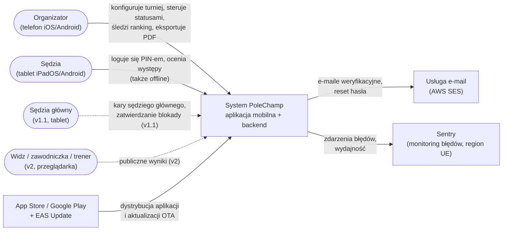
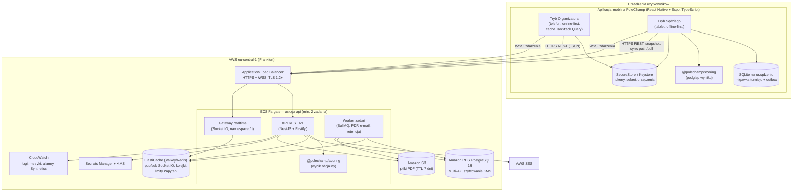
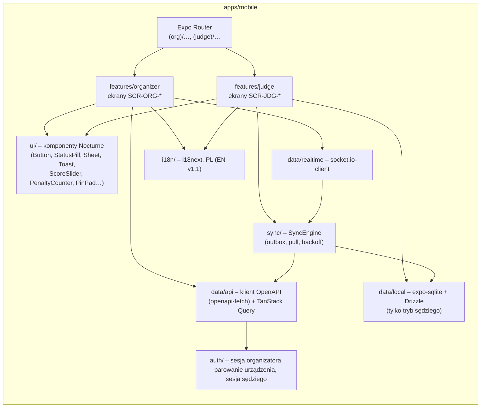

# Przegląd architektury PoleChamp

> Dokument: `01-architecture/01-przeglad-architektury.md` · Autor: Architekt systemu (Agent 1) · Wersja 1.0 · 23.10.2026
> Powiązane: [02-model-danych.md](02-model-danych.md) · [03-api.md](03-api.md) · [04-przeplywy-danych.md](04-przeplywy-danych.md) · [05-bezpieczenstwo.md](05-bezpieczenstwo.md) · [06-offline-i-synchronizacja.md](06-offline-i-synchronizacja.md) · [ADR](adr/) · [99-przekazanie-dla-tech-leada.md](99-przekazanie-dla-tech-leada.md)

## 1. Cel systemu i założenia

PoleChamp to system do prowadzenia turniejów pole dance i oceniania występów:
- **Organizator** na telefonie zakłada turnieje, kategorie, kryteria z wagami, kary, listy startowe i sędziów, steruje statusami (start, blokada, zakończenie), śledzi postęp i ranking na żywo oraz eksportuje wyniki do PDF.
- **Sędzia** na tablecie (w sali, często bez stabilnego internetu) loguje się 4-cyfrowym PIN-em i ocenia kolejne zawodniczki suwakami kryteriów oraz licznikami kar.

Kluczowe właściwości architektoniczne (szczegóły: [NFR](../02-specification/08-wymagania-niefunkcjonalne.md)):

| Właściwość | Znaczenie | Jak ją osiągamy |
|---|---|---|
| **Odporność na brak sieci w sali** | Ocenianie nie może stanąć przez Wi-Fi | Tablet offline-first: lokalna baza SQLite, kolejka wysyłki (outbox), idempotentne komendy ([ADR-004](adr/ADR-004-offline-first-tablet.md)) |
| **Integralność wyników** | Wynik oficjalny liczony jednoznacznie, bez manipulacji | Serwer jest źródłem prawdy. Silnik punktacji to współdzielona biblioteka TS na arytmetyce stałoprzecinkowej, audyt każdej zmiany ([ADR-006](adr/ADR-006-model-punktacji-i-agregacji.md), [ADR-011](adr/ADR-011-monorepo-i-wspoldzielony-silnik-punktacji.md)) |
| **Szybkość pracy sędziego** | Ocena występu w < 60 s, zero oczekiwania na sieć | Zapis lokalny < 100 ms, auto-przejście do kolejnej zawodniczki |
| **Na żywo u organizatora** | Postęp i ranking aktualizują się same | Kanał WebSocket (Socket.IO) z sygnałami unieważnienia ([ADR-003](adr/ADR-003-styl-api-rest-i-websocket.md)) |
| **Prywatność (RODO)** | Dane zawodniczek, w tym niepełnoletnich | Minimalizacja danych, hosting w UE, umowa powierzenia, retencja ([05-bezpieczenstwo.md](05-bezpieczenstwo.md)) |
| **Jedna baza kodu** | iOS + Android, telefon + tablet | React Native (Expo), jedna aplikacja z dwoma trybami ([ADR-001](adr/ADR-001-aplikacja-mobilna-react-native-expo.md)) |

## 2. Kontekst systemu (C4 – poziom 1)

## 3. Kontenery (C4 – poziom 2)

| Kontener | Technologia | Odpowiedzialność | Skalowanie |
|---|---|---|---|
| Aplikacja mobilna | React Native 0.88 (Expo SDK 58 – weryfikacja Tech Leada, [98-weryfikacja-tech-leada.md §3](98-weryfikacja-tech-leada.md#3-potwierdzone-wersje-technologii)), TypeScript 6.0, Expo Router | UI obu trybów, lokalna baza sędziego, kolejka wysyłki, podgląd wyniku | – |
| API REST | Node.js 26 LTS, NestJS 12 (adapter Fastify 5), Drizzle ORM, zod 4 (Standard Schema – [ADR-012](adr/ADR-012-kontrakty-walidacja-i-openapi.md)) | Logika domenowa, autoryzacja, walidacja, przeliczanie wyników, idempotencja, audyt | poziome (ECS, 2–6 zadań) |
| Gateway realtime | Socket.IO 4 + adapter Redis | Pokoje per turniej/kategoria, rozgłaszanie zdarzeń po zmianach | poziome (adapter Redis, transport tylko WebSocket – bez sticky sessions) |
| Worker | BullMQ (ten sam obraz, osobny proces/zadanie ECS) | Generowanie PDF, e-maile, zadania retencji RODO, przeliczenia awaryjne | 1–2 zadania |
| Baza danych | PostgreSQL 18 (RDS Multi-AZ) | Dane domenowe, audyt, dziennik zmian (`change_log`) do synchronizacji | pionowe + read replica (v2) |
| Cache / kolejki | ElastiCache Valkey (zgodny z Redis) | Pub/sub dla Socket.IO, BullMQ, rate limiting, blokady prób PIN | – |
| Magazyn plików | S3 (szyfrowanie SSE-KMS, lifecycle 7 dni) | Wygenerowane PDF-y, linki podpisane (15 min) | – |
| Publiczne wyniki (v2) | decyzja odroczona (Expo Router web lub statyczne strony z CDN) | Tylko odczyt wyników opublikowanych przez organizatora | CDN |
| Strony statyczne (uzupełnienie TL-39) | S3 + CloudFront (domena `polechamp.app`) | Regulamin, polityka prywatności, umowa powierzenia (wersjonowane), strona wniosku o usunięcie konta (wymóg Google Play), pliki `/.well-known/apple-app-site-association` i `/.well-known/assetlinks.json` dla linków uniwersalnych (reset hasła), strona zapasowa „Otwórz w aplikacji” | CDN |
| Narzędzia operatora (uzupełnienie TL-38) | skrypty CLI w `apps/api/src/cli` uruchamiane jako jednorazowe zadania ECS (`ecs run-task`) | MVP nie ma panelu operatora: utworzenie turnieju do przeglądu App Store (długoważny kod parowania), wyłączenie logowania offline turnieju (`allow_offline_pin_login`), ręczne uruchomienie retencji, eksport danych osoby (wniosek RODO), odblokowanie konta. Każde wywołanie zapisuje `audit_log` z `actor_type = SYSTEM` i identyfikatorem operatora | – |

## 4. Komponenty

### 4.1 Aplikacja mobilna (monorepo `apps/mobile`)

- **Wybór trybu**: przy pierwszym uruchomieniu ekran wyboru: „Jestem organizatorem” (logowanie, SCR-ORG-13) / „Tablet sędziowski” (parowanie, SCR-JDG-06) – teksty wg [SCR-SYS-01](../02-specification/05-ekrany-organizatora.md#scr-sys-01--wybór-trybu-przy-pierwszym-uruchomieniu--poza-designem--propozycja). Tryb jest zapamiętywany per instalacja. Telefon może działać w trybie sędziego tylko w buildzie deweloperskim (MVP: tryb sędziego wymaga tabletu – najmniejszy wymiar ekranu ≥ 600 dp i szerokość w poziomie ≥ 1024 dp – [NFR-702](../02-specification/08-wymagania-niefunkcjonalne.md)).
- **Organizator jest online-first**: odczyty z cache (persystowany TanStack Query, MMKV), zapisy wymagają sieci ([FR-807](../02-specification/03-wymagania-funkcjonalne.md)).
- **Sędzia jest offline-first**: UI czyta wyłącznie z lokalnej bazy SQLite, a zapisy idą do outboxu. `SyncEngine` w tle wysyła i pobiera zmiany ([06-offline-i-synchronizacja.md](06-offline-i-synchronizacja.md)).

### 4.2 Backend (monorepo `apps/api`)

| Moduł NestJS | Zakres | Główne encje |
|---|---|---|
| `auth` | Rejestracja, logowanie, refresh, reset hasła, JWT, guardy ról | `app_user`, `auth_refresh_token` |
| `tournaments` | CRUD turniejów, przejścia statusów, statystyki, postęp | `tournament` |
| `categories` | Kategorie, kryteria, kary, szablony stylów, start/blokada/odblokowanie | `category`, `criterion`, `penalty_type` |
| `entries` | Zawodniczki i lista startowa | `athlete`, `entry` |
| `judges` | Sędziowie, PIN-y, panele | `judge`, `category_judge` |
| `devices` | Parowanie, tokeny urządzeń, heartbeat, unieważnianie | `device`, `pairing_code` |
| `judge-sessions` | Logowanie PIN-em, limity prób, sesje offline | `judge_session` |
| `scoring` | Przyjmowanie arkuszy ocen, rewizje, odrzucenia, przeliczanie wyników | `score_sheet`, `score_value`, `score_penalty`, `score_sheet_revision`, `rejected_submission`, `category_result` |
| `sync` | Migawka urządzenia, dziennik zmian, push mutacji | `change_log`, `processed_mutation` |
| `realtime` | Gateway Socket.IO, autoryzacja pokoi, emisja zdarzeń z outboxu transakcyjnego | `domain_event` |
| `exports` | Zlecenia PDF, generowanie (worker), linki S3 | `export_job` |
| `audit` | Zapis i odczyt dziennika audytu | `audit_log` |
| `privacy` | Retencja, pseudonimizacja, eksport danych | zadania cykliczne |

Zasady wewnętrzne:
- **Transakcyjny outbox zdarzeń**: każda komenda zapisuje w jednej transakcji zmiany domenowe, wpis `audit_log`, wpis `change_log` (dla synchronizacji) i `domain_event` (do rozgłoszenia). Osobny proces rozsyła `domain_event` przez Socket.IO, co daje gwarancję „co najmniej raz”.
- **Przeliczenie wyników** kategorii odbywa się synchronicznie w transakcji przyjęcia oceny (`category_result` jest aktualizowany). Przy ≤ 300 startach w kategorii i ≤ 30 sędziach koszt jest pomijalny (< 20 ms).
- **Optymistyczna współbieżność** dla edycji organizatora (kolumna `version`, nagłówek `If-Match`).

### 4.3 Biblioteki współdzielone (monorepo `packages/*`)

| Pakiet | Zawartość | Używany przez |
|---|---|---|
| `@polechamp/scoring` | Czyste funkcje: `sheetTotal`, `aggregate`, `rankEntries`, `formatScore`; arytmetyka w setnych punktu (liczby całkowite) | API (wynik oficjalny), mobile (podgląd „Twój wynik”), testy referencyjne |
| `@polechamp/contracts` | Schematy zod żądań i odpowiedzi, kody błędów, typy zdarzeń realtime, generacja OpenAPI 3.1 | API, mobile |
| `@polechamp/tokens` | Tokeny Nocturne jako stałe TS (kolory, odstępy, promienie, typografia) | mobile, (v2) web |
| `@polechamp/i18n` | Słowniki tekstów PL (EN v1.1), reguły liczby mnogiej | mobile, worker (PDF, e-maile) |

## 5. Stos technologiczny – decyzje

| Obszar | Wybór | Uzasadnienie | Odrzucone alternatywy (powód) | ADR |
|---|---|---|---|---|
| Framework mobilny | **React Native + Expo** (managed + dev client, New Architecture), Expo Router | Jedna baza kodu iOS/Android, telefon i tablet; prototyp jest w React, więc łatwo przenieść logikę; EAS Build/Submit/Update; dojrzałe moduły (SQLite, SecureStore, Camera do QR) | **Flutter** (Dart – brak współdzielenia silnika punktacji i kontraktów z backendem TS, zespół webowy React), **natywne Swift/Kotlin** (2× koszt, 2 bazy kodu), **PWA** (słabe offline na iPadOS, brak bezpiecznego magazynu kluczy, ograniczenia pamięci) | [ADR-001](adr/ADR-001-aplikacja-mobilna-react-native-expo.md) |
| Język | **TypeScript** (strict) wszędzie | Jeden język: wspólne typy, silnik punktacji, kontrakty | Kotlin Multiplatform (słabsze wsparcie UI iOS, mniejsza pula ludzi) | [ADR-011](adr/ADR-011-monorepo-i-wspoldzielony-silnik-punktacji.md) |
| UI | Własne komponenty wg Nocturne na `StyleSheet` + Reanimated 4, własny komponent `Sheet` na Reanimated + Gesture Handler 3 (`@gorhom/bottom-sheet` tylko jeśli spike IMP-602 wykaże zgodność – TL-03), `phosphor-react-native`, `@expo-google-fonts/inter` | Design ma bardzo specyficzny wygląd; gotowe biblioteki (Paper, Tamagui) trzeba by i tak przestylować | React Native Paper (Material, kłóci się z Nocturne), NativeBase (porzucony) | – |
| Stan / dane (mobile) | TanStack Query (organizator), Zustand (stan UI), expo-sqlite + Drizzle ORM (sędzia), MMKV (persystencja cache) | Rozdzielenie „cache serwera” od „lokalnego źródła prawdy offline” | Redux Toolkit (nadmiarowy), WatermelonDB (cięższa synchronizacja dopasowana do własnego protokołu), RxDB (licencje premium na część pluginów) | [ADR-004](adr/ADR-004-offline-first-tablet.md) |
| Backend | **Node.js 26 LTS + NestJS 12** (Fastify 5), Drizzle ORM, zod 4 | Wspólny TS z aplikacją, modułowość (moduły = obszary domeny), guardy do RBAC, wsparcie WebSocket | **Supabase + PowerSync** (logika w RLS/funkcjach SQL trudniejsza w testach, nietypowe uwierzytelnianie PIN + urządzenie, koszt i zależność od dwóch dostawców), **Firebase** (NoSQL utrudnia ranking i spójność transakcyjną, reguły bezpieczeństwa dla PIN-ów), **Go / Kotlin Spring** (brak współdzielenia kodu z mobile) | [ADR-002](adr/ADR-002-backend-nestjs-postgresql.md) |
| Baza danych | **PostgreSQL 18** (Amazon RDS) | Relacyjny model z ograniczeniami (unikalność ocen per sędzia/start), transakcje, `NUMERIC`, JSONB do audytu | MySQL (słabsze CHECK/JSONB), MongoDB (brak ograniczeń relacyjnych) | [ADR-002](adr/ADR-002-backend-nestjs-postgresql.md) |
| Styl API | **REST/JSON + OpenAPI 3.1**, błędy RFC 9457 | Proste zasoby, łatwe mapowanie komend outboxu na idempotentne `PUT`/`POST`, cache HTTP, generacja klienta | GraphQL (nadmiarowy przy prostych ekranach, trudniejsze cache offline i idempotencja), tRPC (wiąże klienta z serwerem, brak publicznego kontraktu dla przyszłego webu/partnerów) | [ADR-003](adr/ADR-003-styl-api-rest-i-websocket.md) |
| Realtime | **Socket.IO 4** (tylko transport WebSocket) + adapter Redis | Pokoje, automatyczne wznawianie połączenia, ack; klient RN | Server-Sent Events (jednokierunkowe; brak natywnego wsparcia w RN bez polyfilli), AWS AppSync/API Gateway WebSocket (dodatkowy dostawca, trudniejsze lokalne testy), sam polling (opóźnienie > 2 s) | [ADR-003](adr/ADR-003-styl-api-rest-i-websocket.md) |
| Auth organizatora | Własny moduł: e-mail + hasło (Argon2id), JWT ES256 (15 min) + rotowany refresh token (30 dni) z wykrywaniem ponownego użycia | Pełna kontrola nad dwoma różnymi modelami uwierzytelniania (organizator i urządzenie+PIN) w jednym miejscu, dane w UE | Auth0 / Clerk / Cognito (koszt, drugi model tożsamości dla sędziów i tak własny), Supabase Auth | [ADR-008](adr/ADR-008-uwierzytelnianie-organizatora.md) |
| Auth sędziego | Parowanie tabletu (kod QR) + PIN 4-cyfrowy per sędzia; weryfikacja online, awaryjnie offline | Zgodne z designem (PIN), szybkie przy stole, odporne na brak sieci | Konta e-mail sędziów (za wolne w sali), sam PIN bez parowania (każdy telefon mógłby próbować PIN-ów) | [ADR-005](adr/ADR-005-uwierzytelnianie-sedziego-pin.md) |
| PDF | Generowanie na serwerze (worker, `pdfmake`, osadzona czcionka Inter z polskimi znakami), S3 + link podpisany | Jednolity, oficjalny dokument z sumą kontrolną; brak zależności od możliwości telefonu | Generowanie na urządzeniu (expo-print: różnice iOS/Android, brak podpisu wersji wyników), headless Chromium (ciężki obraz) | [ADR-009](adr/ADR-009-eksport-pdf-po-stronie-serwera.md) |
| Hosting | **AWS eu-central-1**: ECS Fargate, ALB, RDS, ElastiCache, S3, SES, Secrets Manager; IaC **Terraform** | Dane w UE, zarządzane usługi, WebSocket przez ALB, dojrzałe narzędzia | GCP Cloud Run (WebSocket z limitem czasu żądania, ale dobry region Warszawa – alternatywa do ponownej oceny), Fly.io/Render (mniej kontroli nad zgodnością), własne VPS | [ADR-007](adr/ADR-007-hosting-aws-eu.md) |
| CI/CD | **GitHub Actions** (lint, typecheck, testy, testy integracyjne z Testcontainers, build obrazu → ECR → ECS), **EAS Build / Submit / Update** (kanały `dev`, `staging`, `production`) | Standard, integracja z repo; OTA dla poprawek JS | Bitrise, CircleCI (dodatkowy dostawca bez wyraźnej przewagi) | [ADR-007](adr/ADR-007-hosting-aws-eu.md) |
| Monitoring | **Sentry** (mobile + API, region danych UE, bez PII), **CloudWatch** (logi JSON z `pino`, metryki, alarmy), **CloudWatch Synthetics** (kanarek API co 5 min), OpenTelemetry w API (trace → X-Ray) | Pokrycie błędów klienta i serwera, alarmy dyżurne w dni zawodów | Datadog (koszt), samodzielny Grafana stack (utrzymanie) | – |
| Testy | Vitest (pakiety, API), Jest + `jest-expo` + React Native Testing Library (mobile), Maestro (E2E mobile), Testcontainers (PostgreSQL 18, Valkey), fast-check (właściwości), k6 (obciążenie), Reassure (wydajność renderowania) | – | Detox (bardziej kruchy setup w Expo) | – (szczegóły: [plan testów](../03-test-plans/00-strategia-testowania.md)) |

## 6. Środowiska

| Środowisko | Cel | Infrastruktura | Dane |
|---|---|---|---|
| `local` | Development | Docker Compose: PostgreSQL 18, Valkey, MinIO (S3), Mailpit | seed jak w prototypie (`buildSeed`) |
| `dev` | Integracja ciągła | ECS (1 zadanie), RDS single-AZ (mały) | syntetyczne |
| `staging` | Testy akceptacyjne, próby generalne turniejów | jak prod, mniejsze instancje | syntetyczne + zanonimizowane |
| `production` | Produkcja | ECS ≥ 2 zadania w 2 AZ, RDS Multi-AZ, PITR 35 dni | rzeczywiste |

Polityka wydań w dni zawodów: **zamrożenie wdrożeń backendu i OTA** w oknach turniejów krytycznych. MVP nie ma panelu operatora (TL-37): okna zamrożenia są utrzymywane w repozytorium w pliku `ops/freeze-windows.yaml` (data od–do, turniej, osoba dyżurna), a krok pipeline `freeze-guard` blokuje wdrożenie `production` i publikację EAS Update na kanał `production` w trakcie okna. Wyjątek stanowią tylko poprawki krytyczne zatwierdzone przez dyżurnego (etykieta PR `hotfix-approved` + zatwierdzenie środowiska) ([NFR-905](../02-specification/08-wymagania-niefunkcjonalne.md)).

## 7. Najważniejsze decyzje domenowe (skrót)

| ID | Decyzja | Szczegóły |
|---|---|---|
| D-AR-01 | Serwer liczy wynik oficjalny. Podgląd na tablecie jest informacyjny, ale używa tej samej biblioteki | [ADR-006](adr/ADR-006-model-punktacji-i-agregacji.md) |
| D-AR-02 | Arkusz oceny (`score_sheet`) ma dokładnie jednego autora (sędzia) – brak współbieżnych edytorów, więc brak złożonych konfliktów | [06-offline-i-synchronizacja.md](06-offline-i-synchronizacja.md) |
| D-AR-03 | Blokada kategorii jest autorytatywna na serwerze. Oceny offline, które dotrą po blokadzie, trafiają do „odrzuconych zgłoszeń” do decyzji organizatora | [ADR-010](adr/ADR-010-blokada-kategorii-a-oceny-offline.md) |
| D-AR-04 | Konfiguracja punktacji (kryteria, wagi, skale, kary) jest zamrożona po starcie kategorii | [07-reguly-punktacji.md](../02-specification/07-reguly-punktacji.md) |
| D-AR-05 | Sędzia widzi wyłącznie własne oceny. Ranking widzi tylko organizator (MVP) | [05-bezpieczenstwo.md](05-bezpieczenstwo.md) |
| D-AR-06 | Jedna aplikacja, dwa tryby. Tryb sędziego jest przypięty do turnieju przez parowanie | [ADR-001](adr/ADR-001-aplikacja-mobilna-react-native-expo.md), [ADR-005](adr/ADR-005-uwierzytelnianie-sedziego-pin.md) |
| D-AR-07 | W MVP wszyscy aktywni sędziowie turnieju oceniają każdą kategorię (jak w prototypie). Model danych przewiduje panele per kategoria | [02-model-danych.md](02-model-danych.md) |
