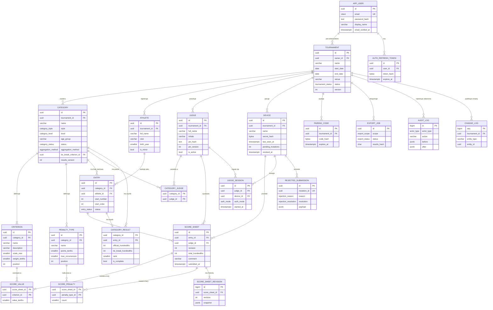
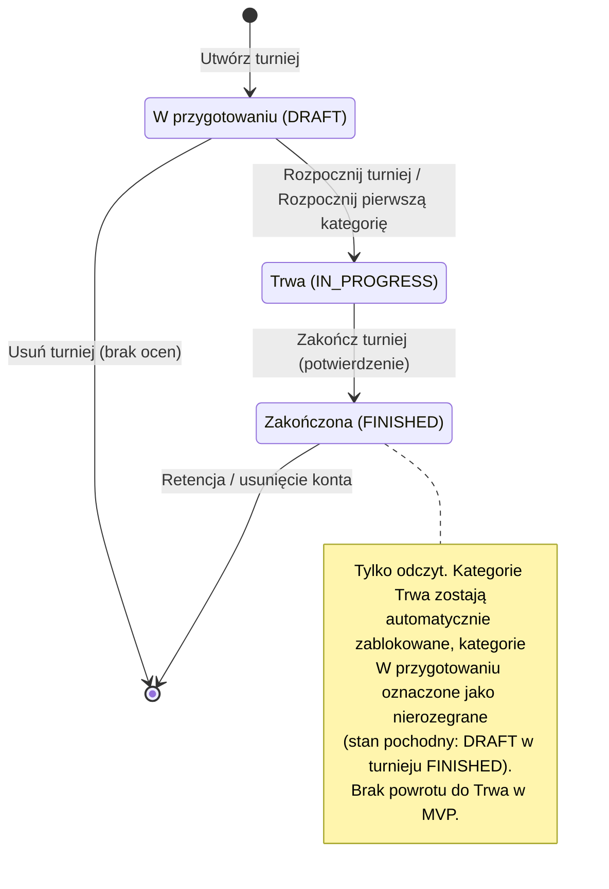
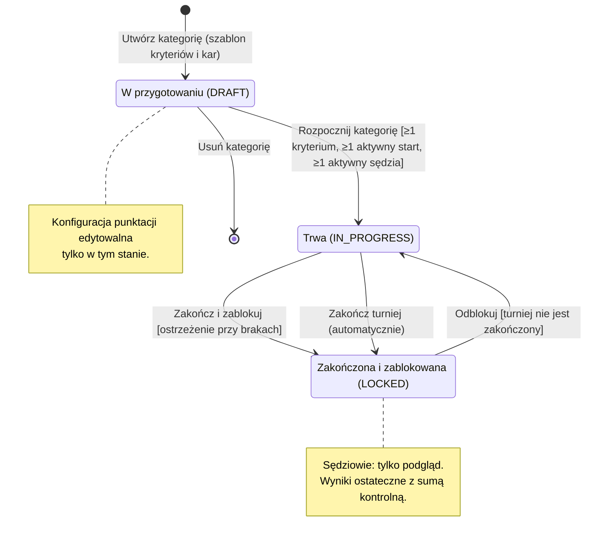
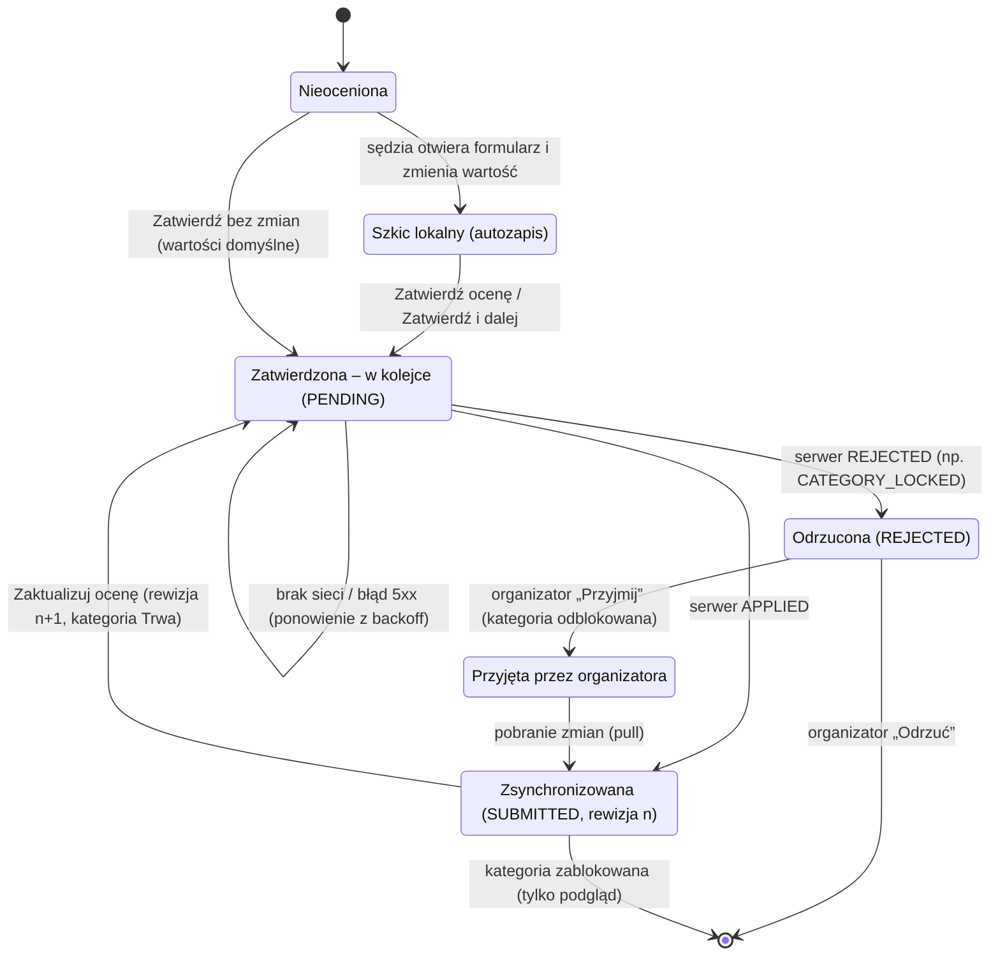
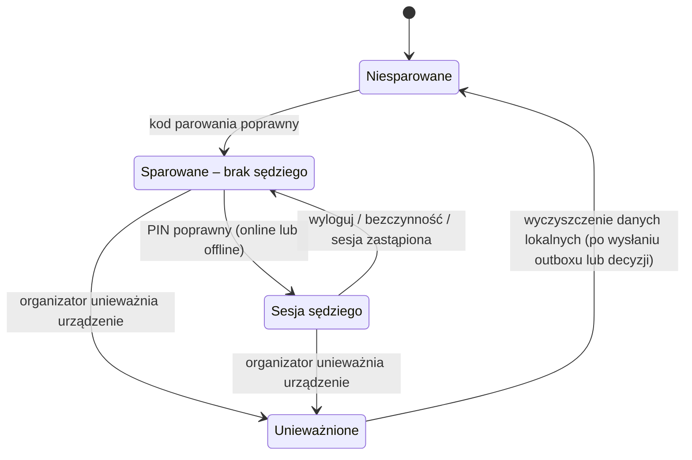

# Model danych

> Dokument: `01-architecture/02-model-danych.md` · Wersja 1.0 · 23.10.2026
> Baza: PostgreSQL 18 (TL-01; identyfikatory serwerowe generowane natywną funkcją `uuidv7()`). Konwencje: tabele i kolumny w `snake_case` (angielskie nazwy techniczne), opisy po polsku. Klucze główne `uuid` (UUIDv7 generowane po stronie klienta dla arkuszy ocen i mutacji, po stronie serwera dla reszty). Czas w `timestamptz` (UTC). Wszystkie tabele domenowe mają `created_at`, `updated_at` (domyślnie `now()`).
> Powiązane: [03-api.md](03-api.md), [06-offline-i-synchronizacja.md](06-offline-i-synchronizacja.md), [07-reguly-punktacji.md](../02-specification/07-reguly-punktacji.md), [10-glosariusz.md](../02-specification/10-glosariusz.md)

## 1. Typy wyliczeniowe

| Typ | Wartości (technicznie) | Etykieta PL w UI |
|---|---|---|
| `tournament_status` | `DRAFT`, `IN_PROGRESS`, `FINISHED` | „W przygotowaniu”, „Trwa”, „Zakończona” (sic – etykieta z designu, patrz Q-07) |
| `category_status` | `DRAFT`, `IN_PROGRESS`, `LOCKED` | „W przygotowaniu”, „Trwa”, „Zakończona” (+ ikona kłódki u sędziego) |
| `category_style` | `POLE_SPORT`, `POLE_ART`, `EXOTIC`, `DOUBLES` | „Pole Sport”, „Pole Art”, „Exotic”, „Doubles” |
| `category_level` | `BEGINNER`, `INTERMEDIATE`, `ADVANCED`, `PRO`, `ELITE` | „Beginner”, „Intermediate”, „Advanced”, „Pro”, „Elite” |
| `aggregation_method` | `MEAN`, `TRIMMED_MEAN` | MVP tylko `MEAN` (`TRIMMED_MEAN` – v1.1) |
| `entry_status` | `ACTIVE`, `WITHDRAWN` | „—” / „Wycofana” |
| `score_sheet_status` | `SUBMITTED` | (rewizje w osobnej tabeli; odrzucone zgłoszenia w `rejected_submission`) |
| `rejection_reason` | `CATEGORY_LOCKED`, `CATEGORY_NOT_STARTED`, `TOURNAMENT_FINISHED`, `JUDGE_NOT_IN_PANEL`, `JUDGE_INACTIVE`, `ENTRY_WITHDRAWN`, `PIN_VERSION_OUTDATED`, `JUDGE_SESSION_INVALID` (te kody trafiają do `rejected_submission` – TL-13); `STALE_REVISION`, `SCHEMA_MISMATCH` (tylko w odpowiedzi `sync/push`, rozwiązuje sędzia na tablecie) | „Kategoria zablokowana” itd. |
| `rejection_resolution` | `PENDING`, `ACCEPTED`, `DISCARDED` | „Do decyzji”, „Przyjęta”, „Odrzucona” |
| `actor_type` | `ORGANIZER`, `JUDGE`, `DEVICE`, `SYSTEM` | – |
| `auth_mode` | `ONLINE_PIN`, `OFFLINE_PIN` | – |
| `export_scope` | `TOURNAMENT`, `CATEGORY` | „Cały turniej”, „Kategoria” |
| `export_status` | `QUEUED`, `RUNNING`, `DONE`, `FAILED` | – |

## 2. Encje i atrybuty

### 2.1 `app_user` – konto organizatora
| Kolumna | Typ | Ograniczenia / opis |
|---|---|---|
| `id` | uuid | PK |
| `email` | citext | NOT NULL, UNIQUE (wśród `deleted_at IS NULL`) |
| `password_hash` | text | NOT NULL, Argon2id (m=19 MiB, t=2, p=1 – minimum OWASP) |
| `display_name` | varchar(80) | NOT NULL |
| `email_verified_at` | timestamptz | NULL dopóki niezweryfikowany |
| `locale` | varchar(5) | domyślnie `pl-PL` |
| `terms_accepted_at` | timestamptz | NOT NULL (regulamin + umowa powierzenia) |
| `terms_version` | varchar(20) | NOT NULL |
| `failed_login_count` | smallint | domyślnie 0 |
| `locked_until` | timestamptz | blokada po zbyt wielu próbach |
| `deleted_at` | timestamptz | wniosek o usunięcie konta: konto natychmiast nieaktywne (logowanie niemożliwe, sesje unieważnione); twarde usunięcie i pseudonimizacja danych turniejów przez zadanie retencji po 30 dniach (TL-15) |
| `lockout_level` | smallint | domyślnie 0; poziom eskalacji blokady logowania (15 min × 2^n, maks. 24 h – [05-bezpieczenstwo.md §2](05-bezpieczenstwo.md#2-uwierzytelnianie-organizatora)) |

### 2.2 `auth_refresh_token`
| Kolumna | Typ | Opis |
|---|---|---|
| `id` | uuid | PK |
| `user_id` | uuid | FK → `app_user` ON DELETE CASCADE |
| `family_id` | uuid | rodzina rotacji (wykrywanie ponownego użycia) |
| `token_hash` | bytea | SHA-256 tokenu (sam token tylko u klienta) |
| `expires_at` | timestamptz | 30 dni |
| `revoked_at` | timestamptz | NULL = aktywny |
| `replaced_by_id` | uuid | następny token w rodzinie |
| `user_agent`, `ip` | text, inet | do audytu |

### 2.3 `tournament` – turniej
| Kolumna | Typ | Ograniczenia / opis |
|---|---|---|
| `id` | uuid | PK |
| `owner_id` | uuid | FK → `app_user`, NOT NULL |
| `name` | varchar(120) | NOT NULL, 3–120 znaków po przycięciu |
| `start_date` | date | NULL = „Data do ustalenia” |
| `end_date` | date | NULL lub ≥ `start_date` |
| `venue` | varchar(120) | NULL = „Miejsce do ustalenia” (np. „Warszawa, Hala Torwar”) |
| `timezone` | varchar(40) | domyślnie `Europe/Warsaw` |
| `status` | tournament_status | NOT NULL, domyślnie `DRAFT` |
| `started_at`, `finished_at` | timestamptz | ustawiane przy przejściach |
| `allow_offline_pin_login` | boolean | domyślnie `true` ([ADR-005](adr/ADR-005-uwierzytelnianie-sedziego-pin.md)) |
| `change_seq` | bigint | ostatni numer w `change_log` dla turnieju |
| `version` | integer | optymistyczna współbieżność |
| `deleted_at` | timestamptz | miękkie usunięcie |

CHECK: `end_date IS NULL OR start_date IS NOT NULL AND end_date >= start_date`.

### 2.4 `category` – kategoria
| Kolumna | Typ | Ograniczenia / opis |
|---|---|---|
| `id` | uuid | PK |
| `tournament_id` | uuid | FK → `tournament` ON DELETE CASCADE |
| `name` | varchar(80) | NOT NULL |
| `style` | category_style | NOT NULL, domyślnie `POLE_SPORT` |
| `level` | category_level | NOT NULL, domyślnie `BEGINNER` |
| `age_group` | varchar(40) | NOT NULL, domyślnie `Open` |
| `position` | integer | kolejność na liście (rosnąco) |
| `status` | category_status | NOT NULL, domyślnie `DRAFT` |
| `aggregation_method` | aggregation_method | domyślnie `MEAN` |
| `tie_break_criterion_id` | uuid | FK → `criterion` (DEFERRABLE), NULL = pierwsze kryterium wg `position` |
| `started_at`, `locked_at` | timestamptz | |
| `locked_by` | uuid | FK → `app_user` |
| `results_version` | integer | zwiększane przy każdej zmianie wyników |
| `final_results_hash` | char(64) | SHA-256 kanonicznego JSON wyników w chwili blokady (zawartość bez danych osobowych – [05-bezpieczenstwo.md §6](05-bezpieczenstwo.md#6-audyt-zmian-i-integralność-wyników)); ustawiany przy blokadzie, zerowany (NULL) przy odblokowaniu |
| `version` | integer | |

UNIQUE (`tournament_id`, `position`) DEFERRABLE.

### 2.5 `criterion` – kryterium oceny
| Kolumna | Typ | Ograniczenia / opis |
|---|---|---|
| `id` | uuid | PK |
| `category_id` | uuid | FK → `category` ON DELETE CASCADE |
| `name` | varchar(60) | NOT NULL |
| `description` | varchar(200) | „Opis dla sędziów”, opcjonalny |
| `scale_max` | smallint | NOT NULL, CHECK 1–20, domyślnie 10 |
| `step` | numeric(3,1) | NOT NULL, domyślnie 0.5 (MVP stałe) |
| `weight_tenths` | smallint | NOT NULL, waga × 10; CHECK 5–50 i `weight_tenths % 5 = 0` (0,5–5,0, krok 0,5) |
| `position` | integer | kolejność; pierwsze = domyślne kryterium rozstrzygające |

UNIQUE (`category_id`, `position`) DEFERRABLE.

### 2.6 `penalty_type` – rodzaj kary
| Kolumna | Typ | Ograniczenia / opis |
|---|---|---|
| `id` | uuid | PK |
| `category_id` | uuid | FK → `category` ON DELETE CASCADE |
| `name` | varchar(60) | NOT NULL |
| `points_tenths` | smallint | „Punkty za 1 raz” × 10; CHECK 5–500 i `% 5 = 0` (0,5–50,0, krok 0,5) |
| `max_occurrences` | smallint | „Maks. wystąpień”; CHECK 1–10, domyślnie 3 |
| `position` | integer | |

### 2.7 `athlete` – zawodniczka (osoba w turnieju)
| Kolumna | Typ | Ograniczenia / opis |
|---|---|---|
| `id` | uuid | PK |
| `tournament_id` | uuid | FK → `tournament` ON DELETE CASCADE (osoba istnieje w zakresie turnieju – minimalizacja danych) |
| `full_name` | varchar(100) | NOT NULL („Imię i nazwisko”) |
| `club` | varchar(100) | NULL → wyświetlane „—” („Klub / szkoła”) |
| `birth_year` | smallint | NULL; CHECK 1920–2100 w bazie (wyrażenie CHECK musi być niezmienne), górna granica „≤ bieżący rok” walidowana w serwisie (TL-15) |
| `is_minor` | boolean | NOT NULL domyślnie false; wyliczane z `birth_year` albo zaznaczane ręcznie |
| `guardian_consent_confirmed` | boolean | wymagane `true`, gdy `is_minor` ([FR-406](../02-specification/03-wymagania-funkcjonalne.md)) |
| `pseudonymized_at` | timestamptz | po okresie retencji lub „Usuń dane osobowe” (FR-904): `full_name` → stały znacznik techniczny `PSEUDONYMIZED`, `club` i `birth_year` → NULL. **Wyświetlanie** (UI, PDF, migawka tabletu) zawsze generuje etykietę „Zawodniczka nr {entry.start_number}” z numeru startu (TL-15) |

### 2.8 `entry` – start zawodniczki w kategorii (pozycja listy startowej)
| Kolumna | Typ | Ograniczenia / opis |
|---|---|---|
| `id` | uuid | PK |
| `tournament_id` | uuid | FK → `tournament` (denormalizacja dla unikalności numeru) |
| `category_id` | uuid | FK → `category` ON DELETE CASCADE |
| `athlete_id` | uuid | FK → `athlete` ON DELETE RESTRICT |
| `start_number` | integer | NOT NULL, CHECK 1–9999 („Nr startowy”) |
| `start_order` | integer | NOT NULL, kolejność w kolejce sędziego |
| `status` | entry_status | domyślnie `ACTIVE` |
| `withdrawn_at` | timestamptz | |

UNIQUE (`tournament_id`, `start_number`), UNIQUE (`category_id`, `athlete_id`), UNIQUE (`category_id`, `start_order`) DEFERRABLE.

### 2.9 `judge` – sędzia turnieju
| Kolumna | Typ | Ograniczenia / opis |
|---|---|---|
| `id` | uuid | PK |
| `tournament_id` | uuid | FK → `tournament` ON DELETE CASCADE |
| `full_name` | varchar(80) | NOT NULL |
| `initials` | varchar(3) | wyliczane (pierwsze litery słów, np. „KN”), edytowalne przy kolizji |
| `pin_hash` | text | Argon2id hash PIN-u (weryfikacja online) |
| `pin_fingerprint` | bytea | HMAC-SHA256(klucz serwera z Secrets Manager, `tournament_id ‖ PIN`) – wyłącznie do sprawdzenia unikalności PIN-u w turnieju bez porównywania hashy Argon2id (TL-06); UNIQUE (`tournament_id`, `pin_fingerprint`) |
| `pin_offline_salt` | bytea | 16 B, sól weryfikatora offline |
| `pin_offline_verifier` | bytea | PBKDF2-HMAC-SHA256(PIN, `pin_offline_salt`, 600 000) – liczony **raz**, przy generowaniu PIN-u (jedyny moment, gdy serwer zna PIN). Urządzenie dostaje go wyłącznie zaszyfrowanego kluczem pochodnym od peppera urządzenia (TL-04, [ADR-005](adr/ADR-005-uwierzytelnianie-sedziego-pin.md)) |
| `pin_version` | integer | zwiększane przy resecie PIN-u (unieważnia weryfikatory offline) |
| `failed_pin_count` | smallint | licznik globalny |
| `pin_locked_at` | timestamptz | blokada do resetu przez organizatora |
| `is_active` | boolean | domyślnie true |
| `position` | integer | kolejność kart na ekranie wyboru |

UNIQUE (`tournament_id`, `full_name`). PIN-y są unikalne w obrębie turnieju (sprawdzane przy generowaniu, aby nie było kolizji przy wyborze złego profilu).

> Uwaga (TL-04): pierwotny projekt zakładał liczenie weryfikatora per urządzenie przy wydaniu migawki. To niewykonalne – serwer przechowuje tylko hash PIN-u i nie zna PIN-u w chwili parowania kolejnego tabletu. Weryfikator offline jest więc liczony przy generowaniu PIN-u i przechowywany na serwerze, a powiązanie z urządzeniem zapewnia szyfrowanie (`wrappedVerifier`) kluczem wyprowadzonym z peppera urządzenia.

### 2.10 `category_judge` – panel sędziowski kategorii
| Kolumna | Typ | Opis |
|---|---|---|
| `category_id` | uuid | PK część 1, FK → `category` |
| `judge_id` | uuid | PK część 2, FK → `judge` |

MVP: przy starcie kategorii tabela wypełniana wszystkimi aktywnymi sędziami turnieju (zgodnie z prototypem). Sędzia dodany później **lub ponownie aktywowany** dołącza do paneli kategorii `DRAFT` i `IN_PROGRESS` (doprecyzowanie TL-18). UI wyboru panelu – v1.1.

### 2.11 `device` – urządzenie (tablet sędziowski)
| Kolumna | Typ | Ograniczenia / opis |
|---|---|---|
| `id` | uuid | PK |
| `tournament_id` | uuid | FK → `tournament` |
| `name` | varchar(60) | np. „Tablet stół 1” (nadawana przy parowaniu) |
| `platform` | varchar(10) | `ios` / `android` |
| `model`, `os_version`, `app_version` | varchar | |
| `secret_hash` | bytea | SHA-256 sekretu urządzenia (256 bit) |
| `pepper` | bytea | 32 B, losowy per urządzenie, do weryfikatorów PIN offline |
| `paired_at`, `paired_by` | timestamptz, uuid | |
| `revoked_at` | timestamptz | NULL = aktywne |
| `last_seen_at` | timestamptz | z heartbeat i każdego żądania urządzenia |
| `last_sync_at` | timestamptz | ostatnie udane `sync/push` lub `sync/changes` („ostatnia synchronizacja” w SCR-ORG-14 – TL-15) |
| `last_sync_cursor` | bigint | ostatni potwierdzony `change_log.seq` |
| `pending_mutations` | integer | zgłaszane w heartbeat |
| `active_judge_id` | uuid | NULL = nikt nie jest zalogowany; z heartbeat („zalogowany sędzia” w SCR-ORG-14 – TL-15) |
| `battery_level` | smallint | opcjonalnie, 0–100 |

### 2.12 `pairing_code`
| Kolumna | Typ | Opis |
|---|---|---|
| `id` | uuid | PK |
| `tournament_id` | uuid | FK |
| `code_hash` | bytea | SHA-256 kodu (8 znaków z alfabetu bez znaków mylących, np. `K7QM-4ZTX`) |
| `expires_at` | timestamptz | 10 minut |
| `max_uses` | smallint | domyślnie 10 (parowanie wielu tabletów jednym kodem) |
| `use_count` | smallint | |
| `created_by` | uuid | FK → `app_user` |

### 2.13 `judge_session`
| Kolumna | Typ | Opis |
|---|---|---|
| `id` | uuid | PK (dla sesji offline generowane przez urządzenie, raportowane przy synchronizacji) |
| `judge_id`, `device_id` | uuid | FK |
| `auth_mode` | auth_mode | `ONLINE_PIN` / `OFFLINE_PIN` |
| `started_at`, `ended_at` | timestamptz | |
| `ended_reason` | varchar(20) | `LOGOUT`, `TIMEOUT`, `REVOKED`, `REPLACED` |

### 2.14 `score_sheet` – arkusz oceny (ocena jednego sędziego dla jednego startu)
| Kolumna | Typ | Ograniczenia / opis |
|---|---|---|
| `id` | uuid | PK, UUIDv7 nadany przez tablet przy pierwszym zatwierdzeniu |
| `category_id` | uuid | FK → `category` |
| `entry_id` | uuid | FK → `entry` |
| `judge_id` | uuid | FK → `judge` |
| `revision` | integer | NOT NULL, 1 przy pierwszym zatwierdzeniu, +1 przy każdej aktualizacji |
| `criteria_total_hundredths` | integer | Σ(nota × waga) w setnych |
| `penalty_total_hundredths` | integer | Σ(liczba × punkty) w setnych |
| `total_hundredths` | integer | max(0, kryteria − kary) – wynik sędziego (oficjalny, liczony przez serwer) |
| `client_total_hundredths` | integer | wartość policzona przez tablet (kontrola zgodności) |
| `comment` | varchar(500) | „Komentarz (opcjonalnie)” |
| `submitted_at` | timestamptz | czas przyjęcia przez serwer (ostatnia rewizja) |
| `client_submitted_at` | timestamptz | czas zatwierdzenia na tablecie |
| `device_id` | uuid | FK → `device` |
| `judge_session_id` | uuid | |
| `auth_mode` | auth_mode | tryb sesji ostatniej rewizji (`ONLINE_PIN` / `OFFLINE_PIN`) – tag „offline” w SCR-ORG-19 (TL-15) |
| `last_mutation_id` | uuid | ostatnia zastosowana mutacja (idempotencja) |

UNIQUE (`entry_id`, `judge_id`) – **jeden arkusz na sędziego i start**. CHECK `total_hundredths >= 0`.

### 2.15 `score_value` – nota za kryterium
| Kolumna | Typ | Ograniczenia |
|---|---|---|
| `score_sheet_id` | uuid | PK część 1, FK ON DELETE CASCADE |
| `criterion_id` | uuid | PK część 2, FK |
| `value_tenths` | smallint | nota × 10; CHECK `value_tenths >= 0 AND value_tenths % 5 = 0`; walidacja ≤ `scale_max × 10` w serwisie (i wyzwalaczem) |

### 2.16 `score_penalty` – liczba wystąpień kary
| Kolumna | Typ | Ograniczenia |
|---|---|---|
| `score_sheet_id` | uuid | PK część 1, FK ON DELETE CASCADE |
| `penalty_type_id` | uuid | PK część 2, FK |
| `count` | smallint | CHECK 0–10; walidacja ≤ `max_occurrences` |

### 2.17 `score_sheet_revision` – historia (audyt ocen)
| Kolumna | Typ | Opis |
|---|---|---|
| `id` | bigserial | PK |
| `score_sheet_id` | uuid | FK |
| `revision` | integer | UNIQUE (`score_sheet_id`, `revision`) |
| `snapshot` | jsonb | pełna treść: noty, kary, komentarz, sumy, wersje kryteriów |
| `actor_type` | actor_type | `JUDGE` (lub `ORGANIZER` przy przyjęciu odrzuconego zgłoszenia) |
| `judge_session_id`, `device_id` | uuid | |
| `mutation_id` | uuid | |
| `created_at` | timestamptz | |

### 2.18 `rejected_submission` – odrzucone zgłoszenie oceny
| Kolumna | Typ | Opis |
|---|---|---|
| `id` | uuid | PK |
| `mutation_id` | uuid | UNIQUE |
| `tournament_id`, `category_id`, `entry_id`, `judge_id`, `device_id` | uuid | |
| `payload` | jsonb | pełna treść arkusza z tabletu |
| `reason` | rejection_reason | |
| `received_at` | timestamptz | |
| `resolution` | rejection_resolution | domyślnie `PENDING` |
| `resolved_by`, `resolved_at` | uuid, timestamptz | |

### 2.19 `category_result` – wynik startu (materializowany)
| Kolumna | Typ | Opis |
|---|---|---|
| `category_id` | uuid | PK część 1 |
| `entry_id` | uuid | PK część 2 |
| `sheet_count` | smallint | liczba ocen (n) |
| `expected_count` | smallint | liczba sędziów panelu (J) |
| `sum_hundredths` | integer | suma wyników sędziów |
| `official_hundredths` | integer | średnia zaokrąglona do 0,01 (ROUND_HALF_UP); NULL gdy n = 0 |
| `tie_break_hundredths` | integer | średnia noty kryterium rozstrzygającego (× 100) |
| `penalty_mean_hundredths` | integer | średnia punktów karnych |
| `rank` | smallint | miejsce (ex aequo dopuszczalne); NULL gdy n = 0 lub start wycofany |
| `is_complete` | boolean | n = J |
| `results_version` | integer | wersja wyników kategorii |
| `computed_at` | timestamptz | |

### 2.20 `audit_log` – dziennik audytu
| Kolumna | Typ | Opis |
|---|---|---|
| `id` | bigserial | PK |
| `occurred_at` | timestamptz | |
| `tournament_id` | uuid | NULL dla zdarzeń konta |
| `actor_type` | actor_type | |
| `actor_id` | uuid | użytkownik / sędzia / urządzenie |
| `device_id` | uuid | |
| `action` | varchar(60) | np. `CATEGORY_LOCKED`, `SCORE_SHEET_SUBMITTED`, `JUDGE_PIN_RESET` |
| `entity_type`, `entity_id` | varchar(40), uuid | |
| `before`, `after` | jsonb | bez PIN-ów i haseł |
| `request_id` | uuid | korelacja z logami |
| `ip` | inet | tylko dla organizatora |

Tabela tylko do dopisywania (uprawnienia roli aplikacyjnej: `INSERT`, `SELECT`; brak `UPDATE`/`DELETE`). Partycjonowana miesięcznie.

### 2.21 `change_log` – dziennik zmian dla synchronizacji
| Kolumna | Typ | Opis |
|---|---|---|
| `seq` | bigserial | PK, globalnie rosnący kursor |
| `tournament_id` | uuid | indeks (`tournament_id`, `seq`) |
| `entity_type` | varchar(30) | `tournament`, `category`, `criterion`, `penalty_type`, `entry`, `athlete`, `judge`, `score_sheet` |
| `entity_id` | uuid | |
| `op` | char(1) | `U` (upsert) / `D` (delete) |
| `audience` | varchar(50) | `ALL` / `JUDGE:{id}` (arkusze ocen tylko dla autora) / `DEVICE:{id}` (arkusze pochodzące z tego urządzenia, np. przyjęte przez organizatora odrzucone zgłoszenia – uzupełnienie TL-49; urządzenie i tak przechowuje ich treść) |
| `created_at` | timestamptz | |

Retencja wpisów: do 30 dni po zakończeniu turnieju (później klienci pobierają pełną migawkę).

### 2.22 `processed_mutation` – idempotencja
| Kolumna | Typ | Opis |
|---|---|---|
| `mutation_id` | uuid | PK |
| `device_id` | uuid | |
| `request_hash` | char(64) | SHA-256 treści (wykrycie ponownego użycia ID z inną treścią) |
| `result` | jsonb | zapisana odpowiedź (`APPLIED` / `REJECTED` + kod) |
| `created_at` | timestamptz | retencja 30 dni |

### 2.22a `idempotency_key` – idempotencja REST organizatora (uzupełnienie TL-15)
| Kolumna | Typ | Opis |
|---|---|---|
| `key` | uuid | PK część 1 – wartość nagłówka `Idempotency-Key` |
| `user_id` | uuid | PK część 2 – właściciel klucza (klucze nie są współdzielone między kontami) |
| `method`, `path` | varchar(10), varchar(200) | żądanie |
| `request_hash` | char(64) | SHA-256 treści; inna treść z tym samym kluczem → `IDEMPOTENCY_KEY_REUSED` |
| `response_status`, `response_body` | smallint, jsonb | zapisana odpowiedź zwracana przy powtórzeniu |
| `created_at` | timestamptz | retencja 24 h (zadanie retencji) |

### 2.23 `domain_event` – outbox zdarzeń realtime
`id bigserial`, `tournament_id`, `type varchar(40)`, `payload jsonb`, `created_at`, `published_at` (NULL = do wysłania).

### 2.23a `auth_email_token` – kody i linki e-mail (uzupełnienie TL-15)
| Kolumna | Typ | Opis |
|---|---|---|
| `id` | uuid | PK |
| `user_id` | uuid | FK → `app_user` ON DELETE CASCADE |
| `purpose` | varchar(20) | `VERIFY_EMAIL` (6 cyfr, 24 h) / `RESET_PASSWORD` (token 256 bit, 1 h) |
| `token_hash` | bytea | SHA-256 kodu/tokenu |
| `expires_at`, `used_at` | timestamptz | jednorazowość |
| `attempts` | smallint | błędne próby kodu; po 5 kod jest unieważniany (`CODE_INVALID`) |

Nowy kod/token unieważnia poprzednie tego samego celu.

### 2.24 `export_job`
`id uuid`, `tournament_id`, `scope export_scope`, `category_id NULL`, `status export_status`, `results_versions jsonb` (wersje wyników użyte do wygenerowania), `results_hash char(64)`, `s3_key`, `created_by`, `created_at`, `finished_at`, `expires_at` (+7 dni), `error`.

## 3. Diagram ER

## 4. Indeksy

| Tabela | Indeks | Cel |
|---|---|---|
| `tournament` | (`owner_id`, `status`) WHERE `deleted_at IS NULL` | Lista turniejów organizatora (Aktywne / Zakończone) |
| `category` | (`tournament_id`, `position`) | Lista kategorii |
| `criterion`, `penalty_type` | (`category_id`, `position`) | Konfiguracja kategorii |
| `entry` | UNIQUE (`tournament_id`, `start_number`); (`category_id`, `start_order`) | Unikalność numeru, kolejka |
| `athlete` | (`tournament_id`, lower(`full_name`)) | Wyszukiwanie |
| `judge` | (`tournament_id`, `position`) | Ekran wyboru profilu |
| `score_sheet` | UNIQUE (`entry_id`, `judge_id`); (`category_id`, `judge_id`); (`category_id`, `entry_id`) | Idempotencja, postęp sędziego, przeliczanie |
| `category_result` | (`category_id`, `rank`) | Ranking |
| `change_log` | (`tournament_id`, `seq`) | Synchronizacja delta |
| `audit_log` | (`tournament_id`, `occurred_at` DESC); (`entity_type`, `entity_id`) | Przeglądanie audytu |
| `rejected_submission` | (`tournament_id`, `resolution`) | Baner „Odrzucone oceny” |
| `device` | (`tournament_id`) WHERE `revoked_at IS NULL` | Lista urządzeń |
| `domain_event` | (`published_at`) WHERE `published_at IS NULL` | Publikator outboxu |

## 5. Reguły integralności (wymuszane w serwisie i, gdzie to możliwe, w bazie)

| ID | Reguła | Miejsce |
|---|---|---|
| INT-01 | Arkusz oceny można przyjąć tylko, gdy kategoria ma status `IN_PROGRESS`, turniej `IN_PROGRESS`, sędzia jest w `category_judge` i `is_active`, a start ma status `ACTIVE` | serwis `scoring` (+ odrzucenie do `rejected_submission`) |
| INT-02 | Arkusz zawiera notę dla **każdego** kryterium kategorii (brak = błąd `SCHEMA_MISMATCH`) i licznik dla każdej kary (brak = 0) | serwis |
| INT-03 | `0 ≤ nota ≤ scale_max`, nota wielokrotnością 0,5; `0 ≤ count ≤ max_occurrences` | CHECK + wyzwalacz |
| INT-04 | Kryteria i kary można dodawać, zmieniać i usuwać tylko w kategorii `DRAFT` | serwis `categories` (błąd `CRITERIA_LOCKED`) |
| INT-05 | Turniej `FINISHED` jest tylko do odczytu (wszystkie mutacje → `TOURNAMENT_FINISHED`). **Wyjątek RODO (TL-17):** sprostowanie danych osobowych zawodniczki (`fullName`, `club`, `birthYear`) i „Usuń dane osobowe” (FR-904) są dozwolone także w turnieju `FINISHED` i kategorii `LOCKED`; nie zmieniają wyników, `results_version` ani `final_results_hash` | serwis (guard) |
| INT-06 | Start z ocenami nie może zostać usunięty (tylko wycofany) | FK `RESTRICT` + serwis (`HAS_SCORES`) |
| INT-07 | Kategorię można usunąć tylko w `DRAFT`; turniej tylko w `DRAFT` i bez arkuszy ocen | serwis |
| INT-08 | `audit_log` i `score_sheet_revision` są tylko do dopisywania dla roli aplikacyjnej. Wyjątek: osobna rola `pc_retention` (używana wyłącznie przez zadanie retencji) ma `UPDATE` tylko na kolumnach `before`, `after`, `ip` (`audit_log`) i `snapshot` (`score_sheet_revision`), żeby usunąć dane osobowe po okresie retencji, oraz prawo odłączania partycji starszych niż 36 mies. (TL-16) | uprawnienia bazy |
| INT-09 | `total_hundredths` liczony wyłącznie przez serwer (`@polechamp/scoring`). Rozbieżność z `client_total_hundredths` jest logowana jako ostrzeżenie (`SCORE_TOTAL_MISMATCH`) | serwis |
| INT-10 | Numer startowy unikalny w turnieju | UNIQUE |

## 6. Cykle życia statusów

### 6.1 Turniej

### 6.2 Kategoria

### 6.3 Arkusz oceny (perspektywa tabletu i serwera)

### 6.4 Urządzenie

## 7. Lokalna baza tabletu (SQLite)

Szczegóły w [06-offline-i-synchronizacja.md §2](06-offline-i-synchronizacja.md#2-lokalna-baza-tabletu). Tabele: `local_tournament`, `local_category`, `local_criterion`, `local_penalty_type`, `local_entry` (z `full_name`, `club`, `start_number` – bez roku urodzenia), `local_judge` (bez `pin_hash`; z `wrapped_verifier`, `pin_offline_salt`, `pin_iterations`, `pin_version`, `pin_locked` – TL-04), `local_score_sheet` (+ `sync_state`), `local_score_value`, `local_score_penalty`, `local_draft` (autozapis formularza), `outbox`, `sync_meta` (kursor, czas ostatniej synchronizacji), `local_judge_session`.
