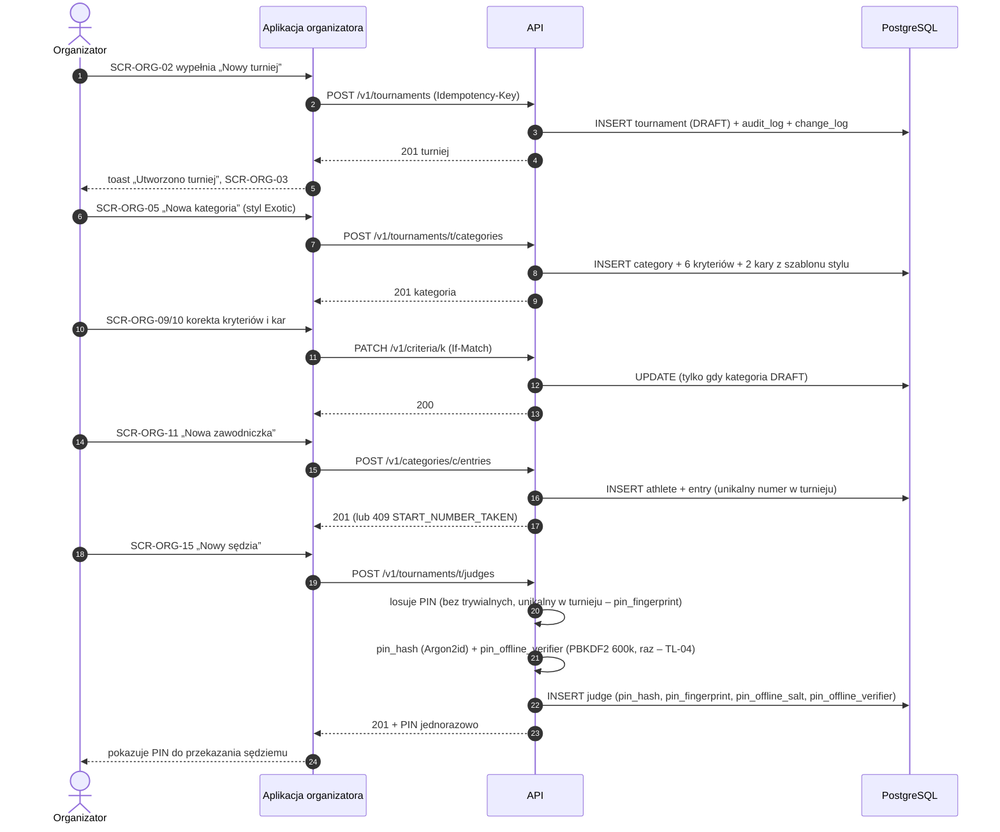
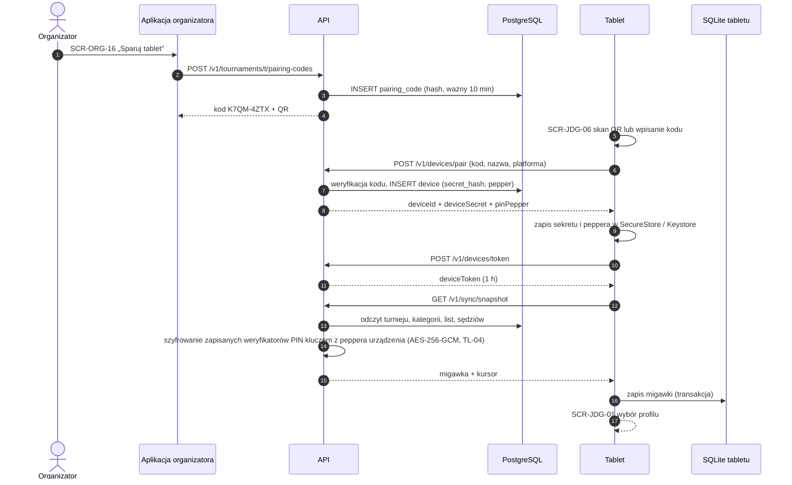
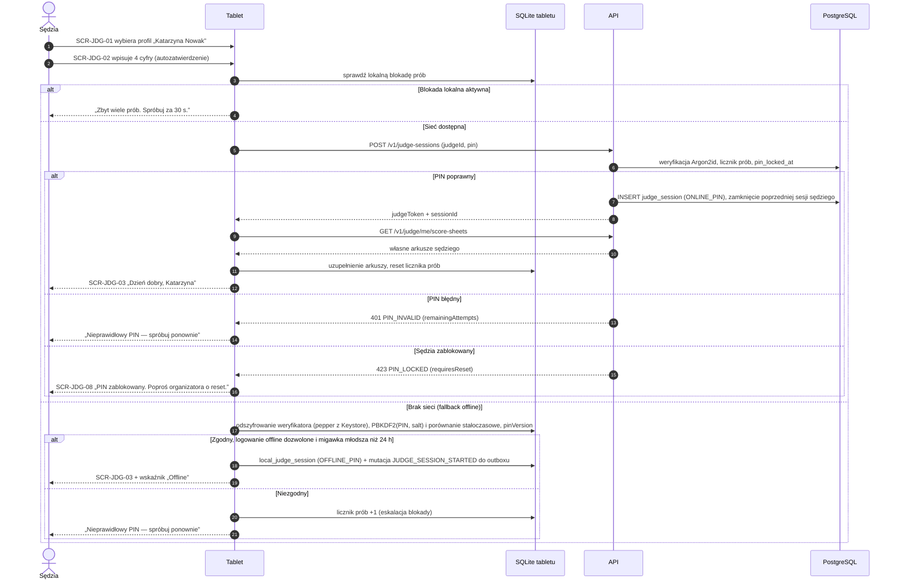
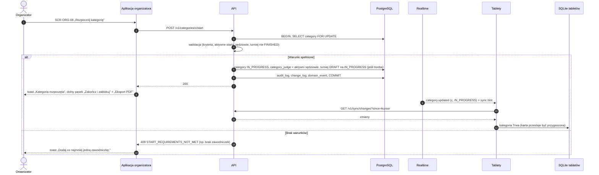
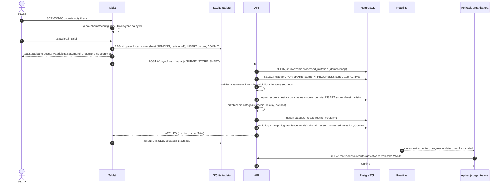
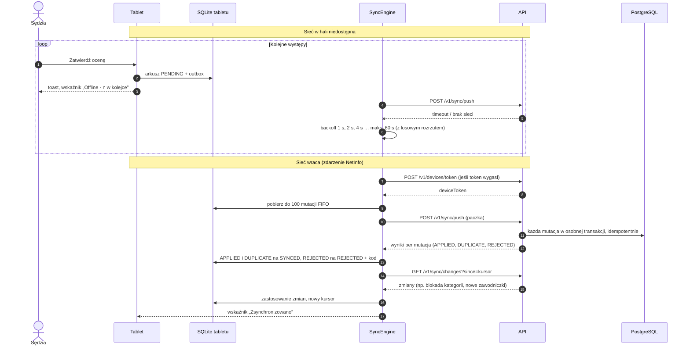
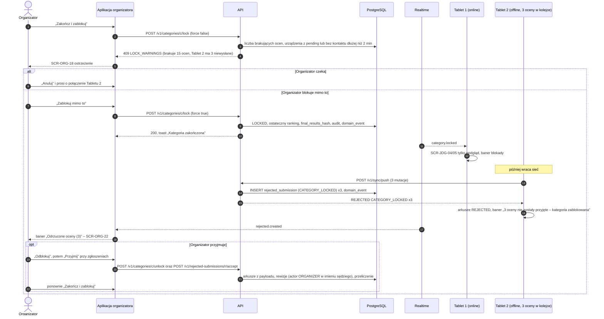
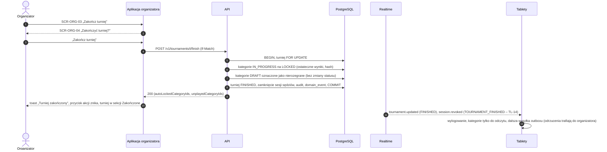
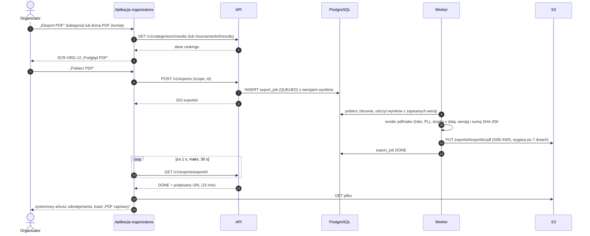

# Przepływy danych – kluczowe scenariusze

> Dokument: `01-architecture/04-przeplywy-danych.md` · Wersja 1.0 · 23.10.2026
> Endpointy: [03-api.md](03-api.md). Offline: [06-offline-i-synchronizacja.md](06-offline-i-synchronizacja.md). Reguły punktacji: [07-reguly-punktacji.md](../02-specification/07-reguly-punktacji.md).

Oznaczenia uczestników w diagramach: **OA** – aplikacja organizatora (telefon), **TA** – aplikacja sędziego (tablet), **LDB** – lokalna baza SQLite tabletu, **API** – backend REST, **DB** – PostgreSQL, **RT** – gateway Socket.IO, **WRK** – worker zadań, **S3** – magazyn plików.

## 1. Konfiguracja turnieju

## 2. Parowanie tabletu z turniejem

## 3. Logowanie sędziego PIN-em (online i offline)

## 4. Start kategorii

## 5. Ocena online i przeliczenie wyników

## 6. Ocena offline i synchronizacja

## 7. Zablokowanie kategorii (z urządzeniem offline)

## 8. Zakończenie turnieju

## 9. Eksport PDF

## 10. Przeliczenie wyników – algorytm (skrót)

Wykonywane w transakcji przyjęcia arkusza, przy odblokowaniu/blokadzie, wycofaniu i przywróceniu startu, dodaniu startu do kategorii Trwa, przyjęciu odrzuconego zgłoszenia oraz (uzupełnienie TL-18) przy dodaniu, dezaktywacji i ponownej aktywacji sędziego (zmienia się `J`, a więc `is_complete` i postęp) – dla wszystkich kategorii `IN_PROGRESS` turnieju:

1. Wczytaj aktywne starty kategorii, panel (J), arkusze (`total_hundredths`, noty kryterium rozstrzygającego, sumy kar).
2. Dla każdego startu: `n` = liczba arkuszy, `S` = Σ wyników sędziów, `official` = round_half_up(S / n, 2 miejsca) (dla `MEAN`).
3. Sortuj: `official` malejąco → średnia kryterium rozstrzygającego malejąco → średnia kar rosnąco → ex aequo.
4. Nadaj miejsca metodą „1, 2, 2, 4”. Starty bez ocen i wycofane dostają `rank = NULL`.
5. Zapisz `category_result`, zwiększ `results_version`, zapisz `domain_event results.updated`.

Pełna specyfikacja: [07-reguly-punktacji.md](../02-specification/07-reguly-punktacji.md).
