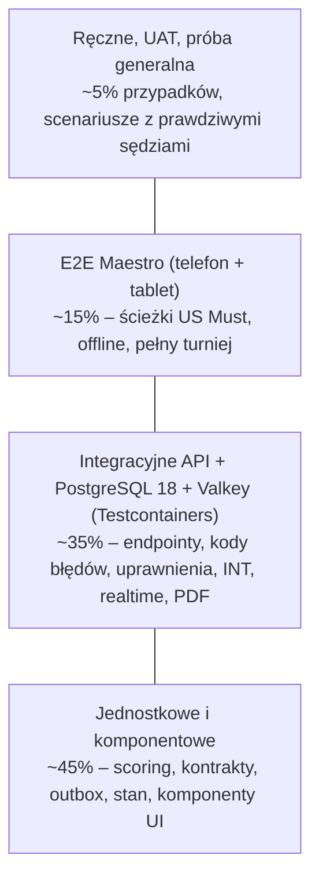

# Strategia testowania PoleChamp

> Dokument: `03-test-plans/00-strategia-testowania.md` · Autor: Tech Lead (Agent 2) · Wersja 1.0 · 23.10.2026
> Podstawa: [99-przekazanie-dla-tech-leada.md §7.9](../01-architecture/99-przekazanie-dla-tech-leada.md#7-do-zweryfikowania-przez-tech-leada-przed-planem-implementacji), [08-wymagania-niefunkcjonalne.md](../02-specification/08-wymagania-niefunkcjonalne.md) (NFR-903), [98-weryfikacja-tech-leada.md](../01-architecture/98-weryfikacja-tech-leada.md). Plan implementacji testów: [EP-11](../04-implementation-plans/11-qa-i-automatyzacja-testow.md).

## 1. Cel i zakres

Celem testów jest dowód, że PoleChamp przeprowadzi rzeczywisty turniej bez utraty ocen i z poprawnymi wynikami (kryterium sukcesu MVP, [02-zakres-mvp.md §1](../02-specification/02-zakres-mvp.md#1-cel-mvp)). Najwyższy priorytet mają trzy obszary ryzyka:

1. **Poprawność punktacji** – silnik `@polechamp/scoring` (te same wyniki na tablecie, serwerze i w PDF).
2. **Brak utraty ocen offline** – outbox, idempotencja, blokada kategorii, odrzucone zgłoszenia.
3. **Izolacja i uprawnienia** – sędzia widzi tylko swoje oceny, organizator tylko swoje turnieje, PIN-ów nie da się zgadywać.

Zakres: aplikacja mobilna (oba tryby), API, worker, infrastruktura (odporność, kopie), PDF, e-maile, dokumenty i linki statyczne. Poza zakresem MVP: SCR-PUB-01 (v2), import CSV (FR-407), średnia obcięta poza testem jednostkowym funkcji (P13).

## 2. Struktura planu testów

| Plik | Zawartość | Przypadków |
|---|---|---|
| [00-strategia-testowania.md](00-strategia-testowania.md) | strategia, narzędzia, środowiska, dane, CI, defekty; przypadki TC-CI | 4 |
| [01-testy-jednostkowe.md](01-testy-jednostkowe.md) | silnik punktacji (P1–P14, D-SC-01…12), kontrakty zod, i18n, tokeny, outbox, logika stanu, komponenty UI | 135 |
| [02-testy-integracyjne-api.md](02-testy-integracyjne-api.md) | każdy endpoint, kody błędów, macierz uprawnień, INT-01…10, realtime, PDF, audyt, RODO | 261 |
| [03-testy-e2e.md](03-testy-e2e.md) | scenariusze organizatora i sędziego, pełny turniej na dwóch urządzeniach | 70 |
| [04-testy-offline-i-synchronizacji.md](04-testy-offline-i-synchronizacji.md) | utrata sieci, kill -9, duplikaty, blokada offline, zegar, wiele tabletów, kolejność zdarzeń | 40 |
| [05-testy-niefunkcjonalne.md](05-testy-niefunkcjonalne.md) | wydajność, dostępność, bezpieczeństwo, odporność, kompatybilność, lokalizacja | 81 |
| [06-testy-zgodnosci-z-designem.md](06-testy-zgodnosci-z-designem.md) | reguły UI-01…UI-15, regresja wizualna, akceptacja projektanta | 26 |
| [07-uat-proba-generalna.md](07-uat-proba-generalna.md) | próbny turniej z prawdziwymi sędziami przed pilotem | 16 |
| [08-przypadki-brzegowe.md](08-przypadki-brzegowe.md) | obszerna lista przypadków brzegowych | 70 |
| [09-macierz-sledzenia.md](09-macierz-sledzenia.md) | FR / US / NFR / SCR / UI / INT → TC i IMP, braki pokrycia | – |

Łącznie **703 przypadków testowych**: P1 480, P2 163, P3 53, P4 7.

### 2.1 Konwencje przypadków testowych
- ID: `TC-<OBSZAR>-NNN` (np. `TC-SCORING-001`, `TC-E2E-JDG-005`); obszary: SCORING, CONTRACT, I18N, TOKENS, OUTBOX, STATE, UI, API, ERR, AUTHZ, INT, RT, PDF, AUDIT, RODO, E2E-ORG, E2E-JDG, E2E-FULL, SYNC, PERF, A11Y, SEC, REL, COMPAT, L10N, DESIGN, UAT, EDGE, CI.
- Każdy przypadek ma: tytuł, poziom, warunki wstępne, kroki, oczekiwany wynik, priorytet i odwołania (FR/US/NFR/SCR/UI/INT/ADR/TL/Q).
- Warunki wstępne odwołują się do fikstur `FX-*` (§5), żeby nie powtarzać danych.
- Przypadek realizuje zadanie implementacyjne wskazane w polu „Odwołania” zadania IMP ([91-indeks-zadan.md](../04-implementation-plans/91-indeks-zadan.md)); automatyczny test w kodzie nosi w nazwie ID przypadku (`it('TC-SCORING-004 …')`), co pozwala liczyć pokrycie skryptem (TC-CI-003).

### 2.2 Priorytety przypadków
| Prio | Znaczenie | Kiedy uruchamiany |
|---|---|---|
| P1 | Krytyczny: utrata ocen, błędny wynik, naruszenie uprawnień lub prywatności, blokada scenariusza US Must | każdy PR (automatyczne) / nocnie (E2E) / przed każdym wydaniem (wszystkie) |
| P2 | Wysoki: funkcja Should, ważny stan błędu, odporność | nocnie i przed wydaniem |
| P3 | Średni: przypadki rzadkie, kosmetyka z wpływem na UX | przed wydaniem 1.0 i przy zmianach obszaru |
| P4 | Niski: zachowania przyszłe (v1.1), decyzje otwarte | przy zmianie decyzji |

## 3. Piramida testów i proporcje

| Poziom | Przypadków w planie | Docelowy udział testów automatycznych w kodzie | Czas przebiegu |
|---|---|---|---|
| Jednostkowe (w tym właściwości) | 124 | ~55% liczby testów | < 3 min |
| Komponentowe (RNTL) | 30 | ~10% | < 3 min |
| Integracyjne (w tym tabelaryczne) | 313 | ~25% | < 10 min |
| E2E automatyczne | 130 | ~8% | nocnie 60–90 min |
| Wydajnościowe | 16 | k6 / pomiary na urządzeniach | przed wydaniem |
| Bezpieczeństwa | 24 | ZAP, Semgrep, pentest, skrypty nadużyć | PR + przed wydaniem |
| Wizualne | 26 | zrzuty Maestro + odiff | nocnie |
| Ręczne | 40 | ~2% | przed wydaniem / UAT |

Uzasadnienie: logika krytyczna (punktacja, synchronizacja, uprawnienia) jest deterministyczna i tania do testowania na niższych poziomach. E2E pokrywają ścieżki użytkownika i zachowania zależne od platformy (kamera, zabicie procesu, sieć, orientacja), których nie da się wiarygodnie zasymulować w Jest.

## 4. Narzędzia

| Obszar | Narzędzie (wersja z X 2026) | Zastosowanie |
|---|---|---|
| Testy pakietów i API | **Vitest 5** | `@polechamp/scoring`, `contracts`, `i18n`, `tokens`, API (jednostkowe i integracyjne) |
| Testy aplikacji | **Jest 30 + `jest-expo` 58 + React Native Testing Library 14** | logika stanu, hooki, komponenty, ekrany (bez urządzenia) |
| Testy właściwości | **fast-check 4.10** | punktacja (TC-SCORING-027…034), idempotencja i kolejność mutacji |
| Baza i cache w testach | **Testcontainers 12** (`postgres:18`, `valkey/valkey:8`, MinIO, Mailpit) | testy integracyjne API i workera |
| Kontrakt | **zod 4 + `@asteasolutions/zod-to-openapi` 9**, Redocly CLI (lint), **oasdiff** (zmiany łamiące), **Schemathesis** (fuzzing z OpenAPI) | TC-CONTRACT, TC-CI-002, TC-SEC-022 |
| E2E mobile | **Maestro CLI 2.11** (emulatory Android w CI, Maestro Cloud lub runner macOS dla iOS) | TC-E2E, TC-SYNC, zrzuty do regresji wizualnej |
| Regresja wizualna | zrzuty Maestro + **odiff** (wzorce w Git LFS, akceptacja projektanta) | TC-DESIGN; PDF: `pdf-to-img` + odiff |
| PDF | **pdfjs-dist** (ekstrakcja tekstu i fontów) | TC-PDF |
| Wydajność | **k6 2.3** (HTTP + WebSocket), **Reassure 1.6** (rendery RN), **Flashlight** (FPS Android), Xcode Instruments, Android Studio Profiler | TC-PERF |
| Sieć i chaos | **toxiproxy**, `tc netem`, Network Link Conditioner, `adb shell svc wifi/data`, AWS FIS | TC-SYNC, TC-REL |
| Dostępność | iOS Accessibility Inspector, Android Accessibility Scanner, VoiceOver, TalkBack, `eslint-plugin-react-native-a11y`, zapytania RNTL po rolach | TC-A11Y |
| Bezpieczeństwo | **OWASP ZAP 2.17** (baseline + API scan), **Semgrep 1.182**, **gitleaks 8.30**, Trivy, `pnpm audit`, listy kontrolne **OWASP ASVS 5.0 L2** i **MASVS 2.x** (MASTG), pentest zewnętrzny | TC-SEC |
| Monitoring jakości | Sentry (crash-free), CloudWatch Synthetics | TC-REL-001, TC-REL-006 |

## 5. Dane testowe i fikstury

Wszystkie fikstury są w pakiecie `packages/test-fixtures` ([IMP-450](../04-implementation-plans/11-qa-i-automatyzacja-testow.md)) i są deterministyczne (ziarno prototypu `20260914`). Dane są fikcyjne – nie używamy danych prawdziwych osób.

| Fikstura | Opis |
|---|---|
| `FX-SEED` | Port `buildSeed` z `design/PoleChamp v2.dc.html`: turnieje t1–t4, kategorie c1–c18, 5 sędziów (jA Katarzyna Nowak, jB Michał Woźniak, jC Aleksandra Kot, jD Tomasz Zając, jE Joanna Wrona), zawodniczki i oceny jak w [03-analiza-designu.md §8](../00-research/03-analiza-designu.md#8-dane-przykładowe-z-prototypu). PIN-y testowe nietrywialne (np. 8306, 4719, 2958, 6143, 7390) – PIN-y demo 1234…5678 są w produkcie zakazane |
| `FX-T1C3` | t1 „Mistrzostwa Polski Pole Sport 2026” (Trwa) + c3 „Pole Sport Advanced” (Trwa, 9 startów nr 41–49, 30/45 ocen, ranking z §8.6) |
| `FX-EMPTY` | konto zweryfikowane bez turniejów |
| `FX-UNVERIFIED` | konto niezweryfikowane z turniejem DRAFT i kategorią gotową do startu |
| `FX-DRAFT-CAT` | turniej DRAFT z kategorią DRAFT (szablon Pole Sport) bez zawodniczek |
| `FX-FINISHED` | turniej t3 „Zimowy Puchar PoleChamp” (Zakończona) |
| `FX-ORG-OTHER` | drugi organizator z własnym turniejem i tabletem (testy IDOR i uprawnień) |
| `FX-TABLET` | tablet sparowany z t1 („Tablet stół 1”), aktualna migawka, nikt nie jest zalogowany |
| `FX-TABLET-JA` | `FX-TABLET` + zalogowana online Katarzyna Nowak |
| `FX-OFFLINE` | tablet w trybie samolotowym, ostatnia synchronizacja < 24 h |
| `FX-MAX` | turniej maksymalny NFR-801: 60 kategorii, 1 500 startów (300 w jednej kategorii), 30 sędziów, 20 urządzeń, kategoria z 12 kryteriami i 10 karami |

Zasady: zegar sterowany w testach (fałszywe timery / wstrzykiwany `Clock` w API), identyfikatory UUIDv7 z generatora deterministycznego w testach jednostkowych, dane staging odświeżane poleceniem `seed:staging` ([IMP-028](../04-implementation-plans/01-fundamenty-i-devops.md)).

## 6. Środowiska testowe

| Środowisko | Zastosowanie | Dane | Uwagi |
|---|---|---|---|
| Lokalne (Docker Compose) | programista: testy jednostkowe i integracyjne | `FX-SEED` | Mailpit, MinIO |
| CI efemeryczne (GitHub Actions + Testcontainers) | PR i nocne | fikstury per test | izolacja per plik testowy |
| `dev` (AWS) | integracja ciągła, spike'i, ręczne próby | syntetyczne | wdrażane z `main` |
| `staging` (AWS, konfiguracja jak prod) | E2E nocne, k6, ZAP, chaos, UAT, próba generalna | `seed:staging`, `FX-MAX` | flaga `E2E_HELPERS` dla endpointów przygotowania stanu (wyłączona w produkcji, test TC-SEC-018) |
| Laboratorium urządzeń | urządzenia referencyjne (§7), testy offline/kill/bateria | staging | zakup lub wypożyczenie – zależność PM |
| `production` | kanarek, monitoring | rzeczywiste | bez testów zapisujących poza kontem syntetycznym kanarka |

## 7. Urządzenia referencyjne (NFR-703) i macierz

| Urządzenie | System | Rola | Uwagi |
|---|---|---|---|
| iPhone 12 | iOS 18 / najnowszy | organizator | najwolniejszy telefon iOS w macierzy |
| Google Pixel 6a | Android 16 | organizator | test zachowań Androida 16 |
| iPad 9. gen. | iPadOS 18 / 26 | sędzia | najsłabszy iPad; test zmiany rozmiaru okna (iPadOS 26) |
| Samsung Galaxy Tab A8 | Android 14 | sędzia | **najsłabszy tablet** – wydajność suwaków (R-01), PBKDF2 (R-04), trwałość SQLite |
| Emulator Android API 29 | Android 10 | oba | minimalna wspierana wersja (NFR-701) |
| Emulator tabletu Android API 36 (sw ≥ 600 dp) | Android 16 | sędzia | ignorowanie blokady orientacji ([ADR-013](../01-architecture/adr/ADR-013-orientacja-i-rozmiar-okna-tabletu.md)) |
| Symulator iOS 16.4 | iOS 16.4 | oba | minimum Expo SDK 58 |
| Tablet 7″ (np. Galaxy Tab A7 Lite) | Android | – | tryb sędziego niedostępny (NFR-702) |

## 8. Kryteria wejścia i wyjścia

| Poziom | Kryterium wejścia | Kryterium wyjścia |
|---|---|---|
| Jednostkowe / komponentowe | kod skompilowany, lint czysty | 100% przejść; progi pokrycia §9 |
| Integracyjne | migracje przechodzą, kontrakt wygenerowany | 100% przejść; każdy endpoint w macierzy TC-AUTHZ; każdy kod błędu z 03-api §1.2 wywołany (TC-ERR) |
| E2E | build `preview` na staging, seed załadowany | 100% P1 zielonych (ponowienie niestabilnego testu maks. 1 raz – niestabilność zgłaszana jako defekt) |
| Offline / synchronizacja | E2E P1 zielone | 0 utraconych i 0 zduplikowanych ocen we wszystkich TC-SYNC P1 (kill -9 100/100) |
| Niefunkcjonalne | środowisko staging w konfiguracji produkcyjnej | progi NFR spełnione; raport k6 i ZAP załączony |
| UAT / próba generalna | wszystkie poprzednie poziomy zaliczone, brak otwartych S1/S2 | kryteria z [07-uat-proba-generalna.md §4](07-uat-proba-generalna.md#4-kryteria-wejścia-i-wyjścia-uat) |
| **Wydanie 1.0 / pilot** | – | brak otwartych defektów S1 i S2; S3 z planem; pentest bez krytycznych/wysokich; crash-free na becie ≥ progów NFR-308; podpisana lista kontrolna wydania ([IMP-554](../04-implementation-plans/13-wydanie.md)) |

## 9. Progi pokrycia (NFR-903)

| Obszar | Próg | Egzekwowanie |
|---|---|---|
| `@polechamp/scoring` | 100% gałęzi i linii + wszystkie przykłady P1–P14 | CI blokuje PR |
| `@polechamp/contracts` | 90% linii; każdy schemat ma test poprawny/niepoprawny | CI |
| API (`apps/api/src`) | ≥ 80% linii, ≥ 70% gałęzi; moduły `scoring`, `sync`, `auth`, `judge-sessions` ≥ 90% linii | CI |
| Mobile – logika (`src/sync`, `src/auth`, `src/features/**/model`, `src/data`) | ≥ 70% linii; `src/sync` ≥ 90% | CI |
| Mobile – komponenty UI | każdy komponent z 09-design-system §4 ma test RNTL i zrzut DevCatalog | przegląd + TC-DESIGN-023 |
| Kontrakty | 100% endpointów w teście zgodności tras i w macierzy uprawnień | TC-CI-002, IMP-453 |
| E2E | każdy US Must ma ≥ 1 przypadek E2E | TC-CI-003 (skrypt macierzy) |

## 10. Testy w CI/CD

| Wyzwalacz | Zestaw | Czas docelowy |
|---|---|---|
| Każdy PR | lint, typecheck, testy jednostkowe i komponentowe (z pokryciem), testy integracyjne API (filtr ścieżek), test zgodności tras i oasdiff, test dokumentacyjny katalogu błędów, gitleaks, `pnpm audit`, Semgrep, Reassure (porównanie z `main`) | ≤ 15 min |
| `main` (po merge) | j.w. + wdrożenie `dev`, smoke test, publikacja OpenAPI | ≤ 25 min |
| Nocnie | E2E Maestro (Android emulator + iOS), regresja wizualna, TC-SYNC automatyczne (sieć, kill -9 w pętli na emulatorze), skan PII w telemetrii, testy uprawnień bazy na staging | ≤ 2 h |
| Przed wydaniem (tag `v*`) | pełny regres E2E na 4 urządzeniach referencyjnych, k6 1× i 2×, ZAP, chaos, TC-SYNC ręczne, TC-A11Y, test odtworzenia (raz na kwartał), regres ręczny ([IMP-466](../04-implementation-plans/11-qa-i-automatyzacja-testow.md)) | 2–3 dni |
| W dni zawodów | wyłącznie kanarek co 1 min i monitoring (okna zamrożenia NFR-905) | – |

## 11. Zarządzanie defektami

| Waga | Definicja | Przykład | Czas reakcji / naprawy |
|---|---|---|---|
| **S1 – krytyczny** | utrata lub zduplikowanie oceny, błędny wynik oficjalny, wyciek danych osobowych, obejście uprawnień, awaria uniemożliwiająca ocenianie | ocena zatwierdzona offline nie dotarła; sędzia widzi noty innych | natychmiast; blokuje wydanie; w dniu zawodów – hotfix za zgodą dyżurnego |
| **S2 – wysoki** | funkcja Must nie działa bez obejścia, NFR P1 niespełniony | brak propagacji blokady na tablet; PDF bez polskich znaków | ≤ 2 dni robocze; blokuje wydanie |
| **S3 – średni** | funkcja działa z obejściem, odstępstwo od designu, Should | nachodzące teksty przy 130% czcionki | w bieżącym lub następnym sprincie |
| **S4 – niski** | kosmetyka bez wpływu na zadanie | różnica 1 dp w odstępie | backlog |

Proces: zgłoszenie w GitHub Issues (szablon: kroki, oczekiwane, rzeczywiste, urządzenie/wersja, ID przypadku TC, logi/`requestId` bez danych osobowych), etykiety `defect`, `S1`…`S4`, `area:*`; triage 2× w tygodniu (TL + QA + PM), codziennie w fazie stabilizacji i UAT. Defekt S1/S2 wymaga testu regresyjnego (nowy lub zaktualizowany TC) przed zamknięciem. Priorytet (kolejność naprawy) ustala PM na podstawie wagi i harmonogramu.

## 12. Pokrycie wymagań z przekazania Architekta (§7.9)

| Wymaganie | Gdzie |
|---|---|
| Przykłady P1–P14 (punktacja) | TC-SCORING-001…014 w [01-testy-jednostkowe.md](01-testy-jednostkowe.md); decyzje D-SC-01…12 – TC-SCORING-015…026 (mapa w [09-macierz-sledzenia.md](09-macierz-sledzenia.md#5-decyzje-punktacji-i-przykłady)) |
| Scenariusze sekwencji 1–9 (04-przeplywy) | [09-macierz-sledzenia.md §6](09-macierz-sledzenia.md#6-scenariusze-sekwencji-i-testy-offline-architekta) |
| Macierz uprawnień (05-bezpieczenstwo §4, §4.1) | TC-AUTHZ-001…062 – każdy endpoint × 6 kontekstów tokenów |
| Reguły UI-01…UI-15 | TC-DESIGN-001…015 + mapa w macierzy śledzenia |
| Kody błędów API (03-api §1.2) | TC-ERR-001…040 (każdy kod) |
| Testy offline (06-offline §10) | [04-testy-offline-i-synchronizacji.md](04-testy-offline-i-synchronizacji.md) i mapa w macierzy śledzenia §6 |

## 13. Ryzyka testowe

| Ryzyko | Mitygacja |
|---|---|
| Niestabilne testy E2E na urządzeniach (czas, animacje, sieć) | helpery API do ustawiania stanu, wyłączone animacje w buildzie E2E, zamrożony czas, ponowienie maks. 1×, kwarantanna z terminem naprawy |
| Brak dostępu do fizycznych urządzeń w CI | emulatory w CI nocnym, urządzenia fizyczne przed wydaniem (laboratorium – PM) |
| Testy utraty zasilania trudne do automatyzacji | procedura ręczna TC-SYNC-006 z 10 powtórzeniami na każdym tablecie referencyjnym |
| Zmiany designu po akceptacji (R-10) | wzorce wizualne zatwierdzane przez projektanta (IMP-653), regresja nocna |
| Dane prawdziwe w testach | wyłącznie fikstury fikcyjne; skan PII (IMP-403) |

## 14. Przypadki CI (kontrola jakości procesu)

| ID | Tytuł | Poziom | Prio | Warunki wstępne | Kroki | Oczekiwany wynik | Odwołania |
|---|---|---|---|---|---|---|---|
| TC-CI-001 | Progi pokrycia w CI | integration | P1 | Pipeline PR | Uruchom testy z pokryciem. | `@polechamp/scoring` 100% gałęzi; API ≥ 80% linii; mobile ≥ 70% linii logiki (`src/sync`, `src/features/**/model`); spadek poniżej progu przerywa PR. | NFR-903 |
| TC-CI-002 | Testy kontraktowe i zgodność wsteczna | integration | P1 | Pipeline PR | Test zgodności tras (ADR-012 pkt 4) + `oasdiff breaking` względem ostatniego wydania. | Brak rozbieżności tras; zmiany łamiące tylko z etykietą `api-breaking` i nową wersją; kompatybilność z 2 poprzednimi wersjami aplikacji (testy kontraktowe klienta N−1, N−2). | NFR-903, NFR-906, NFR-907 |
| TC-CI-003 | Kompletność macierzy śledzenia | unit | P1 | Skrypt `docs/03-test-plans` (generator) | Uruchom sprawdzenie pokrycia FR/US/NFR/SCR przez TC i IMP. | 0 braków dla FR i US Must/Should; każdy US Must ma ≥ 1 TC E2E. | NFR-903 |
| TC-CI-004 | Dokumentacja OpenAPI publikowana | integration | P2 | Pipeline `main` | Sprawdź artefakt `openapi.json` i stronę dokumentacji. | Artefakt dostępny dla każdej wersji, zgodny z wdrożonym API. | NFR-906 |

