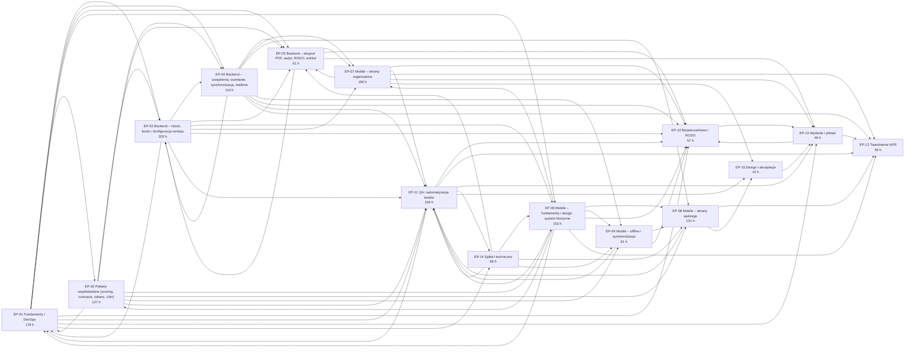
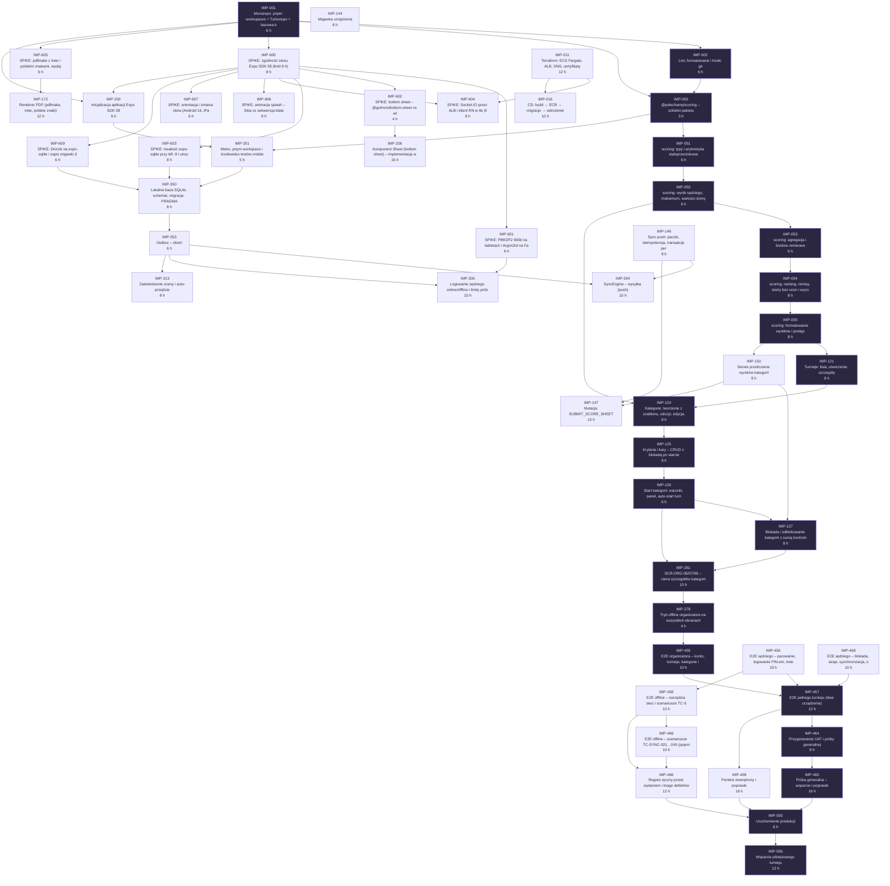

# Graf zależności i ścieżka krytyczna

> Dokument: `04-implementation-plans/90-graf-zaleznosci.md` · Tech Lead · 23.10.2026 · Generowany z kart zadań (zależności „IMP-…”). Indeks: [91-indeks-zadan.md](91-indeks-zadan.md)

## 1. Zależności między epikami

Strzałka A → B oznacza, że co najmniej jedno zadanie epiku B zależy od zadania epiku A. Liczby to suma szacunków epiku (bez buforów).

## 2. Kluczowe zadania i ścieżka krytyczna

Graf obejmuje zadania ścieżki krytycznej (wyróżnione), spike'i oraz zadania o wysokim ryzyku integralności danych. Pełna lista zależności – w kartach zadań i w [91-indeks-zadan.md](91-indeks-zadan.md).

## 3. Ścieżka krytyczna

Najdłuższy łańcuch zależności liczony sumą godzin przy **nieograniczonych zasobach** wynosi **167 h** (21 zadań, ≈ 5,6 tygodnia pracy jednej osoby przy 30 h efektywnie/tydzień):

IMP-001 → IMP-002 → IMP-050 → IMP-051 → IMP-052 → IMP-053 → IMP-054 → IMP-055 → IMP-121 → IMP-124 → IMP-125 → IMP-126 → IMP-127 → IMP-261 → IMP-278 → IMP-455 → IMP-457 → IMP-464 → IMP-465 → IMP-555 → IMP-556

| # | Zadanie | Rola | h | Narastająco (h) | Najwcześniejszy start (h) |
|---|---|---|---|---|---|
| 1 | [IMP-001](01-fundamenty-i-devops.md#imp-001--monorepo-pnpm-workspaces--turborepo--bazowa-konfiguracja-ts) Monorepo: pnpm workspaces + Turborepo + bazowa konfiguracja TS | DEVOPS | 6 | 6 | 0 |
| 2 | [IMP-002](01-fundamenty-i-devops.md#imp-002--lint-formatowanie-i-hooki-git) Lint, formatowanie i hooki git | DEVOPS | 6 | 12 | 6 |
| 3 | [IMP-050](02-pakiety-wspoldzielone.md#imp-050--polechampscoring--szkielet-pakietu) @polechamp/scoring – szkielet pakietu | BE | 3 | 15 | 12 |
| 4 | [IMP-051](02-pakiety-wspoldzielone.md#imp-051--scoring-typy-i-arytmetyka-stałoprzecinkowa) scoring: typy i arytmetyka stałoprzecinkowa | BE | 6 | 21 | 15 |
| 5 | [IMP-052](02-pakiety-wspoldzielone.md#imp-052--scoring-wynik-sędziego-maksimum-wartości-domyślne-walidacja-arkusza) scoring: wynik sędziego, maksimum, wartości domyślne, walidacja arkusza | BE | 6 | 27 | 21 |
| 6 | [IMP-053](02-pakiety-wspoldzielone.md#imp-053--scoring-agregacja-i-średnie-remisowe) scoring: agregacja i średnie remisowe | BE | 6 | 33 | 27 |
| 7 | [IMP-054](02-pakiety-wspoldzielone.md#imp-054--scoring-ranking-remisy-starty-bez-ocen-i-wycofane) scoring: ranking, remisy, starty bez ocen i wycofane | BE | 8 | 41 | 33 |
| 8 | [IMP-055](02-pakiety-wspoldzielone.md#imp-055--scoring-formatowanie-wyników-i-postęp) scoring: formatowanie wyników i postęp | BE | 8 | 49 | 41 |
| 9 | [IMP-121](03-backend-konto-i-konfiguracja-turnieju.md#imp-121--turnieje-lista-utworzenie-szczegóły) Turnieje: lista, utworzenie, szczegóły | BE | 8 | 57 | 49 |
| 10 | [IMP-124](03-backend-konto-i-konfiguracja-turnieju.md#imp-124--kategorie-tworzenie-z-szablonu-odczyt-edycja-usunięcie) Kategorie: tworzenie z szablonu, odczyt, edycja, usunięcie | BE | 8 | 65 | 57 |
| 11 | [IMP-125](03-backend-konto-i-konfiguracja-turnieju.md#imp-125--kryteria-i-kary--crud-z-blokadą-po-starcie) Kryteria i kary – CRUD z blokadą po starcie | BE | 8 | 73 | 65 |
| 12 | [IMP-126](03-backend-konto-i-konfiguracja-turnieju.md#imp-126--start-kategorii-warunki-panel-auto-start-turnieju) Start kategorii: warunki, panel, auto-start turnieju | BE | 6 | 79 | 73 |
| 13 | [IMP-127](03-backend-konto-i-konfiguracja-turnieju.md#imp-127--blokada-i-odblokowanie-kategorii-z-sumą-kontrolną) Blokada i odblokowanie kategorii z sumą kontrolną | BE | 8 | 87 | 79 |
| 14 | [IMP-261](07-mobile-ekrany-organizatora.md#imp-261--scr-org-060708--rama-szczegółów-kategorii) SCR-ORG-06/07/08 – rama szczegółów kategorii | MOB | 10 | 97 | 87 |
| 15 | [IMP-278](07-mobile-ekrany-organizatora.md#imp-278--tryb-offline-organizatora-na-wszystkich-ekranach) Tryb offline organizatora na wszystkich ekranach | MOB | 4 | 101 | 97 |
| 16 | [IMP-455](11-qa-i-automatyzacja-testow.md#imp-455--e2e-organizatora--konto-turnieje-kategorie-i-kryteria) E2E organizatora – konto, turnieje, kategorie i kryteria | QA | 10 | 111 | 101 |
| 17 | [IMP-457](11-qa-i-automatyzacja-testow.md#imp-457--e2e-pełnego-turnieju-dwa-urządzenia) E2E pełnego turnieju (dwa urządzenia) | QA | 12 | 123 | 111 |
| 18 | [IMP-464](11-qa-i-automatyzacja-testow.md#imp-464--przygotowanie-uat-i-próby-generalnej) Przygotowanie UAT i próby generalnej | QA | 8 | 131 | 123 |
| 19 | [IMP-465](11-qa-i-automatyzacja-testow.md#imp-465--próba-generalna--wsparcie-i-poprawki) Próba generalna – wsparcie i poprawki | FULL | 16 | 147 | 131 |
| 20 | [IMP-555](13-wydanie.md#imp-555--uruchomienie-produkcji) Uruchomienie produkcji | DEVOPS | 8 | 155 | 147 |
| 21 | [IMP-556](13-wydanie.md#imp-556--wsparcie-pilotażowego-turnieju) Wsparcie pilotażowego turnieju | FULL | 12 | 167 | 155 |

**Interpretacja dla planowania:**
- Ścieżka krytyczna zależności przechodzi przez silnik punktacji (`@polechamp/scoring`) i rdzeń API konfiguracji turnieju aż po blokadę kategorii (IMP-127), dalej przez ramę kategorii organizatora, testy E2E pełnego turnieju, próbę generalną, uruchomienie produkcji i pilot. Opóźnienie któregokolwiek z tych zadań przesuwa pilot.
- **W praktyce harmonogram wyznacza obciążenie zespołu mobile** (największa liczba godzin – [99-przekazanie-dla-pm.md §2](99-przekazanie-dla-pm.md#2-założenia-o-składzie-zespołu-i-czas-trwania)), a nie łańcuch zależności. Dlatego zadania MOB z ryzykiem wysokim (IMP-206, IMP-305, IMP-310, IMP-350, IMP-354, IMP-500) należy zaczynać możliwie wcześnie po spike'ach.
- Spike'i IMP-600…609 nie leżą na ścieżce krytycznej, ale ich wyniki zmieniają zakres zadań IMP-200, 206, 211, 305, 350, 351, 172 – muszą zakończyć się w 1.–2. tygodniu.
- Akceptacja projektanta (IMP-650) i treść prawna (Q-10) to zależności zewnętrzne poza grafem: blokują odpowiednio DoR ekranów poza designem i wydanie (IMP-553, IMP-555).
