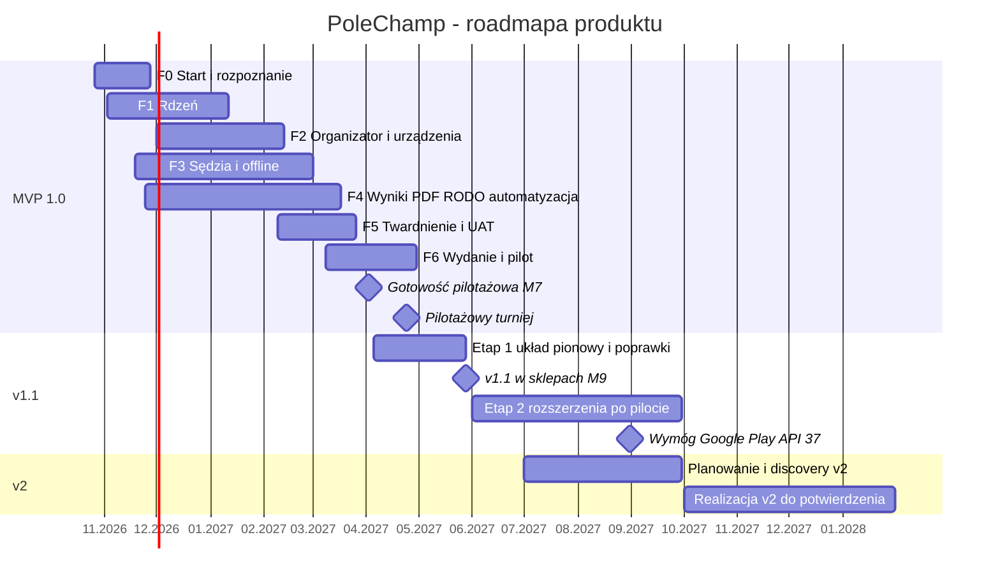

# Roadmapa produktu

> Dokument: `05-project-management/01-roadmapa.md` · Project Manager (Agent 3) · Wersja 1.0 · 24.10.2026
> Podstawa: [02-zakres-mvp.md](../02-specification/02-zakres-mvp.md), [99-przekazanie-dla-pm §3](../04-implementation-plans/99-przekazanie-dla-pm.md#3-sugerowane-fazy-i-kolejność), [91-indeks-zadan.md](../04-implementation-plans/91-indeks-zadan.md), [ADR-013](../01-architecture/adr/ADR-013-orientacja-i-rozmiar-okna-tabletu.md). Szczegóły: [kamienie milowe](02-kamienie-milowe.md), [plan sprintów](03-plan-sprintow.md), [harmonogram](04-harmonogram.md), [backlog po pilocie](10-backlog-po-pilocie.md).

## 1. Cel produktu i MVP

PoleChamp to aplikacja mobilna do prowadzenia turniejów pole dance: **organizator** konfiguruje turniej na telefonie, **sędziowie** oceniają występy na tabletach (także bez internetu), a wyniki i PDF są gotowe zaraz po kategorii.

- **Cel MVP:** przeprowadzić rzeczywisty turniej krajowy (do 60 kategorii, 1 500 startów, 30 sędziów, 20 tabletów) od konfiguracji do PDF z wynikami, bez papieru i arkusza kalkulacyjnego, także przy przerwach w dostępie do internetu ([02-zakres-mvp §1](../02-specification/02-zakres-mvp.md#1-cel-mvp)).
- **Kryterium sukcesu MVP:** pilotażowy turniej (6–10 kategorii, 60–120 startów, 3–5 sędziów) w całości w PoleChamp; 0 utraconych ocen; wyniki kategorii ≤ 2 min po ostatniej ocenie; PDF wysłany klubom w dniu zawodów → kamień milowy [M8](02-kamienie-milowe.md#m8--pilot-przeprowadzony).

## 2. Wersje produktu

| Wersja | Termin (wariant bazowy) | Cel | Zakres | Źródło zakresu |
|---|---|---|---|---|
| **MVP 1.0** | gotowość pilotażowa 2.04.2027 (M7), pilot 24.04.2027 (M8) | pilotażowy turniej bez papieru | wszystkie FR w MVP (M/S/C – 80 FR), 35 ekranów SCR (bez SCR-PUB-01), NFR; **250 zadań IMP, 1679 h** (2308 h z buforami) | [02-zakres-mvp §2](../02-specification/02-zakres-mvp.md#2-zakres-wersji) (kolumny MVP), [91-indeks §3](../04-implementation-plans/91-indeks-zadan.md#3-pokrycie-wymagań-i-ekranów-zadaniami) |
| **v1.1 – etap 1** | 28.05.2027 (M9) | zgodność z polityką Google Play (target API 37 od ok. 31.08.2027) i poprawki z pilota | BL-01 pionowy układ panelu sędziego (ADR-013, G-30), BL-02 poprawki z pilota | ADR-013, Q-18, RT-07 |
| **v1.1 – etap 2** | VI–IX 2027 (priorytety po pilocie, M8) | rozszerzenia oczekiwane przez organizatorów | kolumna „v1.1” z [02-zakres-mvp §2](../02-specification/02-zakres-mvp.md#2-zakres-wersji): Sign in with Apple/Google, TOTP, duplikowanie turnieju, kolejność kategorii, import CSV (FR-407), panele per kategoria, sędzia główny i średnia obcięta (Q-14), kolejka zapisów offline organizatora, eksport danych osoby, EN; SQLCipher (R-06) | [10-backlog §2](10-backlog-po-pilocie.md#2-backlog-v11) |
| **v2** | planowanie po v1.1 (orientacyjnie od IV kw. 2027 – do potwierdzenia) | skalowanie na federacje i publiczność | kolumna „v2”: publiczne wyniki (SCR-PUB-01, FR-709), rundy, zespoły organizatorów, konta sędziów ponad turniejami, kryteria „przez odejmowanie”, tryb sekretariatu, lokalny serwer w sali, dyplomy, rejestracja online | [10-backlog §3](10-backlog-po-pilocie.md#3-backlog-v2) |

Świadomie poza produktem (Won't) – [02-zakres-mvp §3](../02-specification/02-zakres-mvp.md#3-świadomie-poza-mvp-wont--z-uzasadnieniem): rejestracja i płatności, katalog elementów CoP, protesty, wideo i muzyka.

## 3. Fazy realizacji MVP

Fazy F0…F6 pochodzą z [99-przekazanie-dla-pm §3](../04-implementation-plans/99-przekazanie-dla-pm.md#3-sugerowane-fazy-i-kolejność); daty – z planu sprintów (fazy nakładają się, bo role pracują równolegle).

| Faza | Daty (plan) | Sprinty | Cel | Zakres (epiki / kluczowe zadania) | Wyjście / kamień milowy |
|---|---|---|---|---|---|
| **F0 – Start i rozpoznanie** | 26.10–27.11.2026 | tydzień 0, SP-01…SP-02 | decyzje techniczne przed budową, zamówienia zewnętrzne | IMP-001…008, spike'i IMP-600…603, 605…607, 609 (EP-14), silnik punktacji IMP-050…057, akceptacja projektanta IMP-650 (EP-15); konta, urządzenia, prawnik (ZZ-01…ZZ-09) | [M0](02-kamienie-milowe.md#m0--start-projektu), [M1](02-kamienie-milowe.md#m1--fundamenty-i-decyzje-techniczne) – decyzje spike'ów, P1–P14 zielone |
| **F1 – Rdzeń** | 2.11.2026–11.01.2027 | SP-01…SP-06 | wspólne pakiety, API konta i konfiguracji, fundamenty mobile, infrastruktura | EP-02 (contracts, tokens, i18n), EP-03 (API rdzeń), EP-06 (fundamenty mobile, komponenty Nocturne), EP-01 (IMP-009…029) | [M2](02-kamienie-milowe.md#m2--rdzeń-api-i-design-system) – API konfiguracji na `dev`, DevCatalog |
| **F2 – Organizator i urządzenia** | 1.12.2026–12.02.2027 | SP-03…SP-08 | organizator konfiguruje turniej i widzi ranking | EP-07 (SCR-ORG-00…22), EP-04 (parowanie, sesje, migawka, sync, wyniki, realtime) | [M3](02-kamienie-milowe.md#m3--ocenianie-end-to-end), [M4](02-kamienie-milowe.md#m4--organizator-i-synchronizacja-kompletne) |
| **F3 – Sędzia i offline** | 18.11.2026–1.03.2027 | SP-02…SP-09 | pełne ocenianie offline na tablecie | EP-08 (SCR-JDG-00…10), EP-09 (SQLite, outbox, SyncEngine) | M4 (synchronizacja), [M5](02-kamienie-milowe.md#m5--release-candidate-1) (sędzia kompletny, TC-SYNC P1) |
| **F4 – Wyniki, PDF, RODO, automatyzacja** | 24.11.2026–17.03.2027 | SP-02…SP-10 | PDF, retencja, uprawnienia, testy automatyczne | EP-05, EP-10 (bez IMP-408), EP-11 (bez IMP-463…466), IMP-608, IMP-651, IMP-653 | M4 (PDF, RODO), M5 (E2E nocne zielone) |
| **F5 – Twardnienie i UAT** | 9.02–26.03.2027 | SP-08…SP-11 | jakość wydania, próba generalna | EP-12, IMP-463, IMP-464, IMP-465 (próba 20.03.2027), IMP-466, IMP-408 (pentest) | M5, [M6](02-kamienie-milowe.md#m6--gono-go-po-próbie-generalnej) – go/no-go |
| **F6 – Wydanie i pilot** | 8.03–30.04.2027 | SP-10…SP-13 | sklepy, produkcja, pilot | EP-13 (IMP-550…557) | [M7](02-kamienie-milowe.md#m7--gotowość-pilotażowa), [M8](02-kamienie-milowe.md#m8--pilot-przeprowadzony) |
| **v1.1** | 5.04–28.05.2027 | SP-12 (przygotowanie za flagą), SP-14…SP-15 | układ pionowy i poprawki z pilota | BL-01, BL-02 | [M9](02-kamienie-milowe.md#m9--wersja-11-w-sklepach) |

## 4. Epiki w czasie

| Epik | Zadań | h (bez buforów) | Sprinty | Plan (pierwszy start – ostatni koniec) | Faza |
|---|---|---|---|---|---|
| EP-01 Fundamenty i DevOps | 29 | 178 | SP-01…SP-05 | 2.11.2026–8.01.2027 | F0–F1 |
| EP-02 Pakiety współdzielone | 21 | 127 | SP-01…SP-03 | 3.11–10.12.2026 | F0–F1 |
| EP-03 Backend – rdzeń i konfiguracja | 33 | 202 | SP-02…SP-07 | 16.11.2026–2.02.2027 | F1 |
| EP-04 Backend – urządzenia, ocenianie, sync | 17 | 110 | SP-03…SP-07 | 1.12.2026–28.01.2027 | F2 |
| EP-05 Backend – PDF, audyt, RODO | 10 | 61 | SP-06…SP-08 | 22.01–9.02.2027 | F4 |
| EP-06 Mobile – fundamenty i design system | 21 | 153 | SP-01…SP-06 | 12.11.2026–11.01.2027 | F1 |
| EP-07 Mobile – organizator | 29 | 195 | SP-05…SP-08 | 28.12.2026–12.02.2027 | F2 |
| EP-08 Mobile – sędzia | 20 | 131 | SP-03…SP-09 | 30.11.2026–26.02.2027 | F3 |
| EP-09 Mobile – offline i synchronizacja | 10 | 61 | SP-02…SP-09 | 18.11.2026–26.02.2027 | F3 |
| EP-10 Bezpieczeństwo i RODO | 10 | 57 | SP-03…SP-11 | 10.12.2026–25.03.2027 | F4–F5 |
| EP-11 QA i automatyzacja | 20 | 194 | SP-02…SP-11 | 24.11.2026–24.03.2027 | F4–F5 |
| EP-12 Twardnienie NFR | 8 | 56 | SP-08…SP-10 | 9.02–19.03.2027 | F5 |
| EP-13 Wydanie i pilotaż | 8 | 46 | SP-05…SP-13 | 7.01–28.04.2027 | F6 |
| EP-14 Spike'i | 10 | 66 | SP-01…SP-04 | 3.11–17.12.2026 | F0 |
| EP-15 Design i akceptacje | 4 | 42 | SP-01…SP-09 | 2.11.2026–3.03.2027 | F0, F4 |
| **Razem** | **250** | **1679** | SP-01…SP-13 | 2.11.2026–28.04.2027 | |

## 5. Roadmapa – diagram

## 6. Zasady zarządzania roadmapą

- Zmiana zakresu MVP po M5 (zamrożenie funkcji 12.03.2027) wymaga decyzji PO i oceny wpływu TL/PM; po M7 (2.04.2027) – tylko poprawki S1/S2.
- Pytania Q-xx z terminami decyzji: [06-decyzje §2](06-decyzje-i-zaleznosci-zewnetrzne.md#2-pytania-otwarte-q-01q-19). Decyzja zwiększająca zakres MVP (np. Q-04, Q-14, Q-15) bez rezygnacji z innej pozycji przesuwa M5 i zużywa rezerwę SP-12.
- Przegląd roadmapy: na każdym przeglądzie kamienia milowego oraz po pilocie (warsztat priorytetów v1.1 – 29.04.2027).

## 7. Rejestr zmian

| Data | Wersja | Zmiana | Autor |
|---|---|---|---|
| 24.10.2026 | 1.0 | Pierwsza wersja | PM |
