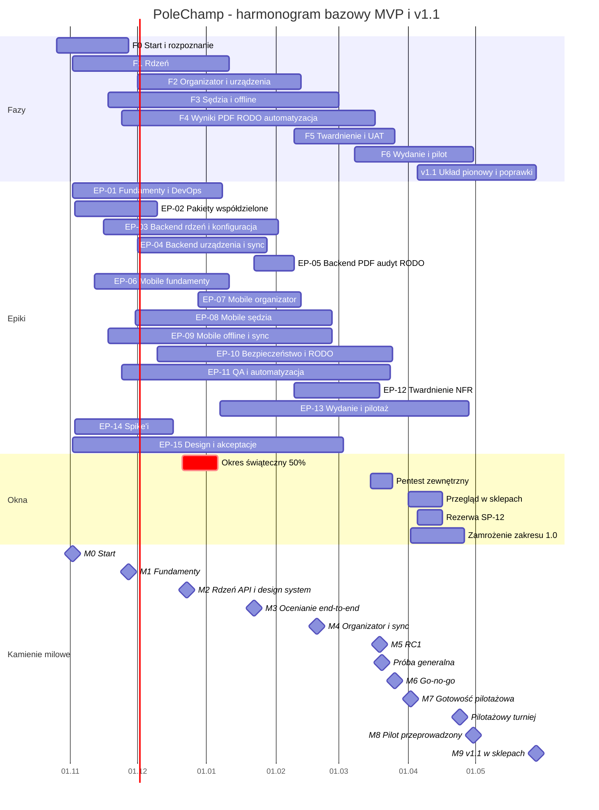
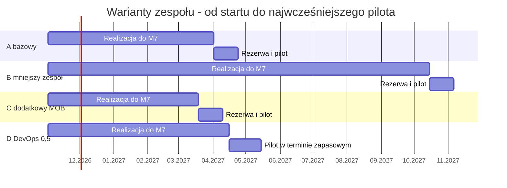

# Harmonogram

> Dokument: `05-project-management/04-harmonogram.md` · Project Manager (Agent 3) · Wersja 1.0 · 24.10.2026
> Podstawa: [plan sprintów](03-plan-sprintow.md), [założenia ZAL-01…ZAL-20](00-zalozenia-planistyczne.md#2-założenia), [kamienie milowe](02-kamienie-milowe.md), [99-przekazanie-dla-pm.md](../04-implementation-plans/99-przekazanie-dla-pm.md), [ADR-013](../01-architecture/adr/ADR-013-orientacja-i-rozmiar-okna-tabletu.md).
> Daty dotyczą **wariantu bazowego A** (2 BE + 2 MOB + 1 QA + DevOps 1,0→0,5 + projektant 0,6→0,2). Terminy pilota i próby generalnej są **założeniami do potwierdzenia** z organizatorem pilotażowym (ZAL-13, ZAL-14).

## 1. Kluczowe daty (wariant bazowy)

| Data | Wydarzenie | Odwołanie |
|---|---|---|
| 26–30.10.2026 | Tydzień 0: zamówienie kont Apple/Google (D-U-N-S), AWS, domeny, urządzeń referencyjnych; umowy z projektantem i prawnikiem | [06-decyzje §3](06-decyzje-i-zaleznosci-zewnetrzne.md#3-zależności-zewnętrzne) |
| **2.11.2026** | **Start projektu – M0**, SP-01 | [M0](02-kamienie-milowe.md#m0--start-projektu) |
| 10.11.2026 | Warsztat akceptacji ekranów poza designem (Q-08, IMP-650) | IMP-650 |
| 13.11.2026 | Decyzje wszystkich spike'ów stosu mobilnego i PDF (poza IMP-604, IMP-608) | EP-14 |
| 27.11.2026 | **M1** – fundamenty i silnik punktacji P1–P14 | [M1](02-kamienie-milowe.md#m1--fundamenty-i-decyzje-techniczne) |
| 1.12.2026 | Decyzja spike'u realtime przez ALB (IMP-604) | IMP-604 |
| 18.12.2026 | Ostatni dzień na zamówienie pentestu (okno 15–24.03.2027) | ZZ-06 |
| **23.12.2026** | **M2** – rdzeń API konfiguracji turnieju i design system na `dev` | [M2](02-kamienie-milowe.md#m2--rdzeń-api-i-design-system) |
| 21.12.2026–5.01.2027 | Okres świąteczny – pojemność 50% (24–25.12, 31.12, 1.01, 6.01 wolne) | ZAL-03, ZAL-04 |
| **22.01.2027** | **M3** – ocenianie end-to-end na serwerze, logowanie w aplikacji | [M3](02-kamienie-milowe.md#m3--ocenianie-end-to-end) |
| **19.02.2027** | **M4** – organizator kompletny, pełna synchronizacja tabletu | [M4](02-kamienie-milowe.md#m4--organizator-i-synchronizacja-kompletne) |
| 19.02.2027 | Ostatni termin wydania Expo SDK 59, aby zaktualizować SDK przed 1.0 (IMP-507) | ZAL-16 |
| 12.03.2027 | Zamrożenie funkcji – build RC1 (wszystkie zadania funkcjonalne ukończone) | bramka RC |
| 15–24.03.2027 | Okno pentestu zewnętrznego na `staging` (RC1) | IMP-408, ZZ-06 |
| **19.03.2027** | **M5** – Release Candidate 1, UAT przygotowany | [M5](02-kamienie-milowe.md#m5--release-candidate-1) |
| **20.03.2027 (sobota)** | **Próba generalna (UAT)** z organizatorem pilotażowym i sędziami | [09-plan-wydania §3](09-plan-wydania-i-pilotazu.md#3-plan-próby-generalnej-uat), [07-uat](../03-test-plans/07-uat-proba-generalna.md) |
| **26.03.2027** | **M6** – decyzja go/no-go | [M6](02-kamienie-milowe.md#m6--gono-go-po-próbie-generalnej) |
| 29.03.2027 | Poniedziałek Wielkanocny (wolne) | ZAL-03 |
| 30.03–1.04.2027 | Uruchomienie produkcji (IMP-555), zgłoszenie buildów 1.0 do App Store i Google Play | IMP-555 |
| **2.04.2027** | **M7 – gotowość pilotażowa**; od tego dnia zamrożenie zakresu 1.0 | [M7](02-kamienie-milowe.md#m7--gotowość-pilotażowa) |
| 1–16.04.2027 | Okno przeglądu w sklepach (cel zatwierdzenia: 16.04) | ZAL-15 |
| 5–16.04.2027 | SP-12 – rezerwa harmonogramu (ok. 2 tygodnie), przygotowanie pilota | [SP-12](03-plan-sprintow.md#sp-12) |
| 15.04.2027 | Próba techniczna z tabletami organizatora na produkcji | [09-plan-wydania §2](09-plan-wydania-i-pilotazu.md#2-lista-kontrolna-gono-go) |
| 22–25.04.2027 | Okno zamrożenia wdrożeń i OTA (`ops/freeze-windows.yaml`, NFR-905) | IMP-017 |
| **24.04.2027 (sobota)** | **Pilotażowy turniej** (termin zapasowy: 15.05.2027) | ZAL-14 |
| **30.04.2027** | **M8** – pilot przeprowadzony, raport, decyzja o v1.1 | [M8](02-kamienie-milowe.md#m8--pilot-przeprowadzony) |
| 3–28.05.2027 | SP-14…SP-15 – v1.1 (układ pionowy tabletu i poprawki z pilota) | [10-backlog](10-backlog-po-pilocie.md) |
| **28.05.2027** | **M9** – v1.1 w sklepach (cel Q-18: „przed VI 2027”) | [M9](02-kamienie-milowe.md#m9--wersja-11-w-sklepach) |
| ok. 31.08.2027 | Oczekiwany wymóg Google Play: target API 37 (koniec tolerancji blokady orientacji na tabletach) | ZAL-17, RT-07 |

## 2. Kalendarz sprintów

| Sprint | Od | Do | Dni robocze | Dni wolne i obniżona pojemność | Kamień milowy |
|---|---|---|---|---|---|
| SP-01 | 2.11.2026 | 13.11.2026 | 9 | 11.11 (Narodowe Święto Niepodległości) | M0 |
| SP-02 | 16.11.2026 | 27.11.2026 | 10 | – | M1 |
| SP-03 | 30.11.2026 | 11.12.2026 | 10 | – | – |
| SP-04 | 14.12.2026 | 25.12.2026 | 8 (efekt. 6,5) | 24.12 (Wigilia), 25.12; 21–23.12 – 50% | M2 |
| SP-05 | 28.12.2026 | 8.01.2027 | 7 (efekt. 4,5) | 31.12 (za 26.12 – sobota), 1.01, 6.01; 28–30.12 i 4–5.01 – 50% | – |
| SP-06 | 11.01.2027 | 22.01.2027 | 10 | – (ferie zimowe – ryzyko RP-02) | M3 |
| SP-07 | 25.01.2027 | 5.02.2027 | 10 | – (ferie zimowe) | – |
| SP-08 | 8.02.2027 | 19.02.2027 | 10 | – (ferie zimowe) | M4 |
| SP-09 | 22.02.2027 | 5.03.2027 | 10 | – | – |
| SP-10 | 8.03.2027 | 19.03.2027 | 10 | sobota 20.03 – próba generalna (praca w weekend, dzień wolny w zamian) | M5 |
| SP-11 | 22.03.2027 | 2.04.2027 | 9 | 29.03 (Poniedziałek Wielkanocny) | M6, M7 |
| SP-12 | 5.04.2027 | 16.04.2027 | 10 | – | – (rezerwa) |
| SP-13 | 19.04.2027 | 30.04.2027 | 9 | 30.04 (za 1.05 – sobota); sobota 24.04 – pilot | M8 |
| SP-14 | 3.05.2027 | 14.05.2027 | 9 | 3.05 (Święto Konstytucji) | – |
| SP-15 | 17.05.2027 | 28.05.2027 | 9 | 27.05 (Boże Ciało) | M9 |

Daty świąt sprawdzone: Wielkanoc 2027 – 28.03, Boże Ciało – 27.05.2027 (Wielkanoc + 60 dni), 1.05.2027 i 26.12.2026 przypadają w sobotę (ZAL-03).

## 3. Okna testów, przeglądów i wydań

| Okno | Termin | Warunek wejścia | Rezerwa / plan B |
|---|---|---|---|
| Spike'i techniczne (EP-14) | 3.11–17.12.2026 (IMP-600…609; IMP-604 – 30.11–1.12, IMP-608 – 16–17.12) | urządzenia referencyjne (ZZ-07), konto AWS (ZZ-03) | fallback SDK 57 (RT-01), biblioteka zamiast `Sheet` (RT-05) |
| Nocne E2E Maestro | od SP-04 (IMP-454), pełne od SP-07 | build `preview`, `staging` z seedem | kwarantanna niestabilnych testów (RP-12) |
| TestFlight / Google Play – testy wewnętrzne | od 8.03.2027 (IMP-550) | konta organizacyjne (ZZ-01, ZZ-02) | build `preview` z EAS (dystrybucja wewnętrzna) |
| Dystrybucja RC1 dla uczestników UAT | 11–12.03.2027 (IMP-552); przegląd beta TestFlight do 48 h | RC1, testerzy z listy PM | tablety zespołu z buildem `preview` |
| Pentest zewnętrzny | 15–24.03.2027 (testy), poprawki i retest do 31.03 (IMP-408) | RC1 na `staging`, zamówienie do 18.12.2026 | poprawki krytyczne przed pilotem, średnie – plan w v1.1 |
| Próba generalna (UAT) | **sobota 20.03.2027**; konfiguracja D−1 19.03 | kryteria wejścia [07-uat §4](../03-test-plans/07-uat-proba-generalna.md#4-kryteria-wejścia-i-wyjścia-uat) | druga próba w sobotę 10.04.2027 (SP-12), jeśli go/no-go = „no-go z planem” |
| Zgłoszenie 1.0 do sklepów | 1.04.2027 (IMP-555) | go/no-go, treść prawna (Q-10), deklaracje prywatności (IMP-407) | pilot na TestFlight (testerzy zewnętrzni) i testach zamkniętych Google Play |
| Przegląd App Store | 1–16.04.2027 (zwykle 1–3 dni; pierwsze zgłoszenie może wymagać poprawek) | turniej do przeglądu (IMP-553, TL-40) | odpowiedź na uwagi w 24 h; dyżur MOB |
| Przegląd Google Play (nowa aplikacja) | 1–16.04.2027 (nowe aplikacje – do ok. 7 dni lub dłużej) | konto organizacji, deklaracje Data safety, usuwanie konta (TL-22) | testy zamknięte jako kanał pilota |
| Zamrożenie zakresu 1.0 | od 2.04.2027 (3 tygodnie przed pilotem – [99-przekazanie-dla-pm §3](../04-implementation-plans/99-przekazanie-dla-pm.md#3-sugerowane-fazy-i-kolejność)) | M7 | wyłącznie poprawki S1/S2 |
| Okno zamrożenia wdrożeń (dzień zawodów) | 22–25.04.2027 | wpis w `ops/freeze-windows.yaml` (IMP-017) | hotfix tylko za zgodą dyżurnego (`hotfix-approved`) |
| Pilotażowy turniej | **sobota 24.04.2027** | M7, próba techniczna 15.04 | termin zapasowy 15.05.2027; papierowe karty ocen ([09 §5](09-plan-wydania-i-pilotazu.md#5-plan-awaryjny-dnia-zawodów)) |
| v1.1 – przegląd w sklepach | zgłoszenie 21.05.2027, cel publikacji 28.05.2027 | układ pionowy (BL-01), regres | twardy limit wewnętrzny 31.07.2027 (miesiąc przed ZAL-17) |

## 4. Terminy zewnętrzne

| Termin | Wymóg / zdarzenie | Wpływ na projekt | Źródło |
|---|---|---|---|
| 28.10.2026 | Node.js 26 wchodzi w fazę Active LTS | start projektu na Node 26 (bez zmian) | [98-weryfikacja §3.2](../01-architecture/98-weryfikacja-tech-leada.md#32-backend-i-infrastruktura) |
| 31.08.2026 (obowiązuje) | Google Play: nowe aplikacje i aktualizacje z target API 36 | spełnione przez Expo SDK 58 | ADR-013, ZAL-17 |
| ok. 19.02.2027 | Ostatni termin wydania Expo SDK 59 dla aktualizacji przed 1.0 | IMP-507 w SP-10 albo tylko łatki SDK 58 | ZAL-16, R-11 |
| IV 2027 (do sprawdzenia) | Apple: coroczna zmiana minimalnej wersji Xcode/SDK dla zgłoszeń | Expo SDK 58 buduje z iOS 27 SDK – ryzyko niskie | ZAL-17 |
| **VI 2027 (cel Q-18)** | v1.1 z pionowym układem panelu sędziego | M9 28.05.2027 | Q-18, ADR-013 |
| **ok. 31.08.2027** | Google Play: target API 37 – brak opt-out z blokady orientacji na tabletach (≥ 600 dp) | aktualizacje po tej dacie wymagają układu pionowego; w wariancie B wymóg obejmuje już wydanie 1.0 | ADR-013, RT-07 |
| sezon zawodów | Turnieje pole sport w Polsce odbywają się przez cały rok; pilot zależy od kalendarza organizatora | ZAL-14, ZZ-10 | – |

## 5. Diagram Gantta (wariant bazowy)

Zakres dat epików i faz wynika z planu sprintów (pierwszy start – ostatni koniec zadań). Fazy F0…F6 nakładają się, bo zespoły BE, MOB i QA pracują równolegle.

## 6. Warianty zespołu i wpływ na daty

Każdy wariant przeliczono tą samą symulacją (te same zadania, bufory i zasady – [00-zalozenia §4](00-zalozenia-planistyczne.md#4-metoda-planowania)), a następnie zakotwiczono w kalendarzu (sobota na UAT, święta, okno przeglądu w sklepach).

| Wariant | Skład | Koniec prac funkcjonalnych | Próba generalna | Gotowość pilotażowa (M7) | Najwcześniejszy pilot | Różnica vs A | Koszt zespołu (szac.) |
|---|---|---|---|---|---|---|---|
| **A – bazowy** | 2 BE, 2 MOB, 1 QA, DevOps 1,0 (SP-01…03) → 0,5, projektant 0,6 → 0,2 | 12.03.2027 | 20.03.2027 | **2.04.2027** | **24.04.2027** (z rezerwą ok. 2 tyg.) | – | ok. 1,08 mln PLN ([08-budzet](08-budzet.md)) |
| B – mniejszy zespół | 1 BE, 1 MOB, 0,5 QA, 0,5 DevOps, projektant | ok. 30.07.2027 (symulacja, bez urlopów letnich) | ok. IX 2027 | ok. X 2027 | **ok. 6.11.2027** | **+6,5 miesiąca** | ok. 1,2–1,4 mln PLN – **drożej niż A** (TL, PM, DevOps i projektant opłacani o ok. 6 miesięcy dłużej) |
| C – dodatkowy MOB | 2 BE, **3 MOB**, 1 QA, DevOps jak A | ok. 26.02.2027 | 6.03.2027 | 19.03.2027 | 10.04.2027 | **−2 tygodnie** (albo pilot 24.04 z rezerwą ok. 5 tyg.) | +0,07…0,16 mln PLN (zależnie od tego, czy projekt kończy się wcześniej) |
| D – DevOps 0,5 od początku | jak A, DevOps 0,5 przez cały projekt | ok. 19.03.2027 | 3.04.2027 (27.03 to Wielka Sobota) | 16.04.2027 | 15.05.2027 (termin 24.04 bez rezerwy) | **+2 tygodnie** (efekt Wielkanocy) | −0,02 mln PLN na DevOps, ale +ok. 0,09 mln PLN, jeśli pilot przesunie się o 2 tygodnie |

Wnioski:
- **Wariant A** jest wariantem rekomendowanym – pilot 24.04.2027 z rezerwą (SP-12) i v1.1 przed czerwcem 2027.
- **Wariant B** przesuwa wydanie 1.0 za oczekiwany termin Google Play dla target API 37 (ok. 31.08.2027) – układ pionowy panelu sędziego (ok. 40–60 h MOB + DESIGN, ADR-013) musiałby wejść do 1.0, a okres wakacyjny (VII–VIII) dodatkowo obniża pojemność. Pilot realnie w XI 2027. Ryzyka: brak zastępowalności w każdej roli (RP-02), RT-07.
- **Wariant C** skraca projekt tylko o ok. 2 tygodnie, bo po odciążeniu MOB wąskim gardłem staje się QA (E2E, regres, UAT) i ścieżka wydania (bramka RC, pentest, sklepy). Bardziej opłacalne jest wzmocnienie QA w SP-09…SP-11 (np. BE wspiera automatyzację – ZAL-12).
- **Wariant D** oszczędza ok. 90 h DevOps, ale opóźnia spike IMP-604 i infrastrukturę o ok. 4 tygodnie; przez Wielkanoc gotowość pilotażowa przesuwa się o 2 tygodnie, a termin 24.04 traci rezerwę.

## 7. Ścieżka krytyczna w kalendarzu

Ścieżka zależności z [90-graf §3](../04-implementation-plans/90-graf-zaleznosci.md#3-ścieżka-krytyczna) (167 h przy nieograniczonych zasobach) w planie bazowym:

| Zadanie | Sprint | Plan | Uwagi |
|---|---|---|---|
| IMP-001 → IMP-002 | SP-01 | 2–4.11.2026 | DevOps 1,0 etatu |
| IMP-050 → IMP-054 | SP-01 | 4–13.11.2026 | silnik punktacji – jedna osoba BE od 1. tygodnia |
| IMP-055 | SP-02 | 16–17.11.2026 | P1–P14 kompletne |
| IMP-121 → IMP-126 | SP-04 | 14–23.12.2026 | czeka na migracje, walidację i logowanie (IMP-102, IMP-018) |
| IMP-127 | SP-06 | 15–19.01.2027 | czeka na przeliczanie wyników (IMP-150) i heartbeat (IMP-142); okres świąteczny |
| IMP-261 → IMP-278 | SP-06…SP-07 | 19–25.01.2027 | MOB – wąskie gardło |
| IMP-455 | SP-07 | 25–28.01.2027 | E2E organizatora (część 1) |
| IMP-457 | SP-10 | 8–11.03.2027 | czeka na E2E sędziego (IMP-456, IMP-468) – ekrany sędziego kończą się w SP-09 |
| IMP-464 | SP-10 | 16–18.03.2027 | bramka RC (wszystkie funkcje ukończone) |
| IMP-465 | SP-11 | 20–24.03.2027 | próba generalna w sobotę 20.03 i poprawki |
| IMP-555 | SP-11 | 25.03–1.04.2027 | po pentestach (IMP-408) i regresie (IMP-466) |
| IMP-556 | SP-13 | 19–28.04.2027 | pilot 24.04.2027 |

**Wniosek:** harmonogram jest ograniczony zasobami (MOB do SP-09, potem QA i ścieżka wydania), nie zależnościami – zgodnie z [99-przekazanie-dla-pm §2](../04-implementation-plans/99-przekazanie-dla-pm.md#2-założenia-o-składzie-zespołu-i-czas-trwania). Każde opóźnienie MOB w SP-02…SP-09 przesuwa M5 i zjada rezerwę SP-12 w stosunku 1:1.

## 8. Rejestr zmian

| Data | Wersja | Zmiana | Autor |
|---|---|---|---|
| 24.10.2026 | 1.0 | Pierwsza wersja (wariant bazowy A, warianty B–D) | PM |
