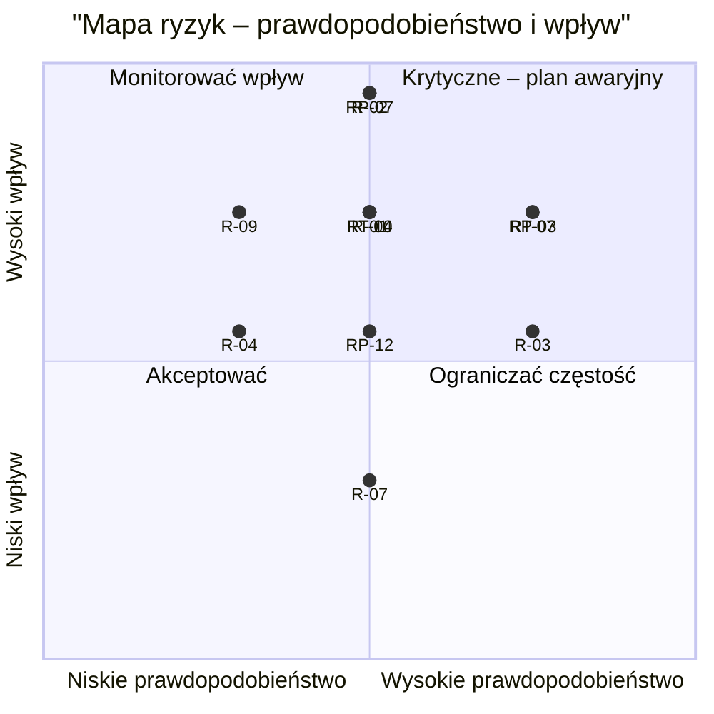

# Rejestr ryzyk

> Dokument: `05-project-management/05-rejestr-ryzyk.md` · Project Manager (Agent 3) · Wersja 1.0 · 24.10.2026
> Łączy ryzyka techniczne Architekta **R-01…R-12** ([99-przekazanie-dla-tech-leada §6](../01-architecture/99-przekazanie-dla-tech-leada.md#6-ryzyka-techniczne)), ryzyka po weryfikacji Tech Leada **RT-01…RT-10** (oraz zaktualizowane R – [99-przekazanie-dla-pm §6](../04-implementation-plans/99-przekazanie-dla-pm.md#6-ryzyka-techniczne-po-weryfikacji)) i nowe ryzyka projektowe PM **RP-01…RP-14**. Opisy i oceny R/RT pochodzą od TL – PM dodał właścicieli, plany awaryjne, wyzwalacze i terminy przeglądu (bez zmiany decyzji technicznych).
> Właściciel rejestru: PM. Przegląd: co 2 tygodnie na przeglądzie sprintu (30 min z PO i TL), co tydzień od SP-10 do pilota.

## 1. Skala oceny

| Wartość | Prawdopodobieństwo (P) | Wpływ (W) |
|---|---|---|
| 1 | bardzo niskie (< 10%) | pomijalny |
| 2 | niskie (10–30%) | niski – do 2 dni opóźnienia zadania, bez wpływu na kamień milowy |
| 3 | średnie (30–50%) | średni – opóźnienie kamienia milowego ≤ 1 tydz. lub obejście w funkcji Should |
| 4 | wysokie (50–70%) | wysoki – opóźnienie M5/M7 > 1 tydz., zagrożony termin pilota, funkcja Must z obejściem |
| 5 | bardzo wysokie (> 70%) | krytyczny – utrata ocen lub danych, błędny wynik oficjalny, brak pilota |

**Ocena = P × W:** 15–25 **krytyczne** (plan awaryjny przygotowany z góry, przegląd co tydzień), 10–14 **wysokie**, 5–9 **średnie**, 1–4 **niskie**. Przeliczenie ocen TL: prawdopodobieństwo niskie = 2, średnie = 3, wysokie = 4; wpływ niski = 2, średni = 3, wysoki = 4, krytyczny = 5.

## 2. Najważniejsze ryzyka (ocena ≥ 12)

| Pozycja | ID | Ryzyko | Ocena | Właściciel | Najbliższy przegląd |
|---|---|---|---|---|---|
| 1 | [RP-03](#rp-03) | Zespół mobile wąskim gardłem (89–99% w SP-02…SP-09) | 16 | PM | przegląd SP-02 (27.11.2026) |
| 2 | [RT-07](#rt-07) | Termin układu pionowego tabletu (Google Play API 37, ok. 31.08.2027) | 16 | PO + TL | M5 (19.03.2027) – decyzja o starcie BL-01 |
| 3 | [R-02](#r-02) | Błędy synchronizacji (duplikaty, utrata ocen) | 15 | TL | M3 (22.01.2027) |
| 4 | [RP-07](#rp-07) | Brak organizatora pilotażowego / sędziów do UAT i pilota | 15 | PO | 27.11.2026 (list intencyjny) |
| 5 | [RT-10](#rt-10) | Opóźniona treść prawna (regulamin, polityka, DPA) | 12 | PO | 22.01.2027 (projekty dokumentów) |
| 6 | [R-01](#r-01) | Wydajność suwaków na Galaxy Tab A8 | 12 | MOB (lider) | SP-03 (pomiar IMP-310) |
| 7 | [R-03](#r-03) | Sieć hali blokuje WSS | 12 | TL | SP-03 (wynik IMP-604) |
| 8 | [RT-04](#rt-04) | Trwałość SQLite vs czas zapisu | 12 | MOB (lider) | SP-01 (wynik IMP-603) |
| 9 | [RP-11](#rp-11) | QA wąskim gardłem końcówki (SP-09…SP-11) | 12 | QA + PM | przegląd SP-07 |
| 10 | [RP-08](#rp-08) | Odrzucenie lub opóźnienie przeglądu w sklepach | 12 | PM | M7 (2.04.2027) |

Pozostałe ryzyka z oceną 12: RP-01, RP-02, RP-04, RP-06, RP-10, RP-13.

## 3. Rejestr

Kolumny: **P** – prawdopodobieństwo, **W** – wpływ, **O** – ocena. Wyzwalacz = obserwowalny sygnał uruchamiający plan awaryjny.

### 3.1 Ryzyka techniczne Architekta (R)

| ID | Opis | P | W | O | Właściciel | Mitygacja | Plan awaryjny | Wyzwalacz | Przegląd | IMP / TC |
|---|---|---|---|---|---|---|---|---|---|---|
| R-01 | Wydajność suwaków i formularza na słabszych tabletach Android (Galaxy Tab A8) | 3 | 4 | 12 | MOB (lider) | Reanimated 4 + worklety, wczesny suwak w SP-03, profilowanie (IMP-500), pomiary na Tab A8 | uproszczenie animacji i cieni, przyciski −/+ jako główna interakcja, `ScoreSlider` bez etykiety pływającej; konsultacja z projektantem | TC-PERF-004 poniżej progu w SP-03 lub SP-09 | SP-03, SP-09 | IMP-310, IMP-500; TC-PERF-003, TC-PERF-004 |
| R-02 | Błędy synchronizacji (duplikaty, utrata ocen) – **krytyczny wpływ** | 3 | 5 | 15 | TL | idempotencja na 3 poziomach (IMP-146, IMP-353), reguły TL-12/13/20, testy właściwości (fast-check), TC-SYNC w CI nocnie, przegląd TL obszaru `sync` | wstrzymanie wydania (S1); eksport niewysłanych ocen z tabletu (JSON – IMP-318) i ręczne przyjęcie; papierowe karty kontrolne na UAT i pilocie | dowolny TC-SYNC P1 czerwony > 1 dzień; rozbieżność ocen tablet/serwer na UAT | M3, M5, przed pilotem | IMP-146, 147, 353, 354, 355, 357, 458, 469; TC-SYNC-001…040, TC-OUTBOX-001…015 |
| R-03 | Sieć hali blokuje WSS / przeciążone Wi-Fi | 4 | 3 | 12 | TL | offline-first, odpytywanie jako fallback (IMP-216), definicja „online” TL-45, spike IMP-604 | LTE organizatora, router zespołu na UAT/pilocie, praca w pełni offline z synchronizacją po kategorii | brak WSS w próbie technicznej 15.04 lub na UAT | SP-03 (IMP-604), UAT, 15.04.2027 | IMP-216, IMP-604, IMP-505; TC-SYNC-018, TC-RT-001…012 |
| R-04 | PBKDF2 600k za wolne na tablecie (TL: prawdopodobieństwo obniżone) | 2 | 3 | 6 | MOB | natywne `react-native-quick-crypto`, spike IMP-601 z kryterium p95 ≤ 1 s | wniosek o 310k iteracji (decyzja TL/bezpieczeństwo), weryfikacja w tle z animacją | p95 > 1 s na Tab A8 (IMP-601) | SP-01 | IMP-601, IMP-305; TC-PERF-010 |
| R-05 | Weryfikator PIN na przejętym tablecie | 2 | 3 | 6 | TL | schemat TL-04 (pepper w Keystore, weryfikator zaszyfrowany), unieważnianie urządzeń, audyt `OFFLINE_PIN` | wyłączenie logowania offline poleceniem CLI (IMP-178), reset PIN-ów | zgłoszenie utraty tabletu | przed pilotem | IMP-130, 144, 305, 141; TC-SEC (pentest IMP-408) |
| R-06 | Niezaszyfrowana SQLite tabletu (dane osobowe) | 2 | 3 | 6 | TL + PO | szyfrowanie urządzenia, usuwanie po 7 dniach (IMP-319), wyjątek MASVS-STORAGE-1 L2 | SQLCipher w v1.1 (BL-10), skrócenie retencji na tablecie | ustalenie pentestu lub zalecenie prawnika | M6 | IMP-319, IMP-402; TC-SEC-002 |
| R-07 | Animacja splash w RN | 3 | 2 | 6 | MOB | spike IMP-606 (Skia vs sekwencja klatek) w SP-01 | statyczny splash (IMP-652) i prostsza animacja; FR-210 (Should) do v1.1 | IMP-211 > 16 h lub spadek TC-PERF-001 | SP-01, SP-04 | IMP-606, IMP-211; TC-PERF-001 |
| R-08 | Złożoność AWS dla małego zespołu | 3 | 3 | 9 | DevOps | moduły Terraform, DevOps 1,0 etatu w SP-01…SP-03 (ZAL-06), budżety i alarmy (IMP-029) | wsparcie zewnętrznego konsultanta AWS (dzień/tydzień), uproszczenie `staging` | `dev` niegotowy do końca SP-02 | M1, M2 | IMP-007…016, IMP-029; TC-REL-001…010 |
| R-09 | Rozjazd punktacji klient/serwer | 2 | 4 | 8 | TL + BE | jeden pakiet `@polechamp/scoring`, TC-SCORING-031 (parzystość Node/Hermes) w CI | blokada wydania; wynik oficjalny zawsze z serwera; ręczne przeliczenie (TC-UAT-016) | czerwony TC-SCORING-031 | M1, M5 | IMP-050…057, IMP-056; TC-SCORING-001…044 |
| R-10 | Zmiany designu po akceptacji ekranów poza designem | 3 | 3 | 9 | PM + projektant | IMP-650 w SP-01, wzorce wizualne (IMP-653), bufor IMP-651 (12 h) | zmiany > bufora → v1.1; zamrożenie UI od M5 | zmiany projektanta po 5.02.2027 | M3, M5 | IMP-650, 651, 653; TC-DESIGN-016…022 |
| R-11 | Aktualizacje SDK / OTA w sezonie | 3 | 3 | 9 | TL + MOB | `runtimeVersion` fingerprint, freeze-guard (IMP-017), jedna aktualizacja SDK przed 1.0 (IMP-507) | pozostanie na SDK 58 z łatkami; OTA tylko poza oknami zawodów | regresja po IMP-507 w SP-10 | SP-10 | IMP-017, IMP-022, IMP-507; TC-REL-010, TC-COMPAT-009 |
| R-12 | Wymogi App Store / Google Play (TL: prawdopodobieństwo podniesione) | 3 | 3 | 9 | PM + MOB | usuwanie konta Must (TL-22), deklaracje prywatności (IMP-407), turniej do przeglądu (IMP-553) | patrz RP-08 | uwagi recenzenta | M7 | IMP-118, 277, 407, 553; TC-E2E-ORG (US-003) |

### 3.2 Ryzyka techniczne po weryfikacji (RT)

| ID | Opis | P | W | O | Właściciel | Mitygacja | Plan awaryjny | Wyzwalacz | Przegląd | IMP / TC |
|---|---|---|---|---|---|---|---|---|---|---|
| RT-01 | Expo SDK 58 świeży – niezgodności modułów natywnych | 3 | 3 | 9 | MOB + TL | spike IMP-600 w SP-01 | fallback SDK 57 (RN 0.86) – decyzja do 13.11.2026 | błąd krytyczny modułu natywnego w IMP-600 | SP-01 | IMP-600, IMP-200 |
| RT-02 | NestJS 12 świeży (ESM, mniej przykładów) | 3 | 3 | 9 | BE + TL | ADR-012, testy kontraktowe, test zgodności tras | fallback NestJS 11 + Node 24 | blokada > 2 dni w IMP-100…102 | SP-02, SP-03 | IMP-100, 101, 102; TC-CI-002 |
| RT-03 | Złożoność kryptografii weryfikatora PIN (TL-04) po obu stronach | 2 | 4 | 8 | TL | wspólne wektory testowe API/mobile (IMP-144, IMP-305), przegląd TL | konsultacja kryptograficzna zewnętrzna (pentester), wyłączenie offline PIN do v1.1 tylko w ostateczności (decyzja PO) | niezgodność wektorów API/mobile | SP-03, SP-06 | IMP-130, 144, 305; TC-SEC |
| RT-04 | Trwałość SQLite vs czas zapisu (fsync) | 3 | 4 | 12 | MOB (lider) | spike IMP-603 z kryterium 100 ms (TL-20) | `synchronous=FULL` tylko dla arkuszy, toast po COMMIT, rozdzielenie transakcji | IMP-603: > 100 ms p95 lub utrata zapisu | SP-01, SP-09 | IMP-603, IMP-350, IMP-313; TC-PERF-003, TC-SYNC-006 |
| RT-05 | Komponent arkusza (bottom sheet) | 3 | 3 | 9 | MOB | własny `Sheet` (IMP-206, 16 h) po spike IMP-602 | prostszy modal pełnoekranowy dla formularzy (odstępstwo do akceptacji projektanta) | IMP-206 > 24 h | SP-03 | IMP-602, IMP-206; TC-UI |
| RT-06 | Przegląd w sklepach – tryb sędziego na jednym urządzeniu, iPad | 3 | 3 | 9 | MOB + PM | turniej do przeglądu z długoważnym kodem (IMP-178, IMP-553) | wideo demonstracyjne dla recenzenta, kontakt z App Review | odrzucenie z powodu braku dostępu do funkcji | M7 | IMP-178, IMP-553 |
| RT-07 | Termin układu pionowego tabletu (Google Play target API 37, ok. 31.08.2027) | 4 | 4 | 16 | PO + TL | ADR-013: nakładka w MVP; BL-01 przygotowany za flagą w SP-12…SP-13, wydanie v1.1 28.05.2027 (M9) | twardy limit wewnętrzny 31.07.2027; zamrożenie aktualizacji na target API 36 do czasu v1.1 (aplikacja dostępna dla obecnych użytkowników) | brak designu G-30 do 16.04.2027 lub v1.1 niegotowa 28.05 | M5, M8, M9 | BL-01, IMP-213, IMP-607; TC-COMPAT-005, TC-COMPAT-006 |
| RT-08 | Czas oczekiwania na konta (Apple D-U-N-S, weryfikacja Google), dostęp produkcyjny SES | 3 | 3 | 9 | PM | zamówienia w tygodniu 0 (ZZ-01, ZZ-02, ZZ-05) | konto Apple/Google tymczasowo na osobę z zespołu – **tylko** do testów wewnętrznych; e-maile przez SES sandbox z listą zweryfikowanych adresów na UAT | brak kont do 8.01.2027; brak SES production do 5.03.2027 | co sprint do M7 | IMP-013, IMP-022, IMP-550 |
| RT-09 | Dostępność urządzeń referencyjnych i farmy | 3 | 3 | 9 | PM + QA | zakup w tygodniu 0 (ZZ-07), emulatory w CI | wypożyczenie / farma (BrowserStack, Maestro Cloud) | brak urządzenia na 2.11.2026 | M0, SP-09 | IMP-463, IMP-454; TC-COMPAT-002 |
| RT-10 | Opóźniona treść prawna (regulamin, polityka, DPA, retencja, zgody opiekunów, TL-17) | 3 | 4 | 12 | PO | zlecenie prawnikowi w tygodniu 0 (ZZ-08) z materiałami z dokumentacji, opinia do 22.01.2027, pakiet IMP-406 w SP-07, projekty dokumentów do 19.02.2027 | pilot z regulaminem pilotażowym (umowa z jednym organizatorem) i przesunięcie publicznego wydania 1.0 | brak ostatecznych dokumentów do 5.03.2027 | SP-05, SP-07, M6 | IMP-179, 406, 553, 555 |

### 3.3 Ryzyka projektowe (RP)

| ID | Opis | P | W | O | Właściciel | Mitygacja | Plan awaryjny | Wyzwalacz | Przegląd | IMP / TC |
|---|---|---|---|---|---|---|---|---|---|---|
| RP-01 | Niekompletny lub spóźniony zespół na start 2.11.2026 (szczególnie 2 × MOB z doświadczeniem Expo/New Architecture) | 3 | 4 | 12 | PM + sponsor | umowy podpisane w tygodniu 0; pakiet wdrożeniowy ([README](../README.md)); SP-01 zaczyna od zadań DevOps/BE i spike'ów | TL wykonuje spike'i MOB; przesunięcie zadań MOB o sprint z użyciem rezerwy SP-12; kontraktor | brak podpisanej umowy do 28.10.2026 | co tydzień do M0 | IMP-600…609, IMP-200 |
| RP-02 | Obniżona dostępność: choroby sezonowe, ferie zimowe (I–II 2027), urlopy; brak zastępowalności (DevOps 0,5, projektant 0,2) | 4 | 3 | 12 | PM | plan urlopów zatwierdzany na planowaniu; obszary krytyczne w parach (sync – 2 × MOB, scoring – BE + TL); runbooki | rezerwa SP-12; odłożenie Should/Could (lista w RP-03) | dostępność roli < 80% planu w sprincie | co sprint | – |
| RP-03 | Zespół mobile wąskim gardłem (89–99% obciążenia SP-02…SP-09); opóźnienie MOB przesuwa M5 1:1 | 4 | 4 | 16 | PM | zadania FULL → BE (ZAL-10); wczesne zadania wysokiego ryzyka; limit WIP 2 zadania na osobę; BE wspiera logikę danych mobile za zgodą TL | (1) odłożenie do v1.1 zadań Should/Could: IMP-211 (FR-210, animacja splash), IMP-315 (FR-611, autozapis), IMP-269 (FR-707/FR-902), IMP-174 (FR-708) – ok. 31 h; (2) wariant C (+1 MOB) najpóźniej od SP-06 | realizacja MOB < 85% planu w dwóch kolejnych sprintach | każdy przegląd sprintu | EP-06…EP-09 |
| RP-04 | Rozrost zakresu: zmiany z UAT, decyzje Q-03/Q-04/Q-14/Q-15 rozszerzające MVP, prośby organizatora pilotażowego | 3 | 4 | 12 | PO | terminy decyzji Q-xx ([06-decyzje](06-decyzje-i-zaleznosci-zewnetrzne.md)); kontrola zmian (CR z oceną TL/PM); zamrożenie funkcji 12.03.2027 | zamiana zakresu (trade-off) lub przeniesienie do v1.1 | CR > 8 h po M4 | co sprint | – |
| RP-05 | Opóźniona akceptacja ekranów poza designem (Q-08); 22 zadania MOB zależne przez DoR | 3 | 3 | 9 | PM + projektant | warsztat 10.11.2026 zarezerwowany w M0; projektant 0,6 etatu w SP-01; bufor IMP-651 | realizacja wg propozycji dokumentacji za flagą (decyzja PO – [00-konwencje §4](../04-implementation-plans/00-konwencje-i-definition-of-done.md#4-definition-of-ready)), poprawki w IMP-651 | brak listy decyzji do 13.11.2026 | SP-01 | IMP-650, IMP-651; TC-DESIGN-021 |
| RP-06 | Weryfikacja prawna wymaga zmian w produkcie (retencja, zgody opiekunów, wyjątek TL-17, umowa powierzenia, Q-16) | 3 | 4 | 12 | PO | wczesne zlecenie; szkice z [05-bezpieczenstwo §5](../01-architecture/05-bezpieczenstwo.md) przekazane w tygodniu 0; konsultacja przed IMP-176 (SP-07) | zmiany konfiguracyjne (okres retencji) bez kodu; zmiany > 8 h → v1.1, jeśli prawnik dopuszcza; ostatecznie termin zapasowy pilota 15.05.2027 | opinia prawnika z wymaganymi zmianami po 22.01.2027 | SP-05, SP-07 | IMP-176, 177, 179, 406 |
| RP-07 | Brak organizatora pilotażowego, terminu turnieju albo sędziów / wolontariuszek do próby generalnej (20.03) i pilota (24.04) | 3 | 5 | 15 | PO | list intencyjny do 27.11.2026; terminy potwierdzone do 8.01.2027; uczestnicy UAT do 19.02.2027; drugi organizator w rezerwie; nagrania występów zamiast wolontariuszek ([07-uat §2](../03-test-plans/07-uat-proba-generalna.md#2-uczestnicy-i-zasoby)) | UAT z sędziami z sieci kontaktów PO; pilot w terminie zapasowym 15.05.2027 lub mniejszy turniej klubowy | brak potwierdzenia w terminach | co sprint | IMP-464, 465, 556; TC-UAT-001…016 |
| RP-08 | Odrzucenie lub opóźnienie przeglądu 1.0 przed pilotem; wymagania kont (weryfikacja organizacji, D-U-N-S; dla kont osobistych Google Play – testy zamknięte z co najmniej 12 testerami przez 14 dni) | 3 | 4 | 12 | PM | konta organizacyjne zamówione w tygodniu 0; IMP-553 (notatki, turniej do przeglądu), usuwanie konta (TL-22), deklaracje (IMP-407); zgłoszenie 1.04 z oknem 2 tygodni | pilot na TestFlight (testerzy zewnętrzni) i testach zamkniętych Google Play (IMP-552) | odrzucenie lub brak decyzji do 12.04.2027 | M7, SP-12 | IMP-550…553, IMP-407 |
| RP-09 | Przekroczenie budżetu (stawki, wydłużenie, koszty AWS, EAS, pentestu, kurs USD) | 3 | 3 | 9 | sponsor + PM | bufor w godzinach + rezerwa zarządcza 10% ([08-budzet](08-budzet.md)); raport kosztów co miesiąc; AWS Budgets (IMP-029) | zmniejszenie alokacji ról z wolną pojemnością (BE po SP-08), odłożenie Should | wykonanie > 105% planu narastająco | co miesiąc | IMP-029 |
| RP-10 | Dostępność firmy pentestowej w oknie 15–24.03.2027 i ustalenia krytyczne tuż przed pilotem | 3 | 4 | 12 | PM + TL | zamówienie do 18.12.2026; ZAP/Semgrep w CI (IMP-027), ASVS/MASVS (IMP-400, IMP-401), testy nadużyć (IMP-404) wcześniej; retest w umowie | rezerwa BE w SP-11/SP-12 na poprawki; kontrole kompensujące (WAF) dla ustaleń średnich | brak potwierdzenia terminu do 8.01.2027; ustalenie krytyczne/wysokie po 24.03 | SP-04, SP-10 | IMP-408, 027, 400, 401, 404; TC-SEC-001…025 |
| RP-11 | QA wąskim gardłem końcówki (SP-09…SP-11: E2E, offline, regres, UAT, wsparcie pentestu) | 3 | 4 | 12 | QA + PM | automatyzacja E2E od SP-04; BE wspiera helpery E2E i dane (ZAL-12); TL jako drugi recenzent testów | kontraktor QA 0,5 etatu w SP-08…SP-11; priorytet P1 przed P2 | obciążenie QA > 100% przez 2 sprinty lub E2E P1 czerwone > 3 dni | SP-07, SP-09 | IMP-455…469 |
| RP-12 | Niestabilne testy E2E (Maestro, urządzenia, sieć) blokują bramkę RC | 3 | 3 | 9 | QA | zasady z [00-strategia §13](../03-test-plans/00-strategia-testowania.md#13-ryzyka-testowe): helpery API, wyłączone animacje, kwarantanna, ponowienie 1× | ręczne wykonanie P1 (IMP-466) | odsetek niestabilnych > 5% w przebiegu nocnym | co sprint od SP-04 | IMP-454, IMP-459; TC-CI-003 |
| RP-13 | Warunki na miejscu UAT/pilota: liczba i stan tabletów organizatora (≥ 10″, aktualne systemy), zasilanie, sieć | 3 | 4 | 12 | PM + organizator | inwentaryzacja tabletów do 19.02.2027 (ZAL-19); 2 tablety zapasowe zespołu; powerbanki; próba techniczna 15.04 | tablety zespołu; papierowe karty ocen ([09 §5](09-plan-wydania-i-pilotazu.md#5-plan-awaryjny-dnia-zawodów)) | tabletów < liczba sędziów + 1 | M4, SP-12 | TC-COMPAT-004, TC-UAT-003, TC-UAT-014 |
| RP-14 | Opóźnione decyzje PO w pytaniach Q-xx blokują DoR | 3 | 3 | 9 | PO | terminy w [06-decyzje §2](06-decyzje-i-zaleznosci-zewnetrzne.md#2-pytania-otwarte-q-01q-19); cotygodniowy przegląd decyzji | realizacja wg założeń domyślnych; późniejsza zmiana = CR | decyzja po terminie | co tydzień | – |

## 4. Zasady prowadzenia rejestru

- Nowe ryzyko zgłasza każdy członek zespołu (kanał `#polechamp-ryzyka`); PM nadaje ID `RP-NN` (ryzyka techniczne zgłoszone przez TL – kolejne `RT-NN`).
- Ryzyko zamknięte (ustąpiło lub zmaterializowało się i stało się problemem) pozostaje w rejestrze ze statusem i datą.
- Ryzyka krytyczne (ocena ≥ 15) mają przegląd co tydzień i właściciela z prawem uruchomienia planu awaryjnego.

## 5. Rejestr zmian

| Data | Wersja | Zmiana | Autor |
|---|---|---|---|
| 24.10.2026 | 1.0 | Pierwsza wersja: R-01…R-12, RT-01…RT-10, RP-01…RP-14 | PM |
