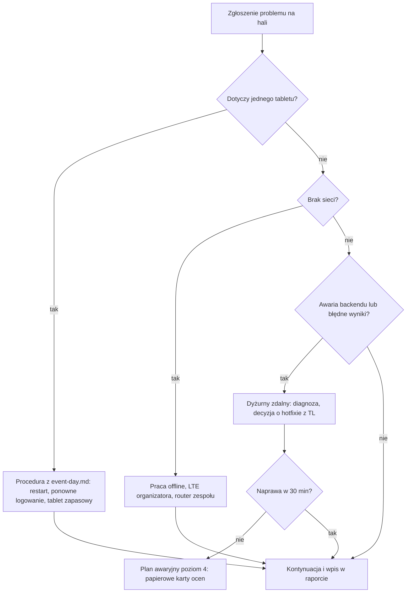

# Plan wydania i pilotażu

> Dokument: `05-project-management/09-plan-wydania-i-pilotazu.md` · Project Manager (Agent 3) · Wersja 1.0 · 24.10.2026
> Podstawa: [07-uat-proba-generalna.md](../03-test-plans/07-uat-proba-generalna.md), [00-strategia-testowania §8](../03-test-plans/00-strategia-testowania.md#8-kryteria-wejścia-i-wyjścia), [13-wydanie.md](../04-implementation-plans/13-wydanie.md) (IMP-550…557), [02-zakres-mvp §1](../02-specification/02-zakres-mvp.md#1-cel-mvp), NFR-905 (okna zamrożenia), [harmonogram](04-harmonogram.md).
> Terminy próby generalnej (20.03.2027) i pilota (24.04.2027) to założenia ZAL-13 i ZAL-14 – do potwierdzenia z organizatorem pilotażowym (ZZ-10).

## 1. Przebieg wydania 1.0

| Termin | Krok | Odpowiada | Zadania / dowód |
|---|---|---|---|
| 8–12.03.2027 | Aktualizacja SDK, rekordy w sklepach, deklaracje prywatności, notatki dla recenzentów | MOB | IMP-507, IMP-550, IMP-407, IMP-553 |
| 11–12.03.2027 | RC1 w TestFlight (testerzy zewnętrzni) i testach zamkniętych Google Play; instalacja u uczestników UAT | MOB, PM | IMP-552 |
| 12.03.2027 | Zamrożenie funkcji – build RC1 | TL | bramka RC ([03-plan-sprintow §1](03-plan-sprintow.md#1-zasady-i-metoda)) |
| 15–24.03.2027 | Pentest na `staging` (RC1) | firma zewnętrzna, BE | IMP-408 |
| 16–18.03.2027 | Przygotowanie próby generalnej | QA | IMP-464 |
| 19.03.2027 | Organizator konfiguruje turniej próbny samodzielnie (D−1) | organizator, obserwacja QA | TC-UAT-001, TC-UAT-002 |
| **20.03.2027** | **Próba generalna** | cały zespół | IMP-465, TC-UAT-003…016 |
| 22–25.03.2027 | Poprawki S1/S2, regres przed wydaniem, poprawki z pentestu | BE, MOB, QA | IMP-465, IMP-466, IMP-408 |
| **26.03.2027** | **Go/no-go (M6)** – lista §2 | PO | – |
| 30.03–1.04.2027 | Uruchomienie produkcji, smoke test, kanarek; zgłoszenie 1.0 do sklepów (1.04) | DevOps, MOB | IMP-555 |
| **2.04.2027** | **Gotowość pilotażowa (M7)**; zamrożenie zakresu 1.0 | PM | – |
| 5–16.04.2027 | Przegląd w sklepach, opieka nad produkcją, instrukcja dla organizatorów, konfiguracja turnieju pilotażowego na produkcji | MOB, DevOps, QA, organizator | IMP-557 |
| 15.04.2027 | Próba techniczna z tabletami organizatora (parowanie, migawka, sieć w miejscu zawodów) | MOB, organizator | – |
| 22–25.04.2027 | Okno zamrożenia wdrożeń i OTA | DevOps | IMP-017, `ops/freeze-windows.yaml` |
| **24.04.2027** | **Pilotażowy turniej** | dyżur §4 | IMP-556 |
| 26–30.04.2027 | Raport po pilocie, retrospektywa z organizatorem, warsztat priorytetów v1.1 (29.04) | PM, PO | M8 |

## 2. Lista kontrolna go/no-go

Decyzja „go” wymaga spełnienia wszystkich pozycji **obowiązkowych**; pozycje warunkowe mogą być przyjęte z planem naprawy i datą (zapis w [06-decyzje §2.1](06-decyzje-i-zaleznosci-zewnetrzne.md#21-rozstrzygnięcia)).

| # | Kryterium | Dowód | Właściciel | Typ |
|---|---|---|---|---|
| 1 | Wszystkie przypadki P1 (pliki 01–06 planu testów) zielone na buildzie wydania | raport IMP-466, CI | QA | obowiązkowe |
| 2 | TC-SYNC P1: 0 utraconych, 0 zduplikowanych ocen (kill -9 100/100, utrata zasilania 10/10 na każdym tablecie referencyjnym – TC-SYNC-006) | raport IMP-458, IMP-469 | QA | obowiązkowe |
| 3 | Kryteria wyjścia próby generalnej ([07-uat §4](../03-test-plans/07-uat-proba-generalna.md#4-kryteria-wejścia-i-wyjścia-uat)), w tym wyniki zgodne z przeliczeniem ręcznym (TC-UAT-016) | raport z próby (TC-UAT-015) | PM | obowiązkowe |
| 4 | Brak otwartych defektów S1 i S2; S3 z planem | GitHub Issues | TL | obowiązkowe |
| 5 | Pentest: brak otwartych podatności krytycznych i wysokich; retest wykonany | raport firmy, IMP-408 | TL | obowiązkowe |
| 6 | Raporty k6 (1× i 2×), ZAP, SBOM załączone; NFR-102 spełnione | IMP-461, IMP-502, IMP-027, IMP-026 | DevOps | obowiązkowe |
| 7 | Crash-free na becie ≥ progów NFR-308 (TC-REL-006 – przybliżenie z UAT i testów) | Sentry | MOB | obowiązkowe |
| 8 | Dokumenty prawne opublikowane (regulamin, polityka prywatności, umowa powierzenia), strona usunięcia konta (TL-22) | `polechamp.app`, IMP-179, Q-10 | PO | obowiązkowe |
| 9 | Produkcja: kopie i test odtworzenia (TC-REL-002), alarmy (TC-REL-009), blokada wdrożeń (TC-REL-010), TLS/HSTS (TC-SEC-003), SES produkcyjny | IMP-025, IMP-019, IMP-017, IMP-555 | DevOps | obowiązkowe |
| 10 | Lista kontrolna wydania i runbook dnia zawodów przejrzane; grafik dyżurów | `ops/runbooks/release.md`, `ops/runbooks/event-day.md`, `ops/on-call.yaml` (IMP-554) | DevOps + PM | obowiązkowe |
| 11 | Tablety organizatora: liczba ≥ sędziowie + 1, ≥ 10″, wspierane systemy (NFR-701, NFR-702), aplikacja zainstalowana | inwentaryzacja (ZAL-19), próba techniczna 15.04 | PM | obowiązkowe przed pilotem |
| 12 | Zatwierdzenie 1.0 w App Store i Google Play | konsole sklepów | MOB | warunkowe (plan B: TestFlight / testy zamknięte) |
| 13 | Instrukcja dla organizatorów zaakceptowana | IMP-557 | QA + PO | warunkowe |
| 14 | Papierowe karty ocen i arkusz awaryjny przygotowane (§5) | wydruk, plik | PM | obowiązkowe przed pilotem |

## 3. Plan próby generalnej (UAT)

- **Termin:** sobota **20.03.2027**, ok. 4 h (scenariusz [07-uat §3](../03-test-plans/07-uat-proba-generalna.md#3-scenariusz-dnia-ok-4-h)); D−1 (19.03) – samodzielna konfiguracja turnieju przez organizatora.
- **Miejsce:** sala organizatora pilotażowego lub hala treningowa ze sceną (warunki zbliżone do zawodów: półmrok, hałas) – do ustalenia do 19.02.2027.
- **Uczestnicy:** organizator pilotażowy (1–2), sędziowie 3–5 (w tym sędzia ekspert), wolontariuszki 6–10 (lub nagrania występów), zespół: TL, QA, 1 × MOB, 1 × BE, PM ([07-uat §2](../03-test-plans/07-uat-proba-generalna.md#2-uczestnicy-i-zasoby)).
- **Środowisko:** `staging` w konfiguracji produkcyjnej, RC1 z TestFlight / testów zamkniętych.
- **Sprzęt (PM):** ≥ 3 tablety (iPad + Android), telefon organizatora, router sterowany przez zespół, powerbanki, przedłużacze, kartki kontrolne do równoległego zapisu not, formularze ankiet.
- **Role zespołu w dniu próby:** TL – decyzje techniczne i triage na bieżąco; QA – prowadzenie scenariusza i rejestracja defektów (ID TC w zgłoszeniu); MOB – wsparcie tabletów; BE – monitoring API, logi, dashboard; PM – logistyka, czas, ankiety, obserwacja ergonomii.
- **Po próbie:** triage tego samego dnia (TC-UAT-015), poprawki S1/S2 do 24.03 (IMP-465), regres (IMP-466), decyzja go/no-go 26.03.
- **Plan B:** jeśli wynik to „no-go z planem” – druga próba w sobotę **10.04.2027** (SP-12, rezerwa), pilot pozostaje 24.04; jeśli „no-go” – pilot w terminie zapasowym 15.05.2027.

## 4. Wsparcie w dniu pilota

### 4.1 Przygotowanie

| Termin | Działanie | Kto |
|---|---|---|
| T−21 (2.04) | zamrożenie zakresu 1.0; ostatnie wydanie przed pilotem | TL, DevOps |
| T−14 (10.04) | turniej pilotażowy skonfigurowany na produkcji (kategorie, kryteria, kary, listy startowe); konta i PIN-y sędziów | organizator, wsparcie QA |
| T−9 (15.04) | próba techniczna: parowanie wszystkich tabletów, migawka, test sieci w miejscu zawodów (WSS lub odpytywanie), poziomy baterii | MOB, organizator |
| T−7 (17.04) | wpis okna zamrożenia 22–25.04 w `ops/freeze-windows.yaml`; grafik dyżurów potwierdzony | DevOps, PM |
| T−2 (22.04) | wydruk papierowych kart ocen i list startowych, arkusz awaryjny z regułami punktacji, ładowanie tabletów i powerbanków | PM |
| T−1 (23.04) | ostateczna synchronizacja danych, kontrola wersji aplikacji na tabletach (bez OTA w oknie), odprawa zespołu 30 min | MOB, PM |

### 4.2 Dyżur

| Rola | Kto (propozycja) | Miejsce | Zadania |
|---|---|---|---|
| Dyżurny na miejscu | MOB (lider) + PM | hala | tablety, parowanie i logowanie sędziów, procedury z `event-day.md`, kontakt z organizatorem |
| Dyżurny zdalny | BE (lider) | zdalnie | dashboard, alarmy, `pending_mutations`, odrzucenia, PDF, decyzja o hotfixie (NFR-905, `hotfix-approved`) |
| Eskalacja | TL | zdalnie (pod telefonem) | decyzje techniczne krytyczne |
| Infrastruktura | DevOps | pod telefonem | AWS, Valkey, ECS, SES |
| Decyzje biznesowe | PO | hala lub telefon | uruchomienie planu awaryjnego poziomu 3–4 |

Kanały: grupa telefoniczna dyżuru, `#polechamp-alerty`; czas reakcji w trakcie zawodów – natychmiast (S1), do 15 min (S2).

## 5. Plan awaryjny dnia zawodów

| Poziom | Sytuacja | Działanie | Decyduje |
|---|---|---|---|
| 1 | Pojedynczy tablet niesprawny lub rozładowany | tablet zapasowy, ponowne parowanie i logowanie sędziego; oceny z kolejki zachowane – synchronizacja po powrocie lub eksport JSON (IMP-318) | dyżurny na miejscu |
| 2 | Brak internetu w hali | ocenianie offline (do 12 h, NFR-301); organizator na LTE; po przywróceniu sieci synchronizacja ≤ 1 min; blokada kategorii dopiero po sprawdzeniu urządzeń (SCR-ORG-14/18) | dyżurny na miejscu |
| 3 | Awaria backendu / realtime (WS, Valkey, PDF) | tablety pracują offline; wyniki po przywróceniu; PDF generowany później w dniu zawodów; hotfix tylko za zgodą dyżurnego | dyżurny zdalny + TL |
| 4 | Awaria uniemożliwiająca ocenianie (np. defekt S1 w formularzu) lub błędny wynik oficjalny | **papierowe karty ocen** (wydrukowane per kategoria z kryteriami, skalami, wagami i karami), przeliczenie w **arkuszu awaryjnym** z regułami z [07-reguly-punktacji](../02-specification/07-reguly-punktacji.md); po naprawie – opcjonalne wprowadzenie do systemu w celach porównawczych | PO z organizatorem |

Kartki kontrolne (sędziowie zapisują noty równolegle) są obowiązkowe na próbie generalnej, a na pilocie co najmniej dla jednej kategorii – do weryfikacji 0 utraconych ocen i zgodności wyników (TC-UAT-016).

## 6. Metryki sukcesu pilotażu

| Metryka | Cel | Źródło pomiaru |
|---|---|---|
| Turniej przeprowadzony w całości w PoleChamp | 6–10 kategorii, 60–120 startów, 3–5 sędziów, bez przejścia na papier (poziom 4) | raport IMP-556 |
| Utracone lub zduplikowane oceny | **0** | porównanie bazy z kartkami kontrolnymi, logi synchronizacji |
| Czas od ostatniej oceny do wyniku kategorii | **≤ 2 min** | znaczniki czasu `score_sheet` vs `category_result` |
| PDF wysłany klubom | **w dniu zawodów** | potwierdzenie organizatora, logi eksportów |
| Mediana czasu wprowadzenia oceny | ≤ 45 s | obserwacja / znaczniki w aplikacji |
| Ocena łatwości formularza przez sędziów | ≥ 80% „łatwy” lub „bardzo łatwy” | ankieta |
| Crash-free sessions | ≥ 99,5% sędzia, ≥ 99,0% organizator (NFR-308) | Sentry |
| Dostępność backendu w oknie turnieju | ≥ 99,9% (NFR-304) | kanarek co 1 min (TC-REL-001) |
| Zużycie baterii tabletów | ≤ 12%/h (NFR-704) | pomiar co godzinę |
| Interwencje zespołu | ≤ 5 interwencji poziomu 1–2, 0 poziomu 4 | dziennik dyżuru |
| Odrzucone oceny | wszystkie rozstrzygnięte przez organizatora przed blokadą kategorii | SCR-ORG-22, audyt |
| Satysfakcja organizatora | ≥ 8/10 i deklaracja kolejnego użycia | wywiad po pilocie |

## 7. Zbieranie informacji zwrotnej → backlog v1.1

1. **W dniu pilota:** dziennik dyżuru (incydenty, czas, decyzje), obserwacje ergonomii (półmrok, hałas), krótka ankieta sędziów (5 min, jak w [07-uat §5](../03-test-plans/07-uat-proba-generalna.md#5-ankiety-i-zbieranie-uwag)).
2. **26–28.04.2027:** wywiad z organizatorem (60 min) i sędzią ekspertem (30 min); zebranie metryk z bazy, logów i Sentry; raport po pilocie (IMP-556).
3. **Triage uwag (28.04):** każda uwaga → defekt (S1–S4) albo pozycja backlogu `BL-NN` z odwołaniem do FR/US/SCR i źródła (pilot, UAT, organizator).
4. **Warsztat priorytetów v1.1 (29.04.2027, 2 h):** PO, PM, TL, projektant – kolejność etapu 2 v1.1 ([10-backlog](10-backlog-po-pilocie.md)); decyzje Q-01…Q-03 i Q-14 na podstawie danych z pilota.
5. **Hypercare:** 2 tygodnie po pilocie (do 7.05.2027) – codzienny przegląd Sentry i alarmów, poprawki S1/S2 w wydaniu 1.0.x.

## 8. Rejestr zmian

| Data | Wersja | Zmiana | Autor |
|---|---|---|---|
| 24.10.2026 | 1.0 | Pierwsza wersja | PM |
